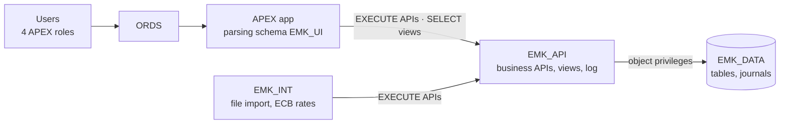

# EuroMarket AI-Driven Compliance & Claims Manager

Web application for managing **cross-border road freight claims** under the **CMR Convention**: claims and documents in one place, CMR deadline tracking with alerts, multilingual legal search and claim indicators by carrier, route and country.

Built on **Oracle AI Database 26ai** and **Oracle APEX**. The MVP runs entirely in the database, with no external services.

> **Status:** in development — Stage 3 (Build), milestone **M1 — Claims core** (M1a: data core). See [docs/sdlc.md](docs/sdlc.md).
> Every design decision is taken for a **professional, multi-developer setting** and recorded as an [Architecture Decision Record](docs/adr/README.md) with the options considered, the reasons and, where possible, a test on the target versions.

## Technology

| Area | Technology |
|------|------------|
| Database | Oracle AI Database 26ai Free (PL/SQL, AI Vector Search) |
| Application | Oracle APEX 24.2, ORDS 25.4 |
| Deployment | SQLcl 25.4: admin scripts + SQLcl `project` (Liquibase) — [ADR-005](docs/adr/ADR-005-deployment-and-database-setup.md) |
| Tests | utPLSQL 3.2.3 |

## Architecture at a Glance

Business rules live in PL/SQL APIs, never in APEX pages. Details: [API design](docs/design/api-design.md) · [data model](docs/design/README.md).

## Key Design Decisions

| Area | How it is solved | Status | Reference |
|------|------------------|--------|-----------|
| **Schema separation** | Data (`EMK_DATA`), business code and views (`EMK_API`), application connect user (`EMK_UI`, owns nothing), integration (`EMK_INT`). The application cannot bypass the APIs: `EMK_UI` has no privilege on any table. Follows the SmartDB / PinkDB paradigms | Decided; implemented in M1a | [ADR-008](docs/adr/ADR-008-schema-separation.md) |
| **Developer access (proxy accounts)** | Owner schemas have **no password**. Each developer has a personal account with `CREATE SESSION` only and **proxy** access to the schemas of his or her work: `ANA[EMK_DATA]` models tables, `JUAN[EMK_API]` writes APIs and cannot drop a table. Every change is attributed to a person (`PROXY_USER`) and access is revoked per person. Compared with 23ai schema privileges by test | Decided | [ADR-007](docs/adr/ADR-007-integration-schema-and-account-hardening.md), [ADR-008](docs/adr/ADR-008-schema-separation.md) |
| **Deployment account** | `EMK_DEPLOY`, the pipeline user, deploys with **schema privileges limited to the project schemas** (23ai `GRANT … ON SCHEMA`); nobody deploys as an owner | Decided | [ADR-008](docs/adr/ADR-008-schema-separation.md) |
| **Environments (DTAP)** | One PDB per environment: DEV, TEST (developer tests), ACCEPTANCE (customer tests, signed acceptance), PRODUCTION (defined). Same schema names everywhere, so **the same artifact** moves through all environments. Outside DEV: no developer proxy, APEX runtime-only, only `EMK_DEPLOY` changes objects | Decided | [ADR-009](docs/adr/ADR-009-environments.md) |
| **Least privilege and hardening** | No `DBA`/`CONNECT`/`RESOURCE`; privileges used by PL/SQL granted directly (roles are disabled in definer's-rights code, verified); CIS password profile for people; outbound network only by ACL script; no REST-enabled project schema; automated verification (`verify_admin.sql`) | Implemented (M0, M1a) | [ADR-005](docs/adr/ADR-005-deployment-and-database-setup.md), [ADR-007](docs/adr/ADR-007-integration-schema-and-account-hardening.md) |
| **Data integrity** | Rules within a row as check constraints (formats without NLS-dependent ranges, explicit `IS NOT NULL`, business dates without time); rules across tables in the APIs; optimistic locking against lost updates; immutable claim documents | Implemented (tables); APIs in progress | [spec §1.3](docs/spec.md), [API design](docs/design/api-design.md) |
| **Audit trail** | Audit columns on every table (who and when, including the APEX user); journal tables keep the previous version of every changed row; soft delete only; technical log in an autonomous transaction | Implemented | [Data model](docs/design/README.md) |
| **Scalability** | Monthly interval partitioning of append-only tables (logs, journals) with purge by partition; an index on every foreign key; stateless ORDS (several nodes behind a load balancer); growth path to Enterprise Edition or Autonomous Database without code changes | Designed; partitioning implemented | [spec §12](docs/spec.md) |
| **Backup, recovery and release rollback** | Archive log mode, RMAN backups and a [recovery runbook](docs/operations/recovery-runbook.md) with restore drills; targets derived from the business (RPO ≤ 1 h, RTO ≤ 4 h); guaranteed restore point before each deployment, decision matrix for rollback vs. fix-forward, backward-compatible schema changes, pilot users through feature flags | Decided | [ADR-010](docs/adr/ADR-010-operations-and-release-strategy.md) |
| **Database auditing, encryption in transit, performance targets** | Unified Auditing of DDL, grants and logons of the project schemas, 1 year online plus a pseudonymised archive; HTTPS outside DEV; page response p95 < 2 s and Apdex at the design volume, shown on an operations page | Decided | [ADR-010](docs/adr/ADR-010-operations-and-release-strategy.md) |

## Edition Constraints and Growth Path

The project runs on **Oracle AI Database 26ai Free** on one machine. What this edition or setup does not allow is **not implemented**, but it is documented with its replacement and growth path, so that a production project includes it ([ADR-010 §8](docs/adr/ADR-010-operations-and-release-strategy.md), [spec §12.3](docs/spec.md)).

| Not available here | Replaced by | Growth path |
|--------------------|-------------|-------------|
| Data Guard (standby database) | Archived logs backed up every 30 min, restore from backup | Enterprise Edition + Data Guard: RPO of seconds or zero, failover in minutes |
| RAC, parallel backup and recovery | One instance, one RMAN channel | Enterprise Edition / Autonomous Database |
| Flashback Transaction, tablespace point-in-time recovery | Journal tables, PDB point-in-time recovery and flashback | Enterprise Edition |
| Online encryption of existing tablespaces | Tablespaces created encrypted | Enterprise Edition + Advanced Security |
| More than 2 CPUs, 2 GB RAM, 12 GB data | Partitioning, sizing, document size limit | Enterprise Edition / Autonomous Database |
| Separate servers, disks and off-site backups | All environments as PDBs of one CDB; backups in a separate folder | One server per environment, backup storage off-site |

## How This Project Is Built

The project follows an AI-native development life cycle ([docs/sdlc.md](docs/sdlc.md)): every stage (intent, specification, plan, code, tests, review) produces a versioned artifact. I work with **Claude Code** (Anthropic) as a pair programmer: I set the requirements and the architecture, compare the options it researches, take the decisions (recorded as ADRs), review every change and verify it with tests on the target versions (Oracle AI Database 26ai, APEX 24.2, ORDS 25.4, SQLcl 25.4).

## Data Protection (GDPR by Design)

- **No personal data leaves the database in the MVP:** semantic search uses an ONNX model inside Oracle AI Database; there are no external calls.
- **Personal data is isolated** in one table (`EMK_CONTACTS`) and its journal, which keeps erasure and pseudonymisation simple (GDPR Art. 17, 25).
- **Test data:** synthetic in development and test; anonymised in acceptance; never real personal data without protection.
- **Planned AI extensions:** every external AI call goes through a single gateway that **redacts or pseudonymises personal data before the call** and re-identifies it only inside the database (FR-21); a test criterion requires zero unredacted personal data in outbound payloads (SC-SEC-04); every call is logged with its redacted payload (FR-23); providers process data in the EU/EEA under a data processing agreement.

## Documentation

| Document | Content |
|----------|---------|
| [Intent](docs/intent.md) | Problem, users, scope |
| [Specification](docs/spec.md) | Requirements, business rules, design, test strategy |
| [Architecture decisions](docs/adr/README.md) | ADRs: options, reasons, verification |
| [Data model](docs/design/README.md) · [API design](docs/design/api-design.md) | Physical design, packages, call flows |
| [SDLC](docs/sdlc.md) | Development stages and current status |
| [Setup guide](docs/setup.md) | Local environment and database installation |
| [Recovery runbook](docs/operations/recovery-runbook.md) | What to do when data is lost: scenarios, commands, business reconciliation, restore drills |
| [Glossary](docs/glossary.md) | Functional and technical terms |

## Repository Layout

| Folder | Content |
|--------|---------|
| `docs/` | Intent, specification, plans, ADRs, design, operations runbooks, glossary, setup guide |
| `scripts/` | Admin scripts run as `SYS` (tablespaces, roles, schemas, accounts, workspace, network ACL, utPLSQL, verification) |
| `.dbtools/`, `src/`, `dist/` | SQLcl project: database objects and APEX app 200 |
| `static/` | APEX static files (JavaScript, CSS) |

## Author

Natalia Müller ([@nmuller000](https://github.com/nmuller000))

## License

Copyright (c) 2026 Natalia Müller. **All rights reserved.** This repository is published for viewing and evaluation only; no part of it (code, scripts or documentation) may be copied, modified, distributed or used without the author's prior written consent. See [LICENSE](LICENSE).
