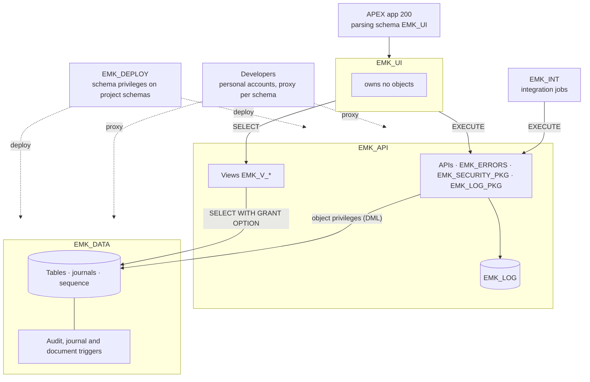

# ADR-008: Schema Separation — Data, API, UI and Integration

| Field | Value |
|-------|-------|
| **Status** | Accepted · implemented in DEV in phases M.2–M.4 of the M1 plan (2026-10-16), with three details: in DEV the developer account also has a proxy to `EMK_UI` (`CREATE SESSION` only, still no password) to export and import application 200 as its parsing schema; each schema exports only the grants it makes; the DEV workspace was created again with `EMK_UI` as first schema, because APEX cannot remove the first schema of a workspace (`ORA-20987`) |
| **Date** | 2026-10-10 |
| **Deciders** | Solution Architect (project owner) |
| **Related** | Supersedes the single application schema of [ADR-005](ADR-005-deployment-and-database-setup.md) and the `EMK_APP` references of [ADR-007](ADR-007-integration-schema-and-account-hardening.md) · [API design](../design/api-design.md) §6 · spec §1.1, §7 |

---

## Context

Today one schema, `EMK_APP`, owns the tables, the journals, the business code and the views, and APEX parses as `EMK_APP`. Consequences:

- Whoever may change an API may also drop a table: privileges cannot follow responsibilities (data model, business code, integration).
- The APEX application runs as the owner of the tables, so a page could bypass the APIs with direct DML. "Pages call APIs" is a convention, not a privilege (best-practice review in the API design, §6).
- The SmartDB and PinkDB paradigms require that **the connect user owns no objects** and **only accesses the API** (packages and, in PinkDB, views).

The decision is taken for a professional, multi-developer setting; the rework of the M1a objects is listed as a cost, not as a decision driver.

**Decision drivers**

| Driver | Source |
|--------|--------|
| Connect user owns no objects (not even synonyms) and accesses the API only (packages and views) | [SmartDB](https://asktom.oracle.com/ords/r/tech/catalog/session-landing-page?p2_oh_id=3422) · [PinkDB](https://www.salvis.com/blog/2018/07/18/the-pink-database-paradigm-pinkdb/) |
| Least privilege and separation of duties between data model, business code, integration and UI | Oracle AI Database 26ai Security Guide |
| Privileges used by definer's-rights code must be granted directly, not through roles | Verified (test B below) |
| Developers work through proxy with personal accounts; the owner schemas have no password | ADR-007 |
| Tooling: SQLcl `project` export and deploy, APEX 24.2 workspaces | SQLcl 25.4, APEX 24.2 |

---

## Verification on Oracle AI Database 26ai (23.26.1), 2026-10-09 / 2026-10-10

Two tests with temporary users, run as `SYS` and removed afterwards (`work/pruebas/`).

**Per-developer account with schema privileges** (alternative to proxy):

| Check | Result |
|-------|--------|
| Create a table / procedure in `EMK_APP` with `CREATE ANY TABLE ON SCHEMA emk_app` | OK; owner `EMK_APP` |
| Create in another schema or in its own schema | `ORA-01031` (scope limited as documented) |
| Grant a privilege on an `EMK_APP` object to another schema | `ORA-01031`: only the owner, or `GRANT ANY OBJECT PRIVILEGE` |
| `DBMS_METADATA.GET_DDL` of `EMK_APP` objects (used by `project export`) | `ORA-31603`: needs `SELECT_CATALOG_ROLE` (whole dictionary) |
| `project export -list` | Incomplete: no triggers, comments or APEX application |

**Separated schemas** (`EMK_T_DATA`, `EMK_T_API`, `EMK_T_UI`):

| # | Check | Result |
|---|-------|--------|
| A | System privileges grantable `ON SCHEMA` | All 20 tested: `SELECT/INSERT/UPDATE/DELETE/LOCK/READ ANY TABLE`, `CREATE/ALTER/DROP/COMMENT ANY TABLE`, `CREATE ANY INDEX/TRIGGER/VIEW/SEQUENCE/SYNONYM/PROCEDURE`, `SELECT ANY SEQUENCE`, `EXECUTE/DEBUG ANY PROCEDURE`, `GRANT ANY OBJECT PRIVILEGE` |
| B | Definer's-rights procedure in the API schema writing to the data schema | Schema privilege granted **directly**: `VALID`, runs. Granted **through a role**: `INVALID` (`ORA-24344`) |
| C | View in the API schema with a schema privilege, granted to the UI user | OK when granted by `SYS` (which may bypass the grant-option check): **to be re-checked as the owner** during implementation |
| D | Same view with an object privilege `WITH GRANT OPTION` | OK |
| E | UI user privileges at the end | Only `EXECUTE` on the procedure and `SELECT` on the views |

---

## Options Considered

### 1. Schema model

| Option | Description | Pros | Cons |
|--------|-------------|------|------|
| A. Single schema + connect user | `EMK_APP` (data and code) + `EMK_UI` + `EMK_INT` | Fewest grants | Code and data under one owner: whoever changes an API can drop a table; no separation of duties |
| **B. Data, API, UI, integration** | `EMK_DATA` (tables), `EMK_API` (code and views), `EMK_UI` (connect, no objects), `EMK_INT` | Each schema has one responsibility; proxy per schema gives per-role developer access; matches PinkDB (views allowed in the API) | Cross-schema grants; export per schema |
| C. Strict SmartDB with a separate API layer | B plus an exposed API schema of thin wrapper packages over implementation packages | Smallest exposed surface | One wrapper per API call for two consumers (APEX, `EMK_INT`) whose contract is already the package specification; more code without a security gain over B |

### 2. Privileges of `EMK_API` on `EMK_DATA`

| Option | Pros | Cons |
|--------|------|------|
| **A. Object privileges per table, granted directly by the data owner** | Least privilege: e.g. no DML on journals, only `SELECT` on reference tables; explicit and exported by SQLcl as grants | One grant per new table (part of the same change) |
| B. Schema privileges `SELECT/INSERT/UPDATE/DELETE ANY TABLE ON SCHEMA emk_data` | Covers future tables automatically | Includes the journals and reference tables: the API could alter the history |

### 3. How the code references objects of another schema

| Option | Pros | Cons |
|--------|------|------|
| **A. Schema-qualified names** (`emk_data.emk_claims`) | Explicit, searchable, no hidden indirection; same form as the SQLcl export (`emitSchema`) | Longer names |
| B. Private synonyms in `EMK_API` / `EMK_INT` | Short names | Indirection; synonyms are objects to maintain and export; not allowed in the connect user (PinkDB) |

### 4. Technical objects

| Object | Placement | Reason |
|--------|-----------|--------|
| Audit and journal triggers | `EMK_DATA`, with their tables | Belong to the data; fire for any writer |
| Document immutability trigger | `EMK_DATA`, error code as a literal (`-20303`) with a comment; a unit test checks it equals `EMK_ERRORS.c_document_immutable` | The data schema must not depend on the code schema |
| `EMK_LOG` table and `EMK_LOG_PKG` | `EMK_API` | Technical log, not business data; written only by the package; the purge drops partitions, which requires the owner |
| `EMK_ERRORS`, `EMK_SECURITY_PKG`, views `EMK_V_*` | `EMK_API` | Code and read API |
| Sequence `EMK_CLAIM_NO_SEQ` | `EMK_DATA` with `SELECT` granted to `EMK_API` | Belongs to the claims data |

### 5. Deployment and export accounts

| Need | Option chosen | Reason |
|------|---------------|--------|
| Development | Personal accounts with proxy **per schema** (`EMK_DEV[EMK_DATA]`, `EMK_DEV[EMK_API]`, `EMK_DEV[EMK_INT]`); a developer gets proxy only to the schemas of his or her work | Owner rights limited to one schema each; personal, traceable, revocable (ADR-007) |
| Export (`project export`) | Run per schema through the proxy of that schema | The owner reads its own DDL; no dictionary-wide role (`SELECT_CATALOG_ROLE`) |
| Deployment (`project deploy`, CI) | Service account `EMK_DEPLOY` (the pipeline user) with **schema privileges limited to the project schemas** (create, alter, drop, `GRANT ANY OBJECT PRIVILEGE` `ON SCHEMA`); Liquibase tables in its own schema; its password is kept in the pipeline secret store | Test A: every needed privilege can be limited to a schema; nobody deploys as owner in shared environments. **Not proxy:** a release created by `project stage` is one changelog that creates objects in several schemas in one session, while a proxy session acts as one schema; deploying per schema through separate proxies would split the changelog and break the order of cross-schema grants; a single owner `EMK_OWNER` would undo the separation |

---

## Decision

1. **Schema model B:** `EMK_DATA`, `EMK_API`, `EMK_UI`, `EMK_INT`; `EMK_APP` is retired.
2. **Object privileges** granted directly by `EMK_DATA` to `EMK_API` (and `WITH GRANT OPTION` only where a view of `EMK_API` exposes the table to `EMK_UI`).
3. **Schema-qualified names**; no synonyms (ADR-007's private synonyms in `EMK_INT` are replaced by qualified names).
4. Technical objects as in option table 4.
5. Accounts as in option table 5. `EMK_UI` is schema-only, owns nothing and receives `EXECUTE` on the APIs and `SELECT` on the views; it becomes the parsing schema of APEX application 200.
6. **Names of tablespaces:** suffix `_TS` (`EMK_DATA_TS`, `EMK_INT_TS`) so that a schema and a tablespace never share a name.
7. **Deployment account `EMK_DEPLOY`** with schema privileges on the project schemas, not proxy (option table 5). In shared environments (TEST, PROD) nobody else deploys and developers have no proxy (ADR-009).

---

## Consequences

**Positive**
- Separation of duties: a developer of business code (proxy to `EMK_API`) cannot alter tables; a data modeller (proxy to `EMK_DATA`) cannot change business rules.
- The application cannot bypass the APIs: `EMK_UI` has no privilege on any table (SmartDB/PinkDB property 1 and 2 met).
- Journals cannot be modified by the API (no DML granted on them).
- Deployment in shared environments without an owner login.

**Negative / costs**
- Cross-schema grants are part of every change that adds a table, view or API (checklist item; exported by SQLcl as grants).
- Export runs once per schema.
- Rework of M1a (information, not a driver): the objects of `EMK_APP` (19 tables, 3 packages, triggers) are re-created in `EMK_DATA` and `EMK_API`; reference data is reloaded with the existing `MERGE` scripts; admin scripts (schemas, roles, proxies, ACL, workspace), `verify_admin.sql`, the SQLcl project configuration, the design documents and the M1 plan are updated.

**To verify during implementation**
- Test C as the owner (through proxy), not as `SYS`.
- APEX 24.2: workspace `EMK_CLAIMS` with `EMK_UI` as parsing schema of application 200 (`APEX_INSTANCE_ADMIN.ADD_SCHEMA`), and `EMK_SECURITY_PKG` in `EMK_API` reading the APEX session.
- SQLcl `project`: export per schema, the grant filter (`grantor` in the project schemas) and `project stage` ordering across schemas.
- Debugger ACL (`jdwp`) for the schemas that own code (`EMK_API`, `EMK_INT`) and triggers (`EMK_DATA`).

## Open Points

| # | Point | Proposal |
|---|-------|----------|
| 1 | Tablespace names | **Decided (2026-10-10):** rename to `EMK_DATA_TS` and `EMK_INT_TS` |
| 2 | Deployment account | **Decided (2026-10-10):** `EMK_DEPLOY` with schema privileges (not proxy), created by the admin scripts; used for every deployment outside DEV (environments: ADR-009) |

## Sources

- Bryn Llewellyn, Toon Koppelaars — [The SmartDB Manifesto](https://asktom.oracle.com/ords/r/tech/catalog/session-landing-page?p2_oh_id=3422)
- Philipp Salvisberg — [The Pink Database Paradigm (PinkDB)](https://www.salvis.com/blog/2018/07/18/the-pink-database-paradigm-pinkdb/) · [Is your application SmartDB?](https://www.salvis.com/blog/2018/07/18/is-your-application-smartdb/)
- Oracle AI Database 26ai Security Guide — [Managing Schema Privileges](https://docs.oracle.com/en/database/oracle/oracle-database/26/dbseg/managing-system-privileges.html)
- Oracle AI Database 26ai SQL Language Reference — [GRANT](https://docs.oracle.com/en/database/oracle/oracle-database/26/sqlrf/GRANT.html)
- Oracle APEX 24.2 API Reference — [APEX_INSTANCE_ADMIN.ADD_SCHEMA](https://docs.oracle.com/en/database/oracle/apex/24.2/aeapi/ADD_SCHEMA-Procedure.html)
- Liquibase — [Best Practices for Multiple Teams Deploying to the Same Database (Oracle)](https://docs.liquibase.com/concepts/multi-teams-same-db-oracle.html)
- Pretius — [SQLcl Project Reference](https://pretius.com/blog/sqlcl-project-reference) (multi-schema export)
