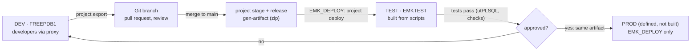
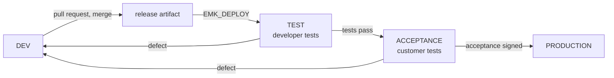

# ADR-009: Environments — DEV and TEST on One Machine, PROD Defined

| Field | Value |
|-------|-------|
| **Status** | Accepted |
| **Date** | 2026-10-10 |
| **Deciders** | Solution Architect (project owner) |
| **Related** | [ADR-005](ADR-005-deployment-and-database-setup.md) (deployment method) · [ADR-008](ADR-008-schema-separation.md) (schemas, `EMK_DEPLOY`) · spec §8 (SC-DEP-01 to 04) · M1 plan T-M1-01 |

---

## Context

Until now there is one database, `FREEPDB1`, where developers build and test. In a professional setting a change is promoted through environments: it is built in development, deployed unchanged by the pipeline into a test environment, and only then into production. A test environment that is rebuilt from scripts proves that the application can be installed from the repository alone (SC-DEP-01, T-M1-01).

Production does not exist in this project, but its rules must be defined so that the setup can be replicated in a company.

**Facts verified on this installation (2026-10-10)**

| Fact | Value | Source |
|------|-------|--------|
| Edition limits | 2 cores, 2 GB RAM, 12 GB user data; one installation per host | [26ai Free Licensing Restrictions](https://docs.oracle.com/en/database/oracle/oracle-database/26/xeinw/licensing-restrictions.html) |
| `max_pdbs` | 18 | `SHOW PARAMETER max_pdbs` (CDB root) |
| Existing PDBs | `FREEPDB1` only | `v$pdbs` |
| Data files of `FREEPDB1` | 2.77 GB | `cdb_data_files` |
| APEX per PDB | Local installation in each PDB (`APEX_240200`); full development or runtime-only | [APEX 24.2 Installation Guide](https://docs.oracle.com/en/database/oracle/apex/24.2/htmig/oracle-apex-installation-guide.pdf) |
| ORDS for several databases | Additional database pools (`--db-pool`), mapped by pool name or path | [ORDS: Multiple Databases](https://docs.oracle.com/en/database/oracle/oracle-rest-data-services/24.2/ordig/configuring-additional-databases.html) |

---

## Options Considered

### 1. How to separate DEV and TEST

| Option | Pros | Cons |
|--------|------|------|
| A. Two sets of schemas in one PDB (`EMK_DATA`, `EMK_DATA_TEST`, …) | Cheapest | Schema names differ per environment, but the code uses qualified names (ADR-008): the code would change between environments; shared users, roles and APEX instance |
| **B. One PDB per environment** (`FREEPDB1` = DEV, `EMKTEST` = TEST) | Same schema names everywhere, so the same artifact is deployed unchanged; isolation of users, roles, APEX and data, as in a company | More disk and memory (shared 2 GB RAM) |
| C. Separate database installations or containers | Strongest isolation | Not allowed by the Free edition on one host (one installation per logical environment) |

### 2. How TEST is built

| Option | Pros | Cons |
|--------|------|------|
| A. Clone `FREEPDB1` | Fast; APEX already installed | Carries everything of DEV (personal accounts, prototype workspace, test data); proves nothing about installing from the repository |
| **B. New PDB from the seed, built only by scripts** | Proves the installation from the repository: admin scripts, then `project deploy` by `EMK_DEPLOY` | APEX must be installed in the new PDB and ORDS configured for it |

### 3. APEX in TEST

| Option | Pros | Cons |
|--------|------|------|
| A. Full development environment | App Builder available | Developers could change the application in TEST, outside version control |
| **B. Runtime-only** | Same as recommended for production: the application runs, but cannot be edited; changes only arrive through deployment | Inspection only through the running application and SQL |

---

## Decision

1. **One PDB per environment:** `FREEPDB1` is **DEV**; a new PDB **`EMKTEST`** is **TEST**; **PROD** is defined by the same rules and not created.
2. **TEST is built from the seed by scripts only**: create PDB → admin layer (`install_admin.sql` with `ENV=TEST`) → APEX 24.2 runtime → ORDS pool → `project deploy` of the release artifact by `EMK_DEPLOY` → reference data (custom changesets) → synthetic data → tests.
3. **APEX runtime-only in TEST** (and in PROD); full development environment in DEV only.
4. **Admin scripts take the environment as a parameter** (`EMK_ENV` = `DEV`, `TEST` or `PROD` in `00_config.sql` or at run time): personal developer accounts and their proxies, the debugger ACL and the developer role are created **only in DEV**.

### Rules per environment

| Rule | DEV (`FREEPDB1`) | TEST (`EMKTEST`) | PROD (defined) |
|------|------------------|------------------|----------------|
| Personal developer accounts with proxy (per schema, ADR-008) | Yes | **No** | **No** |
| Who changes database objects | Developers (proxy), and `project deploy` | **Only `EMK_DEPLOY`** (pipeline) | **Only `EMK_DEPLOY`** (pipeline, after approval) |
| APEX | Full development | Runtime-only | Runtime-only |
| Debugger ACL (`jdwp`) | Yes | No | No |
| Data | Synthetic (generator) | Synthetic, fixed seed (reproducible tests) | Real |
| Secrets | KeePassXC | KeePassXC (pipeline secret in a company) | Vault / pipeline secret store |
| ORDS URL | `/ords/` (default pool) | `/ords/emktest/` (pool `emktest`) | Separate host |

### Promotion flow

The **same artifact** goes to TEST and PROD; nothing is edited by hand in a shared environment.

---

## Consequences

**Positive**
- The installation from the repository is proven on every rebuild of TEST (SC-DEP-01, T-M1-01).
- No developer access and no App Builder in shared environments: every change is versioned and reviewed.
- The rules can be copied to a company setup (PDB or separate servers per environment).

**Negative / costs**
- Disk: a second PDB with APEX (about 2–3 GB of the 12 GB); RAM: 2 GB shared by both PDBs, so TEST is opened only when needed.
- ORDS gets a second pool; APEX 24.2 must be installed in `EMKTEST` (installation files needed).
- Admin scripts become environment-aware.

**To verify during implementation**
- APEX 24.2 runtime installation in a PDB of 26ai Free and the ORDS pool mapping `/ords/emktest/`.
- Memory with both PDBs open (2 GB limit).
- The release artifact deploys into an empty TEST without manual steps.

## Open Points

| # | Point | Proposal |
|---|-------|----------|
| 1 | Order of work | First ADR-008 in DEV (new schemas, `EMK_DEPLOY`, environment-aware admin scripts); then create TEST and deploy the first release into it at the end of M1a |
| 2 | Name of the TEST PDB | `EMKTEST` |

## Sources

- Oracle AI Database 26ai Free — [Licensing Restrictions](https://docs.oracle.com/en/database/oracle/oracle-database/26/xeinw/licensing-restrictions.html)
- Oracle APEX 24.2 — [Installation Guide](https://docs.oracle.com/en/database/oracle/apex/24.2/htmig/oracle-apex-installation-guide.pdf)
- ORDS — [Configuring for Multiple Databases](https://docs.oracle.com/en/database/oracle/oracle-rest-data-services/24.2/ordig/configuring-additional-databases.html) · [ORDS 25.4 Installation and Configuration Guide](https://docs.oracle.com/en/database/oracle/oracle-rest-data-services/25.4/ordig/lot.html)

## Amendment (2026-10-10, before implementation): DTAP — Acceptance Environment

The owner decided to add an **acceptance** environment between test and production (DTAP model: Development, Test, Acceptance, Production), so that the customer, not the development team, accepts each release.

| Rule | DEV (`FREEPDB1`) | TEST (`EMKTEST`) | **ACCEPTANCE (`EMKACC`)** | PROD (defined) |
|------|------------------|------------------|---------------------------|----------------|
| Who tests | Developers | Developers and automated tests | **Key users of the customer** | All users |
| Who changes objects | Developers (proxy) and `project deploy` | `EMK_DEPLOY` | `EMK_DEPLOY` | `EMK_DEPLOY`, after acceptance |
| Developer proxy | Yes | No | No | No |
| APEX | Full development | Runtime-only | Runtime-only | Runtime-only |
| Data | Synthetic | Synthetic, fixed seed | **Production-like, anonymised** (no real personal data without protection, GDPR Art. 5, 25) | Real |
| Exit criterion | — | All tests pass | **Signed acceptance record** by the customer | — |

- The **same artifact** moves through TEST, ACCEPTANCE and PRODUCTION.
- On this machine ACCEPTANCE is a PDB (`EMKACC`) created when needed; TEST and ACCEPTANCE are not open at the same time (2 GB RAM shared; to verify).
- Release, rollback and pilot-user strategy: ADR-010.
