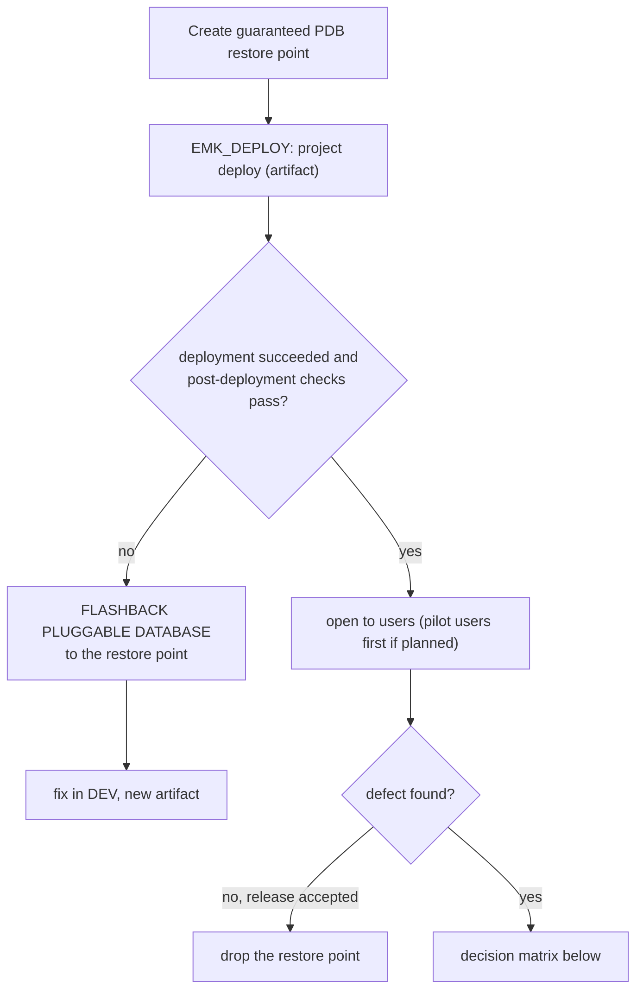

# ADR-010: Operational Baseline and Release Strategy

| Field | Value |
|-------|-------|
| **Status** | Accepted |
| **Date** | 2026-10-11 (proposed 2026-10-10) |
| **Deciders** | Solution Architect (project owner) |
| **Related** | [ADR-008](ADR-008-schema-separation.md) (schemas, `EMK_DEPLOY`) · [ADR-009](ADR-009-environments.md) (DTAP) · [Recovery runbook](../operations/recovery-runbook.md) · spec §1.3, §2.5, §8, §12 · M1 plan |

---

## Context

A review of the design for production readiness (2026-10-10) found that the application and data rules are well covered, but the operational baseline that a company expects is missing:

| Gap | Fact |
|-----|------|
| No backup or recovery | The database runs in **`NOARCHIVELOG`** (checked with `SELECT log_mode FROM v$database`): no online backup, no restore point, no point-in-time recovery |
| No release rollback | Nothing defines what happens when a deployment fails or a new version has a defect |
| No database audit | Data changes are audited (audit columns, journals), but privileged activity (DDL, grants, failed logins, proxy sessions) is not |
| No encryption in transit | ORDS serves HTTP on port 8080 |
| No performance targets | Spec §12.4 says pages are timed, without a target (except search, SC-AI-05) |
| No code quality gate | PL/SQL compiler warnings are not enabled |
| No health monitoring | Space against the 12 GB limit, failed jobs and logged errors are not checked |

**Facts of the DEV machine (2026-10-11):** one internal disk (`C:`) holds the Oracle software, all data files (system files in the Oracle data folder, project tablespaces in `C:\db_files`), both control files and the three online redo logs (one member each); no second disk with enough space. Disk sizing: [setup.md §1.1](../setup.md). All environments of ADR-009 are PDBs of the same CDB `FREE`.

**Verified for the versions in use**

| Fact | Source |
|------|--------|
| `ARCHIVELOG` and RMAN online backups are available in 26ai Free; switching needs a restart in `MOUNT` and applies to the whole CDB | [Backup and Recovery User's Guide 26ai](https://docs.oracle.com/en/database/oracle/oracle-database/26/bradv/oracle-ai-database-backup-and-recovery-users-guide.pdf) · [Free Installation Guide (Windows)](https://docs.oracle.com/en/database/oracle/oracle-database/26/xeinw/oracle-ai-database-free-installation-guide-microsoft-windows.pdf) |
| Guaranteed **PDB** restore points and `FLASHBACK PLUGGABLE DATABASE` exist; they require `ARCHIVELOG` | [Using Flashback Database and Restore Points (26ai)](https://docs.oracle.com/en/database/oracle/oracle-database/26/bradv/using-flasback-database-restore-points.html) · [CREATE RESTORE POINT](https://docs.oracle.com/en/database/oracle/oracle-database/26/sqlrf/CREATE-RESTORE-POINT.html) |
| Free edition, **included:** Flashback Database, Flashback Table, block change tracking, block-level media recovery, duplexed backup sets, Diagnostics and Tuning Packs, Partitioning, TDE (no online conversion of an existing tablespace). **Not included:** Data Guard (Redo Apply, SQL Apply, Active), RAC, parallel backup and recovery, tablespace point-in-time recovery, Flashback Transaction and Transaction Query, unused block compression in backups | [Database Licensing Information User Manual (23ai/26ai), tables 1-5 to 1-11](https://docs.oracle.com/en/database/oracle/oracle-database/23/dblic/Licensing-Information.html) |
| `ARCHIVE_LAG_TARGET` (seconds, 0 or 60–7200) forces a log switch after that time, so the current redo is archived at least that often; 1800 is the typical value; very low values cost performance | [MOS 2673217.1](https://support.oracle.com/knowledge/Oracle%20Database%20Products/2673217_1.html) · [Database Reference 26ai](https://docs.oracle.com/en/database/oracle/oracle-database/26/refrn/ARCHIVE_LAG_TARGET.html) |
| Traditional auditing is desupported in 23ai/26ai: only **Unified Auditing** (`CREATE AUDIT POLICY`); `AUD$UNIFIED` cannot be updated or deleted directly (the attempt is audited); `DBMS_AUDIT_MGMT` sets an archive timestamp and purges | [Introduction to Auditing (26ai)](https://docs.oracle.com/en/database/oracle/oracle-database/26/dbseg/introduction-to-auditing.html) · [Unified Auditing FAQ](https://www.oracle.com/security/database-security/unified-auditing/faq/) · [Unified Audit Best Practice Guidelines](https://www.oracle.com/a/tech/docs/dbsec/unified-audit-best-practice-guidelines.pdf) |
| ORDS standalone serves HTTPS with `standalone.https.port` and a certificate | [ORDS 25.4: Deploying and Monitoring](https://docs.oracle.com/en/database/oracle/oracle-rest-data-services/25.4/ordig/deploying-and-monitoring-oracle-rest-data-services.html) |
| Liquibase SQL changesets have no automatic rollback: rollback statements must be written by hand | [Liquibase: rollback strategy with SQL changelogs](https://docs.liquibase.com/secure/implementation-guide-5-1/implement-a-rollback-strategy-with-sql-changelogs) |
| APEX 24.2: **Build Options** switch components on or off for the whole application (also at runtime); **Application Settings** hold configuration values; authorization schemes control access per user or role | [Build Options](https://docs.oracle.com/en/database/oracle/apex/24.2/htmdb/using-build-options-to-control-configuration.html) · [APEX_APP_SETTING](https://docs.oracle.com/en/database/oracle/apex/24.2/aeapi/APEX_APP_SETTING.html) |
| APEX logs every page view with its server elapsed time in `APEX_WORKSPACE_ACTIVITY_LOG`, without debug mode; the log is purged after a retention period | [APEX 24.2: Creating Custom Activity Reports](https://docs.oracle.com/en/database/oracle/apex/24.2/htmdb/creating-custom-activity-reports-using-apex_activity_log.html) |
| Recovery targets come from a **business impact analysis** (BIA); the RTO must be shorter than the maximum tolerable period of disruption (MTPD); targets are proven by a recovery test with a protocol | [BSI-Standard 200-4, glossary](https://www.bsi.bund.de/SharedDocs/Downloads/DE/BSI/Grundschutz/Hilfsmittel/Standard200_4_BCM/Standard_200-4_BCM_Glossar.pdf?__blob=publicationFile&v=4) · [Wiederanlauftest: RTO und RPO belegen](https://www.bcm-news.de/2026/09/22/wiederanlauftest-was-im-protokoll-stehen-muss-damit-rto-und-rpo-belegt-sind/) |
| Latency targets use percentiles, not the mean (the mean hides the slow tail); an internal target tighter than the published one leaves a safety margin | [Google SRE book, ch. 4 Service Level Objectives](https://sre.google/sre-book/service-level-objectives/) |
| Apdex: open standard that classifies each response as satisfied (≤ T), tolerating (≤ 4T) or frustrated (> 4T) and gives a score from 0 to 1 | [Apdex](https://en.wikipedia.org/wiki/Apdex) |

---

## Business Basis of the Targets

The targets are derived from **this business** (spec §12.1 design volume, CMR rules of spec §5), not from generic values. In a real project they are confirmed by the customer's BIA; until then they are the documented assumption.

| Business fact | Value | Source |
|---------------|-------|--------|
| Claims per year | 10,000 → **≈ 40 per working day, ≈ 5 per hour** (250 working days, 8 h) | spec §12.1 |
| Shipments per year | 200,000 → ≈ 800 per working day, loaded **from files** by `EMK_INT` | spec §12.1, ADR-007 |
| Concurrent users | 50 | spec §12.1 |
| Shortest CMR period that the system tracks | **7 days** (reservation for non-apparent damage, Sundays and public holidays excluded); 21 days for delay | CMR Art. 30; spec §5 |
| Limitation period | 1 year, **3 years** for wilful misconduct; **suspended** by a written claim until the carrier rejects it | CMR Art. 32 |
| Source documents | Claims come with emails, CMR notes, photos and surveyor reports that exist **outside** the system | Business process (intent §3) |
| Support hours (assumption) | Monday–Friday, 08:00–18:00 CET; targets count within these hours | To confirm in the BIA |

**What this means**

| Target | Value | Reasoning from the business |
|--------|-------|-----------------------------|
| **RPO** (data that may be lost) | **≤ 1 hour**; internal target **30 minutes** | One hour of work is about 5 new claims plus their updates. Their sources (emails, documents) exist outside the system, so they can be re-entered the same day. The risk is a **legal date** recorded in the lost window (written claim sent → suspension of limitation); the runbook therefore reconciles that window with the sent letters and emails. Losing a full day (≈ 40 claims, 800 shipments) is not acceptable |
| **MTPD** (maximum tolerable disruption) | **1 working day** (assumption) | The shortest CMR period is 7 days and the act-by alerts warn ahead, so an outage of one day does not by itself miss a legal deadline; reservations at delivery are written on the consignment note, not in the system |
| **RTO** (time to restore service) | **≤ 4 hours** (half of the MTPD) | Calculation below: about 2 h 15 min for a database restore, about 3 h 15 min if the machine must be rebuilt; 4 h keeps a margin. Proven by the restore drill |
| **p95 page time** | **< 2 s** published; **< 1.5 s** internal | A claims handler opens many pages per claim (list, detail, documents, letters). Apdex with T = 2 s: above 8 s a user is "frustrated". Confirmed with users in ACCEPTANCE |
| **Audit retention** | **1 year** in the database + **pseudonymised archive up to 3 years** | Covers the life of a claim: limitation of 1 year (longer when suspended) and 3 years for wilful misconduct. Business records follow their own retention (open point 3) |

**RTO calculation** (one database, at most 12 GB of user data; Free has no parallel restore, so one channel):

| Phase | Estimate | Comment |
|-------|----------|---------|
| Detect (alert, first check) | 15 min | Monitoring from M2 (section 7) |
| Diagnose and decide | 30 min | Decision table of the runbook; the customer decides if data is lost |
| Rebuild the machine (only if hardware is lost) | + 60 min | Oracle Free, ORDS and APEX images from [setup.md](../setup.md) |
| `RESTORE` | 30 min | ≤ 20 GB from disk; measured in the drill |
| `RECOVER` (apply archived logs) | 15 min | At most one day of logs |
| Verify (technical and functional checklist) | 30 min | `verify_admin.sql`, smoke tests, last saved records |
| Reopen and inform users | 15 min | — |
| **Total** | **≈ 2 h 15 min** (≈ 3 h 15 min with rebuild) | Below the RTO of 4 h; measured values replace the estimates after each drill |

---

## Decision

### 1. Backup and recovery

| Item | Decision |
|------|----------|
| Log mode | **`ARCHIVELOG` in every environment** (one setting for the CDB `FREE`; DEV practises the procedures) with a fast recovery area |
| Log switch | **`ARCHIVE_LAG_TARGET = 1800`**: the current redo is archived at least every 30 minutes, also with little activity |
| Backups | RMAN: weekly full (level 0, Sunday), daily incremental (level 1) with block change tracking, **archived logs every 30 minutes**; `CONTROLFILE AUTOBACKUP ON` |
| Backup location | Fast recovery area on the internal disk (archiving must never wait for a removable disk); RMAN copies backups and archived logs to storage **separate** from the data files (DEV: external disk, [setup.md §1.1](../setup.md); company: backup server and an off-site copy). A backup on the same disk protects against errors, not against loss of the disk |
| Redo log protection | Two members per online redo log group, on different disks in a company setup |
| Targets | RPO ≤ 1 h (internal 30 min), RTO ≤ 4 h, MTPD 1 working day — see *Business Basis* |
| Procedure | **[Recovery runbook](../operations/recovery-runbook.md)**: worked example, scenarios, commands, business reconciliation, drill protocol |
| Restore drill | A restore is tested, not assumed: one documented drill per release in DEV (T-M1-33) and one per quarter in a production setup; the measured RPO and RTO are recorded |
| Logical export | Data Pump export of the project schemas before each release in ACCEPTANCE and PROD (second, independent copy) |

**How the RPO is reached (example: failure at 15:00).** Every change is first written to the online redo log. With `ARCHIVE_LAG_TARGET = 1800` the redo is archived at least every 30 minutes, and the archived logs are backed up to separate storage every 30 minutes. If the disk fails at 15:00, the last archived log saved outside the disk covers the changes up to about 14:30: recovery restores the last full and incremental backups and applies the archived logs up to 14:30. Nothing starts automatically at 15:00: an operator follows the runbook. Without the separate copy, the archived logs would be lost with the disk and the data would go back to the last daily backup.

**How the targets are measured and what happens when they are missed**

| Target | Measurement | Frequency | Response when missed |
|--------|-------------|-----------|----------------------|
| RPO | Age of the newest archived log that has a backup (`MAX(next_time)` of `V$ARCHIVED_LOG` with `backup_count > 0`); alert when older than 45 min. In the drill: marker rows with timestamps show the real point reached | Continuous (M2) + each drill | Analyse the cause; back up archived logs more often, lower `ARCHIVE_LAG_TARGET`, duplex the redo logs; if still not enough, growth path (Data Guard, section 8) |
| RTO | Drill timed phase by phase with a protocol (runbook §9); `RESTORE DATABASE VALIDATE` weekly | Each drill; weekly validation | Improve the runbook, automate steps, faster or closer backup storage; or agree a different target with the business |
| p95 | Section 5 | Daily summary, monthly report | Section 5 |

Missing a target triggers a root-cause analysis and corrective work **before** new features (SRE practice).

### 2. Release and rollback strategy

**Deployment procedure in TEST, ACCEPTANCE and PROD** (runbook `docs/operations/deploy-runbook.md`, written with the first deployment):



**Decision matrix for a defect after deployment**

| Situation | Response | Decided by |
|-----------|----------|------------|
| Deployment failed, or technical error before users work | **Flashback** to the restore point; no data is lost | Release manager |
| Users already entered data; defect in **code** (APIs, APEX app) and schema changes are backward compatible | **Redeploy the previous artifact's code** (packages, views, APEX application); data stays | Customer, with the impact analysis of the team |
| Users already entered data; defect in a **feature** that can be switched off | **Switch the feature off** (Build Option or pilot role); fix forward | Customer |
| Fix is small and urgent | **Hotfix**: new release through TEST (and ACCEPTANCE, shortened) | Customer |
| Few data entered and the customer accepts re-entering them | Flashback and re-enter the data | Customer |

**Rules that make rollback possible**

| Rule | Reason |
|------|--------|
| **Backward-compatible schema changes (expand/contract):** a change first adds (new column or table, old ones kept), and a later release removes what is no longer used | The previous version of the code still works on the new schema, so code can be rolled back without touching data |
| **Feature flags:** a risky feature is wrapped in an APEX Build Option (on/off for everyone) and, for a pilot, an authorization scheme on an APEX role `PILOT_USER` | A defective feature is switched off or limited to pilot users without a new deployment |
| **Pilot users:** a new feature is first opened to a few users (role `PILOT_USER`), then to everybody | Smaller impact; easier rollback |
| **Liquibase rollback is not the primary mechanism** | SQL changesets need hand-written rollback statements; a failing rollback stops halfway. Restore points cover structure and data together |
| **Edition-Based Redefinition (EBR)** | Documented as the growth path for zero-downtime releases (two code versions active at once); not used in Release 1 |

Schema changes affect all users at once: pilot users protect against defects in **functionality**, not in **structure**; structure is protected by TEST, ACCEPTANCE and expand/contract.

### 3. Database auditing (Unified Auditing)

**Enabled by default in this database** (checked 2026-10-11 with `AUDIT_UNIFIED_ENABLED_POLICIES` and `AUDIT_UNIFIED_POLICIES`):

| Policy | Covers | Project schemas? |
|--------|--------|------------------|
| `ORA_LOGIN_LOGOUT` | Logons, **failures only** (`SUCCESS = NO`) | Failed logons only |
| `ORA_SECURECONFIG` | 17 security-configuration actions and 41 system privileges (users, roles, `ALTER SYSTEM`, …) | Account and role changes only |
| `ORA$DICTIONARY_SENS_COL_ACCESS` | Access to sensitive dictionary columns | No |
| `ORA_DV_SCHEMA_CHANGES` | 10 object actions on `DVSYS`, `DVF` and `LBACSYS` only | **No** |
| `ORA_DV_DEFAULT_PROTECTION` | Database Vault realm violations and rule-set failures (Database Vault is not used) | No |

How the defaults were checked (as `SYS`; `AUDIT_UNIFIED_POLICIES` returns one row per audited object, so the queries group):

```sql
-- Enabled policies and for whom (ENTITY_NAME = ALL USERS when general)
SELECT policy_name, enabled_option, entity_name, success, failure
FROM   audit_unified_enabled_policies
ORDER  BY policy_name;

-- 1. Summary: rows and distinct actions per policy
SELECT policy_name, audit_option_type,
       COUNT(*)                     AS total_rows,
       COUNT(DISTINCT audit_option) AS distinct_actions
FROM   audit_unified_policies
WHERE  policy_name IN ('ORA_DV_SCHEMA_CHANGES', 'ORA_DV_DEFAULT_PROTECTION', 'ORA_SECURECONFIG')
GROUP  BY policy_name, audit_option_type
ORDER  BY policy_name;

-- 2. Distinct actions of each policy
SELECT DISTINCT policy_name, audit_option
FROM   audit_unified_policies
WHERE  policy_name IN ('ORA_DV_SCHEMA_CHANGES', 'ORA_DV_DEFAULT_PROTECTION')
ORDER  BY policy_name, audit_option;

-- 3. Schemas the policies act on (result: DVSYS, DVF, LBACSYS only; no EMK_ schema)
SELECT policy_name, object_schema, COUNT(*) AS objects
FROM   audit_unified_policies
WHERE  policy_name IN ('ORA_DV_SCHEMA_CHANGES', 'ORA_DV_DEFAULT_PROTECTION')
GROUP  BY policy_name, object_schema
ORDER  BY policy_name, object_schema;
```

Nothing that happens **inside** the project schemas is audited by default. Project policies, enabled per user (`AUDIT POLICY … BY …`):

| Policy | Audits | Enabled for |
|--------|--------|-------------|
| `EMK_AUD_DDL` | `CREATE`, `ALTER`, `DROP` of tables, indexes, sequences, views, packages, procedures, functions, triggers and types; `TRUNCATE TABLE`; `COMMENT` | `EMK_DATA`, `EMK_API`, `EMK_INT`, `EMK_DEPLOY` |
| `EMK_AUD_GRANTS` | `GRANT` and `REVOKE` of object privileges | `EMK_DATA`, `EMK_API`, `EMK_INT`, `EMK_DEPLOY` |
| `EMK_AUD_SESSIONS` | Successful logons (complements `ORA_LOGIN_LOGOUT`) | `EMK_DATA`, `EMK_API`, `EMK_INT`, `EMK_DEPLOY` |

- **Proxy sessions:** a developer working as `ANA[EMK_DATA]` runs a session of `EMK_DATA`; the audit record also stores the proxy user (`DBPROXY_USERNAME` in `UNIFIED_AUDIT_TRAIL`), so every structural change is attributed to a person.
- **No noise from the application:** APEX users do not log on as `EMK_UI` (APEX connects through `APEX_PUBLIC_USER`); business data changes are already traced by the audit columns and journals.
- Created by the admin scripts in every environment; checked by `verify_admin.sql` (policies enabled for the listed users).

**Retention in two tiers** (instead of deleting after one year):

| Tier | Where | How long | Content |
|------|-------|----------|---------|
| Online | `UNIFIED_AUDIT_TRAIL` (`AUDSYS`, `SYSAUX`) | 1 year | Complete records, for daily investigation |
| Archive | Table in a schema-only schema `EMK_AUDIT` with its own tablespace, readable only by an audit-reviewer role | Until 3 years after the event, then deleted | Copy of the records with **person accounts pseudonymised**: user names replaced by a pseudonym; the pseudonym-to-person table is kept apart with stricter access |

- A scheduled job copies records older than one year to the archive, sets the archive timestamp and purges them with `DBMS_AUDIT_MGMT`. `AUD$UNIFIED` cannot be updated, so pseudonymisation happens only in the copy.
- **Pseudonymised, not anonymised:** full anonymisation would remove the forensic value ("who did it?"). Pseudonymised data is still personal data under the GDPR, so the archive keeps restricted access and a fixed end date.
- Technical accounts (`EMK_DEPLOY`, owner schemas) are not personal data and stay readable.
- The final periods are confirmed by the customer's data protection officer and legal department. Built with the compliance pack (X4), before the first year of production ends.

### 4. Encryption in transit

- **HTTPS is mandatory outside DEV** (ORDS with a certificate, or a reverse proxy in front of ORDS); HTTP only on `localhost` in DEV.
- Database connections between separate servers (company setup) use TLS (TCPS) or native network encryption; on one machine the connection stays local.
- Encryption at rest (TDE): included in Free, but an existing tablespace cannot be encrypted online; the project tablespaces are therefore created encrypted when the schemas are rebuilt (keystore setup in Free to verify). Required in a company PROD.

### 5. Performance targets

| Target | Measured with |
|--------|---------------|
| **p95 < 2 s** (internal **< 1.5 s**) for claims list, claim detail and dashboards, with the synthetic data at the design volume (spec §12.1) and at least 10 concurrent sessions; **p50 reported** with it | `APEX_WORKSPACE_ACTIVITY_LOG.elapsed_time` (server time to generate the page): `PERCENTILE_CONT(0.95) WITHIN GROUP (ORDER BY elapsed_time)` per page |
| **Apdex** with T = 2 s, reported monthly | Same source: satisfied ≤ 2 s, tolerating ≤ 8 s, frustrated > 8 s |
| p95 < 500 ms for search | SC-AI-05 (unchanged) |
| Incremental statistics on partitioned tables (`DBMS_STATS` preference `INCREMENTAL`) | Statistics stay cheap as partitions grow |
| ORDS connection pool sized for the 50 concurrent users of spec §12.1 | ORDS configuration |

- The activity log is purged by APEX; a daily job stores **page-level summaries** (count, p50, p95, max, Apdex) in a project table, so the history is kept.
- The log measures the **server** time. Network and browser time are not included; for an internal application the server time is the main part.
- **When the target is missed:** the slow pages are analysed (execution plan, AWR in environments where it is licensed) and corrected before new features.

### 6. Code quality gate

- `PLSQL_WARNINGS = 'ENABLE:ALL'` for compilations in DEV; severe and performance warnings must be zero before a pull request (exceptions documented in the code).
- Pull request checklist: tests green, warnings, journal mirror test (D-39), code documentation (spec §1.3), grants for new objects (ADR-008).

### 7. Health monitoring and operations dashboard

Scheduled checks (from M2, with the alert mechanism): data size against the 12 GB limit (warning at 80 %), failed `DBMS_SCHEDULER` jobs, `ERROR` entries in `EMK_LOG`, invalid objects, audit trail growth, **age of the newest backed-up archived log (RPO)**, backup age.

**Dashboard:** an administrator page in the APEX application shows the indicators: p50/p95 and Apdex per page, RPO age, last backup and its validation, result and times of the last drill, audit events of the day.

| Option | Decision |
|--------|----------|
| **A. Own APEX operations page** | **Chosen** (M2): no additional infrastructure, same security model (authorization scheme `ADMINISTRATOR`), shows business and technical indicators together |
| B. APEX activity monitor (built in) | Used by developers; shows only page activity, not RPO, backups or audit |
| C. Oracle Database Metrics Exporter + Prometheus + Grafana | Growth path: industry standard for alerts and history across several systems; needs additional servers |
| D. Oracle Enterprise Manager | Not used: heavy installation; Diagnostics and Tuning Packs are extra-cost options in Enterprise Edition |

### 8. Edition and environment constraints (growth path)

What 26ai Free or the single-machine setup does not allow is **not implemented**, but it is recorded so that a production project includes it. Licensing facts: [Database Licensing Information User Manual](https://docs.oracle.com/en/database/oracle/oracle-database/23/dblic/Licensing-Information.html).

| Capability | Constraint | What the project does instead | Growth path |
|------------|-----------|-------------------------------|-------------|
| Standby database (Data Guard, Active Data Guard) | Not in Free | Archived logs backed up every 30 min → RPO ≤ 1 h; restore from backup → RTO ≤ 4 h | Enterprise Edition with Data Guard: RPO of seconds (asynchronous) or zero (synchronous), RTO of minutes (failover) |
| Clustered database (RAC) | Not in Free | One instance; restart or restore after a failure | EE with RAC (extra-cost option) or Autonomous Database |
| Parallel backup and recovery | Not in Free | One RMAN channel (enough for ≤ 12 GB) | EE: several channels for large databases |
| Unused block compression in backups | Not in Free | Basic backup compression | EE |
| Tablespace point-in-time recovery | Not in Free | Point-in-time recovery of the PDB, flashback of the PDB or table, restore from journals (runbook) | EE |
| Flashback Transaction / Transaction Query | Not in Free | Journals (`<TABLE>_JN`) keep the previous version of each row | EE |
| Online encryption of an existing tablespace (TDE) | Not in Free | Tablespaces created encrypted when the schemas are rebuilt | EE with Advanced Security |
| 2 CPUs, 2 GB RAM, 12 GB user data | Free limits | Sizing (spec §12), partitioning, documents ≤ 10 MB | EE or Autonomous Database (spec §12.3) |
| Diagnostics and Tuning Packs (AWR, SQL Tuning Advisor) | Included in Free; **extra cost in EE** | Used in DEV; the dashboard does not depend on them | Licensed in EE production if needed |
| Separate backup storage and off-site copy | Environment: one internal disk on the DEV machine | External USB disk for the backup copies (sizing in [setup.md §1.1](../setup.md)); without it, DEV backups protect against errors, not disk loss | Backup server or NAS, off-site or cloud backup service (e.g. Autonomous Recovery Service) |
| Duplexed redo logs on two disks | Environment: one disk | Two members in different folders | Two members on different disks |
| Separate servers per environment | Environment: all PDBs in one CDB on one machine (ADR-009) | One log mode and one restart for all environments; maintenance windows planned together | One CDB or server per environment |

---

## Consequences

**Positive:** recovery targets derive from the business and are proven by drills; recovery and release rollback are defined and tested; privileged activity is traceable for the life of a claim without keeping readable personal data longer than needed; credentials are encrypted in transit outside DEV; performance has a measurable acceptance criterion; code defects are caught before review; what the edition does not allow is visible as a growth path.

**Negative / costs:** switching to `ARCHIVELOG` needs a restart of the whole CDB and disk for archived logs and backups (outside the 12 GB of user data, but on the same machine in DEV); audit policies and the audit archive add storage and a job; feature flags and expand/contract add work to some releases; HTTPS needs a certificate (self-signed in TEST and ACCEPTANCE on this machine); drills take time every release.

**New tests (M1 plan):** T-M1-31 failed deployment and flashback to the restore point (objects and data identical to before); T-M1-32 redeploy of the previous APEX application artifact; T-M1-33 restore drill from an RMAN backup in DEV with protocol (measured RPO and RTO); T-M1-34 audit records exist for DDL, grants and proxy logons.

**To verify during implementation:** the column `DBPROXY_USERNAME` filled for proxy sessions; guaranteed PDB restore point, PDB flashback and PDB point-in-time recovery on 26ai Free; OS authentication (`/ as sysdba`) for shutdown and startup on Windows; scheduling of RMAN without stored passwords; whether SQLcl `project stage` writes rollback sections; TDE keystore in Free; memory with archive logging.

## Open Points

| # | Point | Proposal |
|---|-------|----------|
| 1 | Time zone of business dates (`registration_date` default uses the server time) | Decided in plan step 8 with `EMK_CLAIM_API` |
| 2 | RPO, RTO, MTPD, support hours, p95 | Derived from the business above; confirmed by the customer's BIA in a real project |
| 3 | Retention of business records (claims, journals, letters) | Set with the customer: CMR limitation (Art. 32) and German commercial and tax law (accounting documents 8 years since 2025, books 10 years: §147 AO, §257 HGB; changes traceable under GoBD). Recorded in spec §2.5 |

## Sources

**Oracle (versions in use):** [Backup and Recovery User's Guide 26ai](https://docs.oracle.com/en/database/oracle/oracle-database/26/bradv/oracle-ai-database-backup-and-recovery-users-guide.pdf) · [RMAN Backup Concepts 26ai](https://docs.oracle.com/en/database/oracle/oracle-database/26/bradv/rman-backup-concepts.html) · [Oracle Flashback Best Practices 26ai](https://docs.oracle.com/en/database/oracle/oracle-database/26/haovw/oracle-flashback-best-practices.html) · [Database Licensing Information](https://docs.oracle.com/en/database/oracle/oracle-database/23/dblic/Licensing-Information.html) · [ARCHIVE_LAG_TARGET (MOS 2673217.1)](https://support.oracle.com/knowledge/Oracle%20Database%20Products/2673217_1.html) · [Unified Auditing FAQ](https://www.oracle.com/security/database-security/unified-auditing/faq/) · [Unified Audit Best Practice Guidelines](https://www.oracle.com/a/tech/docs/dbsec/unified-audit-best-practice-guidelines.pdf) · [APEX 24.2 activity reports](https://docs.oracle.com/en/database/oracle/apex/24.2/htmdb/creating-custom-activity-reports-using-apex_activity_log.html) · [Oracle Database Metrics Exporter](https://github.com/oracle/oracle-db-appdev-monitoring)

**Continuity and performance practice:** [BSI-Standard 200-4 glossary](https://www.bsi.bund.de/SharedDocs/Downloads/DE/BSI/Grundschutz/Hilfsmittel/Standard200_4_BCM/Standard_200-4_BCM_Glossar.pdf?__blob=publicationFile&v=4) · [Wiederanlauftest: RTO und RPO belegen](https://www.bcm-news.de/2026/09/22/wiederanlauftest-was-im-protokoll-stehen-muss-damit-rto-und-rpo-belegt-sind/) · [Google SRE book, Service Level Objectives](https://sre.google/sre-book/service-level-objectives/) · [Apdex](https://en.wikipedia.org/wiki/Apdex)

**Business and law:** [CMR Convention (UNECE)](https://unece.org/fileadmin/DAM/trans/conventn/cmr_e.pdf) · [CMR Art. 32 limitation (Lexology)](https://www.lexology.com/library/detail.aspx?g=ae303fba-7e34-4323-a22a-a68d8eb5ac7f) · [BEG IV retention periods](https://steuerberater-tabak.com/alles-ueber-beg-iv-aufbewahrungsfristen/) · [Data-protection-compliant logging (dr-datenschutz.de)](https://www.dr-datenschutz.de/protokollierung-datenschutzgerecht-gestalten/)
