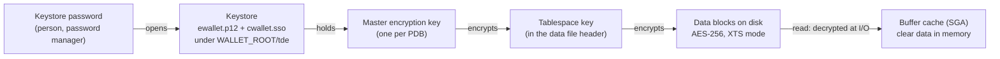
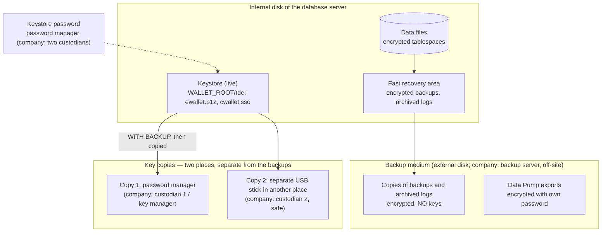

# ADR-011: Encryption at Rest, Key Management and Encrypted Backups

| Field | Value |
|-------|-------|
| **Status** | Accepted · **Data Pump export encryption is not enabled in 26ai Free** in any mode (`ORA-00439: feature not enabled: Dump File Encryption`; `PASSWORD` and `TRANSPARENT` tested 2026-10-15, migration phase M.3), although the licensing manual lists it under Advanced Security as included in Free. The statements below on encrypted Data Pump exports (decision, diagram, keystore-loss table, licence table) do not hold in Free; replacement: open point 11 of the [M1 plan](../plans/M1-plan.md); growth path: Enterprise Edition with Advanced Security, or Oracle Cloud |
| **Date** | 2026-10-12 (proposed and accepted) |
| **Deciders** | Solution Architect (project owner) |
| **Related** | [ADR-010](ADR-010-operations-and-release-strategy.md) §4 (encryption at rest), §1 (backups), §8 (edition constraints) · [ADR-008](ADR-008-schema-separation.md) (schemas and tablespaces) · [ADR-009](ADR-009-environments.md) (environments) · [Backup runbook](../operations/backup-runbook.md) (routine, concepts in plain words) · [Recovery runbook](../operations/recovery-runbook.md) · spec §1.3 (data protection), §2.5 |

---

## Context

ADR-010 §4 requires encryption at rest in a company production and notes that 26ai Free cannot encrypt an existing tablespace online. The project tablespaces are about to be **created again** for the schema separation of ADR-008, which is the cheapest moment to create them encrypted.

**What has to be protected (from the business)**

| Data | Where | Why it is sensitive |
|------|-------|---------------------|
| Contact persons: names, emails, phone numbers | `EMK_CONTACTS` and its journal | Personal data (GDPR) |
| Claim documents: photos, invoices, surveyor reports, letters | `EMK_CLAIM_DOCUMENTS` (BLOB) | Commercial secrets; may contain personal data |
| Claim amounts, recovery rates per carrier | Claims, KPIs | Commercial secrets of the forwarder and its carriers |
| Inbound shipment files | `EMK_INT` landing tables | Customer and partner data as received |
| Technical log and audit archive | `EMK_LOG`, `EMK_AUDIT` (ADR-010 §3) | May contain user names and data values |

**Most likely incidents**, given ADR-010 and setup.md §1.1: an **external USB disk with the backups** is lost or stolen; a laptop or server disk is replaced or discarded; data files, backups or exports are copied by someone with file-system access. In all these cases the data is read **outside** the database, where database privileges do not help.

---

## What a Tablespace Encryption Is and How It Works

**Transparent Data Encryption (TDE)** encrypts data **when it is written to disk** and decrypts it **when it is read from disk**. For SQL, PL/SQL, APEX and the applications nothing changes ("transparent"): an authorised session sees normal data; someone who reads the files directly sees only ciphertext.

With **tablespace encryption**, every block of every data file of the tablespace is encrypted, with all tables, indexes, LOBs and partitions in it.

**Two-tier key architecture**



| Element | What it is |
|---------|-----------|
| **Tablespace key** | Random key that encrypts the blocks of one tablespace; stored in the data file header, itself encrypted by the master key |
| **Master encryption key** | Key that encrypts the tablespace keys; stored only in the keystore, one per PDB |
| **Keystore (software wallet)** | Encrypted file `ewallet.p12` protected by a password; holds the master keys, including old ones after a rotation |
| **Local auto-login keystore** | File `cwallet.sso` created from the keystore; lets the database open the keys after a restart without typing the password, **only on the computer where it was created** |
| **Rotation (rekey)** | A new master key re-encrypts only the small tablespace keys, not the data; old master keys stay in the keystore for old backups |

**Where data stays encrypted:** data files, and also undo, temporary segments, redo logs and archived logs for data of encrypted tablespaces; RMAN backs up the encrypted blocks as they are. **Where it is clear:** in memory (buffer cache), in query results, and in a Data Pump export unless the export is encrypted.

---

## Verified for the Versions in Use

| Fact | Source |
|------|--------|
| TDE for tablespaces is included in **Free** ("TDE online method to encrypt/rekey/decrypt an existing tablespace is not supported"). Oracle Advanced Security (TDE, Data Pump export encryption, RMAN backup encryption, Data Redaction) is included in Free. **EE: extra-cost Advanced Security option. SE2 on premises: not available.** Oracle Cloud Base Database (SE and EE) includes TDE | [Database Licensing Information User Manual (23ai/26ai)](https://docs.oracle.com/en/database/oracle/oracle-database/23/dblic/Licensing-Information.html) |
| 26ai: default tablespace algorithm **AES256**; tablespace encryption mode **AES-XTS** (better security and performance); 3DES desupported by FIPS 140-3; GOST and SEED desupported for new keys | [TDE Guide 26ai: Changes in this release](https://docs.oracle.com/en/database/oracle/oracle-database/23/dbtde/changes-this-release-oracle-database-transparent-data-encryption-guide.html) · [TABLESPACE_ENCRYPTION_DEFAULT_ALGORITHM](https://docs.oracle.com/en/database/oracle/oracle-database/26/refrn/TABLESPACE_ENCRYPTION_DEFAULT_ALGORITHM.html) |
| Keystore location with the **static** parameter `WALLET_ROOT` (restart) and `TDE_CONFIGURATION = "KEYSTORE_CONFIGURATION=FILE"`; `ENCRYPTION_WALLET_LOCATION` in `sqlnet.ora` is **desupported in 26ai** | [TDE Quick-start Guide 26ai](https://docs.oracle.com/en/database/oracle/oracle-database/26/dbtde/get-started.html) · [sqlnet.ora parameters 26ai](https://docs.oracle.com/en/database/oracle/oracle-database/26/netrf/parameters-for-the-sqlnet.ora.html) |
| `TABLESPACE_ENCRYPTION` (static): `AUTO_ENABLE` encrypts every new user tablespace and forbids decrypting; on-premises default `MANUAL_ENABLE`; affects new tablespaces only | [TABLESPACE_ENCRYPTION (26ai)](https://docs.oracle.com/en/database/oracle/oracle-database/26/refrn/TABLESPACE_ENCRYPTION.html) |
| United mode (one keystore for the CDB, a master key per PDB) and isolated mode (own keystore per PDB) | [TDE Quick-start Guide 26ai](https://docs.oracle.com/en/database/oracle/oracle-database/26/dbtde/get-started.html) |
| A local auto-login keystore opens only on the computer where it was created; auto-login keystores cannot be backed up, the password keystore must be | [TDE Quick-start Guide 26ai](https://docs.oracle.com/en/database/oracle/oracle-database/26/dbtde/get-started.html) · [Managing the Keystore (19c, unchanged concept)](https://docs.oracle.com/en/database/oracle/oracle-database/19/asoag/managing-keystore-and-tde-master-encryption-key.html) |
| **Without the keystore and its master keys, encrypted data cannot be decrypted: the database cannot be opened or recovered, also not from backups** ("Do not lose your wallet password") | [TDE Quick-start Guide 26ai](https://docs.oracle.com/en/database/oracle/oracle-database/26/dbtde/get-started.html) · [TDE Best Practices white paper](https://www.oracle.com/br/a/tech/docs/technical-resources/twp-transparent-data-encryption-bestpractices.pdf) |
| Performance: encryption and decryption at the I/O block layer; decrypted blocks are cached in the buffer cache; AES-NI CPU acceleration; no storage overhead; Oracle's estimate is a small single-digit percentage | [TDE Best Practices white paper](https://www.oracle.com/br/a/tech/docs/technical-resources/twp-transparent-data-encryption-bestpractices.pdf) · [Advanced Security data sheet 23ai](https://www.oracle.com/a/tech/docs/dbsec/aso/advanced-security-ds.pdf) |
| RMAN backs up blocks of encrypted tablespaces as they are (still encrypted); RMAN transparent backup encryption uses the keystore; 23ai uses AES-256 (XTS) for new encrypted backups | [RMAN 23ai new features (MAA blog)](https://blogs.oracle.com/maa/oracle-database-23ai-recovery-manager-rman-new-features-part-2-celebrating-three-decades-of-data-protection-more) · [Ask TOM: TDE and RMAN encryption](https://asktom.oracle.com/ords/f?p=100%3A11%3A%3A%3A%3A%3AP11_QUESTION_ID%3A9543152700346947752) |
| Data Pump writes data of encrypted tablespaces **in clear text** to the dump file unless an encryption password is given (warning `ORA-39173`) | [ORA-39173](https://docs.oracle.com/en/error-help/db/ora-39173/) |
| Existing tablespaces, including `SYSTEM` and `SYSAUX`, can be encrypted **offline** (tablespace offline or database mounted) with an auto-login keystore | [Encryption conversions (21c guide)](https://docs.oracle.com/en/database/oracle/oracle-database/21/asoag/encryption-conversions-tablespaces-and-databases1.html) |
| GDPR: encryption is a security measure (Art. 32); if encrypted data is lost and the key is not compromised, the breach is unlikely to result in a risk and the data subjects need not be informed (Art. 34(3)(a)) | [EDPB Guidelines 9/2022 on breach notification](https://www.edpb.europa.eu/system/files/2023-04/edpb_guidelines_202209_personal_data_breach_notification_v2.0_en.pdf) |

---

## Options

| Option | Protects | Why not chosen |
|--------|----------|----------------|
| **A. TDE tablespace encryption** | Data files, backups, archived logs, discarded disks; whole tables including LOBs and indexes | **Chosen** |
| B. TDE column encryption | Selected columns only | Each sensitive column must be found and marked (error-prone as the model grows); limits indexes and foreign keys on encrypted columns; documents (BLOB) and logs would stay clear |
| C. Disk encryption of the operating system (BitLocker, device encryption) | A stolen switched-off disk | Files copied by a process or user of the running machine and **backups copied to the USB disk** stay clear; outside the database's control. Kept as a **complement** for laptops |
| D. Encryption in the application (`DBMS_CRYPTO`) | Selected values | Keys managed in PL/SQL code; no indexes, search or vector search on encrypted text; every API must encrypt and decrypt |
| E. No encryption | — | Lost USB backup disk = readable personal data and business secrets → breach notification (GDPR Art. 33, 34); not state of the art (Art. 32) |

---

## Decision

**TDE tablespace encryption with a software keystore** for the project tablespaces, built during the schema separation (migration phase 1–2, ADR-008), with **encrypted RMAN backups** and **encrypted Data Pump exports**. The three pieces are one design: the data, its backups and its keys.

> **Separation rule:** the keys are never kept with the data. The keystore and its copies are never stored on the same disk or medium as the data files or the database backups. A stolen backup disk is then useless; a lost keystore copy alone contains no data.

**Where each piece lives** (DEV paths in the [backup runbook §4](../operations/backup-runbook.md)):



| Restore needs | Comes from |
|---------------|-----------|
| Backup pieces and archived logs | Backup medium |
| Master keys of the time of the backup | Keystore copy 1 or 2 |
| Keystore password | Password manager / custodians |

A thief of the backup medium gets no keys; a thief of a key copy gets no data; only the authorised restore brings both together.

**Roles**

| Role | Task |
|------|------|
| Key administrator (`SYSKM` privilege; in a company the DBA or the security officer, not a developer) | Creates the keystore and keys, rotates keys, makes keystore backups |
| Two key custodians (company) | Each keeps one keystore copy and knows the password (four-eyes); together they confirm the monthly check |
| DBA | Backups, validation, restore drills (backup runbook §5) |

**Reference commands** (in the admin scripts; the password is asked at run time):

```sql
ADMINISTER KEY MANAGEMENT CREATE KEYSTORE IDENTIFIED BY "&keystore_pwd";
ADMINISTER KEY MANAGEMENT SET KEYSTORE OPEN IDENTIFIED BY "&keystore_pwd" CONTAINER = ALL;
ADMINISTER KEY MANAGEMENT SET KEY IDENTIFIED BY "&keystore_pwd" WITH BACKUP CONTAINER = ALL;
ADMINISTER KEY MANAGEMENT CREATE LOCAL AUTO_LOGIN KEYSTORE FROM KEYSTORE IDENTIFIED BY "&keystore_pwd";
CREATE TABLESPACE emk_data_ts DATAFILE '<path>' SIZE 100M AUTOEXTEND ON
  ENCRYPTION USING 'AES256' ENCRYPT;
```

```
RMAN> CONFIGURE ENCRYPTION FOR DATABASE ON;
```

| Item | Decision |
|------|----------|
| Tablespaces | The project tablespaces of ADR-008 (`EMK_DATA_TS`, `EMK_INT_TS`; also the default tablespace of `EMK_API`, so the log is covered) and the audit archive tablespace of ADR-010 §3: all created **encrypted**; nothing to convert because they are new |
| Algorithm | `AES256` (26ai default), XTS mode; written explicitly in the scripts (`ENCRYPTION USING 'AES256' ENCRYPT`) |
| New tablespaces | `TABLESPACE_ENCRYPTION = AUTO_ENABLE`: every new tablespace is encrypted, also if a script forgets the clause |
| Keystore | Software keystore under `WALLET_ROOT` (outside the Oracle home and the data folder), `TDE_CONFIGURATION = "KEYSTORE_CONFIGURATION=FILE"`; **united mode**: one keystore for the CDB, an own master key for each PDB (DEV, TEST, ACCEPTANCE). PROD has its **own keystore on its own server**: DEV and PROD never share keys |
| Opening after a restart | **Local auto-login** keystore (`cwallet.sso`): the database opens unattended, and the file is useless on another computer |
| Keystore password | Entered at run time (`ACCEPT … HIDE`), never in a file; kept in the password manager; in a company with two custodians (four-eyes) |
| Backups | RMAN **transparent backup encryption** on (`CONFIGURE ENCRYPTION FOR DATABASE ON`, uses the keystore): also `SYSTEM`, `SYSAUX` and control files are encrypted in the backups on the USB disk |
| Data Pump | Exports always encrypted with a password typed at run time (`ENCRYPTION=ALL`, `ENCRYPTION_PWD_PROMPT=YES`, password mode): the dump does not depend on the keystore and is an **independent second copy** |
| Rotation | Master key rotated once a year and when a person with access leaves (`ADMINISTER KEY MANAGEMENT SET KEY … WITH BACKUP`); old keys stay in the keystore |
| Restart | `WALLET_ROOT` and `TABLESPACE_ENCRYPTION` are static: set in the **same maintenance restart** as the switch to `ARCHIVELOG` (ADR-010, runbook Appendix A) |
| Scripts and checks | Admin scripts create the keystore and keys idempotently; `verify_admin.sql` checks `V$ENCRYPTION_WALLET` (`OPEN`, `LOCAL_AUTOLOGIN`), `DBA_TABLESPACES.ENCRYPTED = 'YES'` for `EMK_%` and the algorithm in `V$ENCRYPTED_TABLESPACES` |

### Impact on performance

| Area | Impact |
|------|--------|
| Queries | Decryption happens only when a block is **read from disk**; blocks in the buffer cache are clear, so repeated reads cost nothing extra. The reference CPU (Intel i5-8300H) has AES-NI. Expected overhead: small single-digit percentage on disk reads, within the p95 targets of ADR-010 §5 |
| Free edition | The buffer cache is small (2 GB RAM in total), so more reads go to disk than on a large server; the effect is measured (test below), not assumed |
| Storage | No overhead; encrypted blocks do not compress well, which the disk sizing (setup.md §1.1) already assumes (no backup compression counted) |
| Deployment | None for SQLcl `project` and Liquibase: tables and indexes are created in an encrypted tablespace with normal DDL. The keystore must be **open** (it is, with auto-login); creating a new PDB adds one step: set its master key |

### Keystore loss: what happens and how it is prevented

| What is lost | Consequence | Recovery |
|--------------|-------------|----------|
| `cwallet.sso` (auto-login file) | The database opens, but encrypted tablespaces give `ORA-28365: wallet is not open` | Open the keystore with the password and create the auto-login file again — no data lost |
| `ewallet.p12` (password keystore) | No new keys, no rotation; after the next restart possibly no access | Restore the file from the keystore backup |
| Keystore password, files still present | No key operations; the database still opens through auto-login on the same computer | Create a new keystore and merge the keys from the auto-login keystore on the same computer (to verify in the test); then back up |
| **Keystore and all its backups** | **The encrypted data is lost for good — also in every RMAN backup.** Oracle cannot recover it | Only the **Data Pump exports** encrypted with their own password remain (state of the last export) |

**Rules that prevent the last row**

1. Every key operation uses `WITH BACKUP`; after it, the keystore folder is copied to **two places separate from the database backups** (never on the same USB disk as the RMAN backups — a lost disk would then carry data and keys together).
2. The keystore password is stored in the password manager; in a company, with a second custodian or in a key manager.
3. Keystore backups are kept **as long as the oldest database backup** that needs their keys.
4. The restore drill (T-M1-33) restores **with the keystore from its backup**, not with the live one.
5. Monitoring (ADR-010 §7): keystore status `OPEN` and date of the last keystore backup.

### What is not encrypted (residual risk)

| Area | Content | Measure |
|------|---------|---------|
| `SYSTEM`, `SYSAUX` of each PDB | APEX session state, collections, activity and mail logs; Unified Audit trail | Encrypted in **backups** (RMAN encryption). In the data files: offline encryption of `SYSAUX` is possible in Free; to be tried in a test PDB and decided with the result |
| Memory, query results, screens | Clear for authorised sessions | Access control (ADR-008), least privilege, HTTPS (ADR-010 §4) |
| A running machine with OS access | The auto-login file opens the keys on that computer | OS hardening, disk encryption of the laptop as a complement; in a company, servers in a secured room |

---

## Edition Constraints and Growth Path

| Capability | In this project (26ai Free) | Growth path and cost |
|------------|------------------------------|----------------------|
| TDE tablespace encryption | Included; new tablespaces created encrypted | **Enterprise Edition: Advanced Security option, extra cost per processor.** Standard Edition 2 on premises: not available. Oracle Cloud Base Database and Autonomous Database: included and mandatory |
| Online encryption of an existing tablespace | **Not in Free** | EE with Advanced Security: encrypt, rekey, decrypt online |
| RMAN backup encryption, Data Pump encryption | Included (Advanced Security in Free) | EE: part of the Advanced Security option |
| Central key management (Oracle Key Vault, hardware security module, OCI Vault) | Not used: software keystore on the server | Oracle Key Vault (separately licensed), HSM or cloud vault: keys outside the database server, separation of duties |

When the project moves to EE on premises, the Advanced Security licence is a **cost to plan**; without it, the tablespaces must not stay encrypted (licence breach) — the decision is taken with the platform choice (spec §12.3).

---

## Consequences

**Positive:** a lost backup disk, a discarded disk or copied files do not expose personal data or business secrets (GDPR Art. 32; Art. 34(3)(a)); no application change; built at the cheapest moment; backups and exports encrypted as well.

**Negative / costs:** the keystore becomes **critical**: losing it with its backups loses the data; key and keystore procedures add work to restore drills, new PDBs and rotations; one more restart parameter set; licence cost in EE.

**New tests (M1 plan):**
- **T-M1-35** — Tablespaces are encrypted: `DBA_TABLESPACES.ENCRYPTED = 'YES'` for every `EMK_%` tablespace; a known test string is found in a data file of an unencrypted test tablespace and **not** in the encrypted one; timing of the same full scan with cold cache in both, recorded.
- **T-M1-36** — Keystore loss without data loss: `cwallet.sso` removed → `ORA-28365` → auto-login recreated from the password keystore → data readable; restore drill (T-M1-33) uses the keystore backup.

**Backup and drill evidence:** the RMAN scripts (`scripts/operations/rman/`) and the first restore drill protocol (`docs/operations/drills/`) are committed together, after they ran successfully in migration phase 1.

**To verify during implementation:** keystore creation and auto-login in Free on Windows; `ACCEPT … HIDE` with `ADMINISTER KEY MANAGEMENT`; master key in a new PDB in united mode; offline encryption of `SYSAUX` in a test PDB; RMAN transparent encryption in Free; merge from the auto-login keystore after a lost password.

## Sources

**Oracle:** [TDE Quick-start Guide 26ai](https://docs.oracle.com/en/database/oracle/oracle-database/26/dbtde/get-started.html) · [RMAN Backup Concepts 26ai](https://docs.oracle.com/en/database/oracle/oracle-database/26/bradv/rman-backup-concepts.html) · [TDE Guide: Changes in this release](https://docs.oracle.com/en/database/oracle/oracle-database/23/dbtde/changes-this-release-oracle-database-transparent-data-encryption-guide.html) · [TABLESPACE_ENCRYPTION](https://docs.oracle.com/en/database/oracle/oracle-database/26/refrn/TABLESPACE_ENCRYPTION.html) · [TABLESPACE_ENCRYPTION_DEFAULT_ALGORITHM](https://docs.oracle.com/en/database/oracle/oracle-database/26/refrn/TABLESPACE_ENCRYPTION_DEFAULT_ALGORITHM.html) · [sqlnet.ora parameters 26ai](https://docs.oracle.com/en/database/oracle/oracle-database/26/netrf/parameters-for-the-sqlnet.ora.html) · [Licensing Information](https://docs.oracle.com/en/database/oracle/oracle-database/23/dblic/Licensing-Information.html) · [TDE Best Practices](https://www.oracle.com/br/a/tech/docs/technical-resources/twp-transparent-data-encryption-bestpractices.pdf) · [Advanced Security data sheet 23ai](https://www.oracle.com/a/tech/docs/dbsec/aso/advanced-security-ds.pdf) · [RMAN 23ai new features](https://blogs.oracle.com/maa/oracle-database-23ai-recovery-manager-rman-new-features-part-2-celebrating-three-decades-of-data-protection-more) · [ORA-39173](https://docs.oracle.com/en/error-help/db/ora-39173/) · [Encryption conversions](https://docs.oracle.com/en/database/oracle/oracle-database/21/asoag/encryption-conversions-tablespaces-and-databases1.html)

**Law:** [EDPB Guidelines 9/2022 on personal data breach notification](https://www.edpb.europa.eu/system/files/2023-04/edpb_guidelines_202209_personal_data_breach_notification_v2.0_en.pdf)
