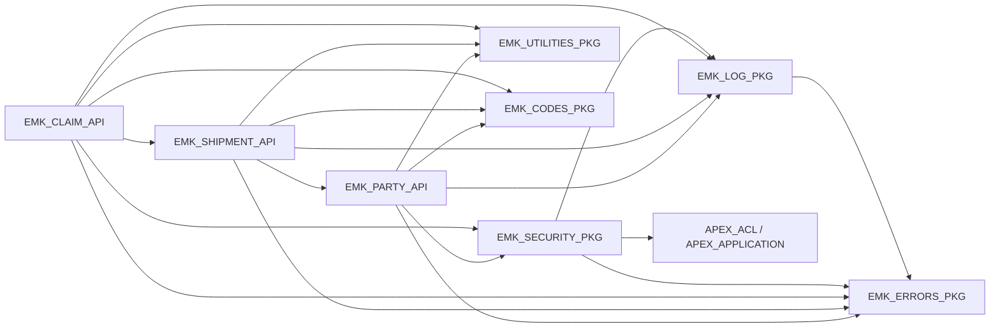
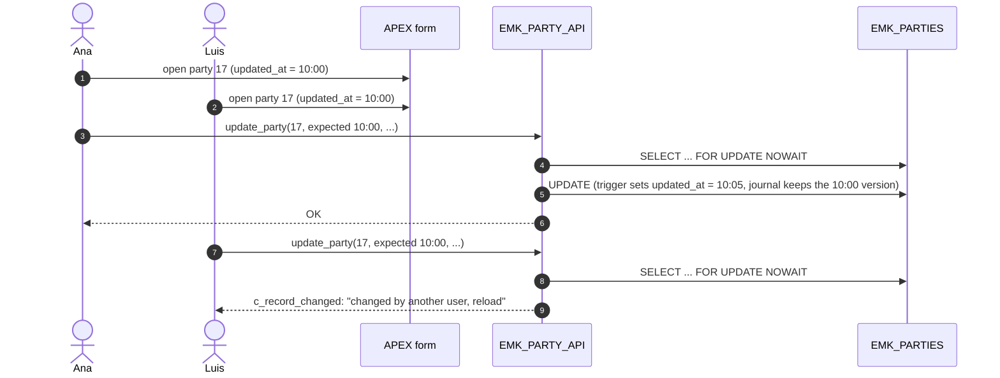
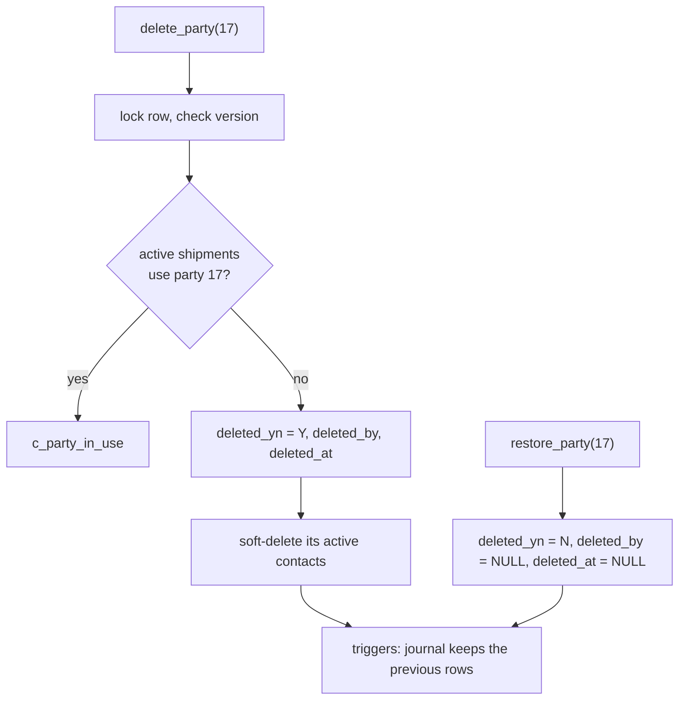

# PL/SQL API Design

| | |
|---|---|
| **Status** | Accepted v1.6 (2026-10-21): master data API as built (§3a, step 7.7), error -20403, views and grants of the master data pages, column privileges in a release script (§8). v1.5 (2026-10-21): master data API (decisions 22 and 23, D-82); file types: catalog by the developer, allowed period by the administrator (decision 19, §9). v1.4 (2026-10-21): code lists (D-68): a new language or role must be valid today, views for the lists of values; language and at least one role required, `create_party` with roles, error -20106 (D-71); common packages `EMK_UTILITIES_PKG`, `EMK_CODES_PKG`, `EMK_ROW_VERSION_PKG` (D-69); role locks between shipments and companies (D-73); file checks of claim documents designed for step 8 (BR-18, §9); required codes in the pages. v1.3 (2026-10-18): step 7 as built (decisions D-64 to D-67), views, change history and grants for the application (§8). v1.2 (2026-10-16): error package `EMK_ERRORS_PKG` (naming rule), log purge `EMK_LOG_PKG.purge_entries`. v1.1 (2026-10-10): schemas `EMK_DATA`, `EMK_API`, `EMK_UI` (ADR-008) |
| **Schema** | `EMK_API` (APIs, services, views, log) · `EMK_DATA` (tables, journals, triggers) · `EMK_UI` (APEX parsing schema, no objects) · `EMK_INT` (integration, M1b) — [ADR-008](../adr/ADR-008-schema-separation.md) |
| **Milestone** | M1a (plan steps 1, 7, 8) |
| **Input** | [spec.md](../spec.md) §1, §2.7, §4, §7.1 · [Data model](README.md) · [ADR-007](../adr/ADR-007-integration-schema-and-account-hardening.md) · [ADR-008](../adr/ADR-008-schema-separation.md) |

How the application code is organised: which packages exist, who calls them, and how a business operation flows from the user to the tables. Business rules live in these packages, never in APEX pages (spec §1.1).

## 1. Architecture


| Layer | Responsibility | Never does |
|-------|----------------|------------|
| APEX pages | Show data (views), collect input, call an API, show errors (APEX error handling function, M1c) | Business rules, direct DML on tables |
| Business APIs | Validate, normalise, apply business rules (BR), lock, write, log refusals | `COMMIT` / `ROLLBACK` (the caller decides) |
| Shared services | Role checks, logging, error codes | Business rules |
| Triggers | Audit columns, journals, immutable document file | Business rules (spec §1.3) |
| Constraints | Rules within one row (formats, BR-03, BR-11, dates) | Rules across tables (those are in the APIs) |

## 2. Package Dependencies



- **Common packages** (decision 20): `EMK_UTILITIES_PKG` holds the functions every API needs (current user, change detection, validity on a date, the locked-row exceptions); `EMK_ROW_VERSION_PKG` writes `row_version` as text (a scalar SQL macro used by the views) and reads it back — a package of its own, so that `EMK_UI` executes only what the pages need (least privilege, 2026-10-21); `EMK_CODES_PKG` holds the codes that the rules name (roles of BR-16, `EUR`, `GB` and `XI` for the VAT rule; claim statuses and types in step 8). Each is written once.

- Dependencies point in one direction only (no cycles): an API may call a lower API (`EMK_SHIPMENT_API` checks party roles through `EMK_PARTY_API`), never the other way.
- `EMK_SECURITY_PKG` is used by `EMK_CLAIM_API` for BR-02 and by `EMK_MASTER_DATA_API` for the administrator role (step 7.7, decision 22). `EMK_PARTY_API` and `EMK_SHIPMENT_API` do not check roles in Release 1 (§5, decision 4).

## 3. `EMK_PARTY_API` and `EMK_SHIPMENT_API` (step 7)

| Package | Subprogram | Rules and errors |
|---------|------------|------------------|
| `EMK_PARTY_API` | `create_party (in_name, in_vat_number, in_country_code, in_street, in_postal_code, in_city, in_language_code, in_role_codes, out_party_id)` | VAT normalised (upper case, no spaces); prefix = country's `eu_vat_prefix` (`XI` allowed for `GB`) → `c_vat_country_mismatch`; duplicate VAT → `c_duplicate_vat` (message says "restore" if the party is deleted, D-39); language required (→ `c_invalid_argument`), lower case, from `EMK_LANGUAGES` and valid today → `c_reference_not_valid` (D-68); the company is created **with its roles** (at least one → `c_party_role_required`, D-71) |
| | `update_party (in_party_id, in_expected_updated_at, …same fields…)` | Optimistic locking → `c_record_changed`; same checks as create, but country and language validity only when they change (a party keeps a retired country or language); no update if nothing changed |
| | `delete_party (in_party_id, in_expected_updated_at)` | Rejected while active shipments use the party → `c_party_in_use`; active contacts are soft-deleted in the same transaction |
| | `restore_party (in_party_id)` | `deleted_yn` Y→N, `deleted_by`/`deleted_at` → NULL (D-39); contacts are restored one by one (`restore_contact`); does nothing if the party is not deleted |
| | `add_role (in_party_id, in_role_code)` / `remove_role (in_party_id, in_role_code)` | BR-16: a role used by any shipment (also soft-deleted) cannot be removed → `c_party_role_in_use`; adding an existing role does nothing, also if it was retired since; a new role must be in `EMK_PARTY_ROLE_TYPES` and valid today → `c_reference_not_valid` (D-68); no role → `c_invalid_argument` |
| | `set_roles (in_party_id, in_role_codes)` | The complete list of roles, colon-separated (an APEX checkbox item): adds the missing roles first, then removes the others, with the rules above, so that the page computes no difference itself; an empty list and removing the last role → `c_party_role_required` (D-71) |
| | `lock_role (in_party_id, in_role_code)` | Locks the role row until the end of the transaction (`FOR UPDATE WAIT 3`), called by `EMK_SHIPMENT_API` before its BR-16 check; `remove_role` and `delete_party` lock the same rows `NOWAIT` → `c_record_locked` (decision 21) |
| | `has_role (in_party_id, in_role_code) RETURN BOOLEAN` | Active party with the role; used by `EMK_SHIPMENT_API` |
| | `create_contact` / `update_contact` / `delete_contact` / `restore_contact` | Personal data (spec §3.3); optimistic locking on update and delete; phone stored without spaces (E.164); a contact of a deleted party cannot be restored |
| `EMK_SHIPMENT_API` | `create_shipment (in_cmr_note_no, in_cmr_note_date, in_shipper_id, in_carrier_id, in_consignee_id, in_pickup_place, in_origin_country, in_delivery_place, in_destination_country, in_pickup_date, in_agreed_delivery_date, in_delivery_date, in_disposal_date, in_goods_description, in_packages, in_gross_weight_kg, in_carriage_charges, in_currency_code, in_declared_value, in_declared_value_currency, in_special_interest, in_special_interest_currency, out_shipment_id)` | Note number `UPPER(TRIM())`; date of the consignment note required (D-79); the currencies of the declared value and of the special interest as the carriage charges (D-78); dates `TRUNC`; the carrier is never the shipper or the consignee (CMR Art. 1(1), carriage for reward) → `c_carrier_not_third_party`; **BR-16** each party active with its role → `c_party_role_missing`; **BR-17** one country is a CMR party on the pickup date → `c_cmr_not_applicable`; both countries and the currency valid on the pickup date, currency EUR or with an ECB rate → `c_reference_not_valid`; **BR-03** duplicate → `c_duplicate_cmr_note`; the role rows of the three companies are locked until the commit (decision 21) |
| | `update_shipment (in_shipment_id, in_expected_updated_at, …)` | Same checks; optimistic locking |
| | `delete_shipment (in_shipment_id, in_expected_updated_at)` / `restore_shipment (in_shipment_id)` | Rejected while active claims exist → `c_shipment_in_use`; restore re-checks BR-16 (a party may have lost its role) |

All parameters use `%TYPE` of their column; callers use named notation. Every public subprogram is documented in its package specification (spec §1.3 *Code documentation*).

## 3a. `EMK_MASTER_DATA_API` (step 7.7, D-82)

The code lists the administrator maintains in the Master Data menu ([reference data §6](data-model-reference.md#6-code-lists-d-68), decisions 22 and 23). Every subprogram first checks the administrator role (`EMK_SECURITY_PKG.assert_role` → `c_not_authorized`, logged); updates use optimistic locking like §3; a required value is never defaulted (missing → `c_invalid_argument`; the page proposes one, e.g. today); an update that changes nothing writes nothing; there is no delete and no subprogram changes a code.

| Subprogram | Rules and errors |
|------------|------------------|
| `create_role_type (in_role_code, in_name, in_description, in_sort_order, in_valid_from)` | Code upper case and trimmed; an existing code, also retired or in another letter case → `c_code_exists` (-20403): a code is never reused |
| `update_role_type (in_role_code, in_expected_updated_at, in_name, in_description, in_sort_order, in_valid_from, in_valid_to)` | Retiring (`valid_to`) leaves the role on the companies that have it; a role named in `EMK_CODES_PKG` (`is_protected_role`) cannot end or start in the future → `c_code_protected` (-20402), logged as `WARN`; its name can change |
| `update_claim_status`, `update_claim_type (code, in_expected_updated_at, in_name, in_description, in_sort_order)` | Name, description and order only: code, `final_yn` and validity belong to the state machine and the deadline rules |
| `create_document_type`, `update_document_type` | As the role types; no document type is protected |
| `allow_file_type (in_mime_type, in_expected_updated_at, in_valid_from)` | Allows uploads of a catalogued type from a date, with no end; also after a retirement |
| `retire_file_type (in_mime_type, in_expected_updated_at, in_valid_to)` | Last day uploads are allowed; a type that is not allowed → `c_invalid_argument`; documents keep their type |

**Three layers per rule (owner, 2026-10-21):** the page shows the rule (code read only after creation, `final_yn` and signatures read only, the end of validity of a protected role disabled with the reason, "Allow" or "Retire" offered from `allowed_yn`); the API enforces it; the database guarantees it with **column privileges** of `EMK_API` (§8). Tests: `TEST_EMK_MASTER_DATA_API` (without an APEX session: refusals, columns the database refuses) and `tests/emk_ui/master_data_test.sql` (with an APEX session and the administrator role given and removed by `APEX_ACL`; its log entries are deleted by `master_data_test_cleanup.sql` as `EMK_API`), T-M1-44.

## 4. Flows

### 4.1 Create a shipment (APEX page or import)

```mermaid
sequenceDiagram
    autonumber
    actor U as User / import job
    participant P as APEX page or EMK_INBOUND_PKG
    participant S as EMK_SHIPMENT_API
    participant PA as EMK_PARTY_API
    participant R as Reference tables
    participant T as EMK_SHIPMENTS + triggers
    participant L as EMK_LOG_PKG

    U->>P: enter / load a shipment
    P->>S: create_shipment(...)
    S->>S: normalise note number and dates
    S->>PA: has_role(shipper, SHIPPER), has_role(carrier, CARRIER), has_role(consignee, CONSIGNEE)
    alt a party is missing its role (BR-16)
        S->>L: log_warn
        S-->>P: c_party_role_missing
    end
    end
    S->>R: CMR party on pickup date? currency valid?
    alt not a CMR carriage (BR-17)
        S->>L: log_warn
        S-->>P: c_cmr_not_applicable
    end
    end
    S->>T: INSERT (constraints check BR-03, formats, dates)
    alt same note number for this carrier (BR-03)
        S-->>P: c_duplicate_cmr_note
    end
    end
    S-->>P: out_shipment_id
    P->>P: COMMIT (APEX page process) or one COMMIT per batch (import)
```

### 4.2 Update with optimistic locking ("lost update")



The version compared is `NVL(updated_at, created_at)`: the trigger `_BU` changes it on every update, so it works like the *row version column* of APEX lost update detection, without an extra column, and it protects every caller (APEX, import, scripts), not only APEX forms ([APEX: Configuring Lost Update Detection](https://docs.oracle.com/en/database/oracle/apex/24.2/htmdb/configuring-lost-update-detection.html)). `FOR UPDATE NOWAIT` never makes a web session wait: a row locked by another transaction raises `c_record_locked` ("try again").

### 4.3 Soft delete and restore of a party



## 5. Decisions (D-43, 2026-10-09)

| # | Decision | Alternative not taken |
|---|----------|-----------------------|
| 1 | One parameter per field, named notation | A `%ROWTYPE` record: callers would see columns they must not set (id, audit) |
| 2 | Optimistic locking with `in_expected_updated_at`; `FOR UPDATE NOWAIT` | Last writer wins: silent loss of another user's change |
| 3 | No delete of a party with active shipments or of a shipment with active claims; a party's contacts are soft-deleted with it | Deleting anything: visible shipments of hidden parties |
| 4 | `EMK_PARTY_API` and `EMK_SHIPMENT_API` do not check roles in Release 1; protected by APEX authorization, the `EMK_INT` grants (ADR-007) and the connect user `EMK_UI`, which has no privilege on any table (ADR-008); role check in the API for BR-02 and for master data only (decision 22) | A role check with an exception for trusted processes: more complex, and the exception becomes the weak point |

Decisions taken while building step 7 (D-64 to D-66, 2026-10-16/17):

| # | Decision | Reason | Alternative not taken |
|---|----------|--------|-----------------------|
| 5 | `set_roles` takes the complete role list of a company | The APEX page passes its checkbox value; computing which roles to add and remove would be business logic in the page | Only `add_role` / `remove_role`, with the difference computed in APEX |
| 6 | `restore_contact`; restoring something not deleted does nothing; deleting something already deleted raises `c_not_found` | The design said contacts are restored one by one, without a subprogram; a second restore does no harm, a delete of a missing row is an error | Error on a second restore |
| 7 | A party's country is valid **today** (on update only when it changes: a party keeps a retired country, D-68); a VAT number only for EU countries (prefix = the country's EU VAT prefix, `XI` also for `GB`) | The party record describes the company now; `vat_number` holds EU VAT numbers in VIES format | Accepting any VAT number for non-EU countries |
| 8 | Values are normalised before they are stored (trimmed names, VAT upper case without spaces, phone without spaces); format rules stay in the check constraints, whose errors reach the caller unchanged and are turned into messages by the APEX error handling function | One place per rule: the table for formats within a row, the API for rules across tables | Repeating format checks in the API |
| 9 | Countries (origin, destination) are checked for validity like the currency | "The same temporal validity (from/to) as currencies: no obsolete country codes, robust against future changes of international codes, negligible performance impact" (owner) | Checking only the currency |
| 10 | Countries, currency and CMR membership are checked on the **pickup date**, not today | "Shipments are past events: the rules in force at the time of carriage apply, so historic data and old claims with ended currencies or rules can be registered" (owner). The pickup date is mandatory; an update rechecks everything with the new date | Today's date: rejects correct old shipments (kuna in 2021) |
| 11 | Rejections by role and by CMR are logged as `WARN` with ids only; a read-only log page for the administrator | "Traceability for bulk loads and for actions in APEX, to diagnose role configuration problems without harming performance or privacy" (owner). Storing the raw input first is the import design (M1b); a form never stores an invalid shipment | No log: refused page entries would leave no trace |
| 12 | The carrier is never the shipper or the consignee of the same shipment; shipper = consignee is allowed | "CMR Art. 1(1) requires a contract with a third party (for reward) and excludes carriage on own account: no claims without a legal basis" (owner). The rule is per shipment, not per role | Any combination (data without a basis for a claim); three different companies (rejects transfers between two sites of a company) |
| 13 | APEX reads views of `EMK_API`; one restore page for all deleted records (`EMK_V_DELETED_RECORDS`) | One page and one view instead of three of each | A deleted view and a restore button per entity |
| 14 | `row_version` is text in the fixed format `YYYY-MM-DD"T"HH24:MI:SS.FF6TZH:TZM`; a page converts it back with `TO_TIMESTAMP_TZ` and the same format | APEX items are text; a conversion that depends on the session format can lose fractions of a second and report "changed by another user" without a change | A `TIMESTAMP` column converted by APEX with the session format |
| 15 | Country and currency names in English; German names when the interface is translated (M5) | The German name tables exist; no page uses them before the translation | Both languages now |
| 16 | Views are documented by their `/** */` header only, without `COMMENT ON` | SQLcl project 25.4 exports the comments of tables only (checked on the export of step 7.4); the header is exported with the view, so database and repository stay equal | `COMMENT ON` plus a custom release script: the same text twice and a script to maintain |
| 17 | Change history visible in the application through three views over the journals, with the action of each change (`UPDATED`, `DELETED`, `RESTORED`) computed from the next version; contacts' history for the compliance officer only | The app-context test reads the history as `EMK_UI` and rolls back, and users see who changed what (FR-09); former personal data shown only to who needs it (GDPR Art. 5(1)(c)) | Two test scripts that commit test data and delete it physically |
| 18 | Code lists (D-68, 2026-10-18): a **new** value (language, role; later status, claim type, document type, file type) must exist in its reference table and be valid **today**; a value a record already has stays when it is retired | The foreign key guarantees that the value exists, but cannot check a date; rejecting stored values that were retired later would block every update of old records | Re-checking every stored value on each update |
| 20 | Common packages (D-69, 2026-10-20): `EMK_UTILITIES_PKG` for common functions and `EMK_CODES_PKG` for the codes named by the rules; the reference tables stay the lists of values, maintained in the application; the codes in `EMK_CODES_PKG` are protected there. `row_version` is formatted by a scalar SQL macro, so the views make no call per row | Each function and code was copied in several packages (the user function twice, change detection four times, the roles twice, the validity check five times); one place to change. Two packages, because a changed code recompiles only what uses codes ([Oracle: schema object dependency](https://docs.oracle.com/en/database/oracle/oracle-database/26/adfns/schema-object-dependency.html)) | One package for everything; copies in each API |
| 21 | Concurrency between a shipment and its companies (D-73, 2026-10-21): saving a shipment locks the role rows of its three companies (always shipper, carrier, consignee; waits up to 3 s); removing a role or deleting a company locks the same rows without waiting. Whichever comes second is checked against what the first committed | Without it, a role could be removed (or a company deleted) between the shipment's BR-16 check and its commit, leaving a shipment with a company that lacks the role (write skew). The fixed order prevents deadlocks between single-shipment transactions; a page saves in milliseconds, so the wait is short. Tested through the application (`tests/emk_ui/hold_role_lock.sql`); M1b batches must commit in small units, because a batch holds these locks until it commits | Locking the whole party row (blocks every edit of the company); accepting the risk |
| 22 | Master data API (D-82, step 7.7): `EMK_MASTER_DATA_API` checks that the caller has the administrator role (`EMK_SECURITY_PKG.assert_role` → `c_not_authorized`) and logs a refusal as `WARN` | No trusted process calls it (data scripts write as `EMK_DATA`), so the reason of decision 4 does not apply. OWASP ASVS 5.0: a function only for consumers with explicit permission (V8.2.1), enforced at a trusted service layer (V8.3.1), failed authorization attempts logged (V16.3.2). Two layers: the APEX authorization of the pages and the API | APEX authorization only (one layer) |
| 23 | Master data rules (D-82): the administrator adds party role types and document types; claim statuses and types come with code (state machine, deadline rules) and file types with the developer's catalog; a value is retired, never deleted, also when records use it; a code never changes; a code named in `EMK_CODES_PKG` cannot be retired → `c_code_protected` (-20402) | A status without its transitions or a claim type without its deadline rules would be data the program cannot process. ISO practice for code lists: ISO 3166 does not reassign a deleted code for at least 50 years, ISO 4217 keeps withdrawn codes as historic codes ([reference data §6](data-model-reference.md#6-code-lists-d-68)) | The administrator adds any value; deleting unused values (a code could come back with another meaning) |

## 6. Best-Practice Review

Checked against the SmartDB properties (Oracle: [The SmartDB Manifesto](https://asktom.oracle.com/ords/r/tech/catalog/session-landing-page?p2_oh_id=3422); [Is your application SmartDB?](https://www.salvis.com/blog/2018/07/18/is-your-application-smartdb/)) and the project conventions.

| Practice | Status | Note |
|----------|--------|------|
| Business logic in PL/SQL APIs, one entry point per area | ✅ | All writes go through the APIs |
| SQL written by hand, set-based where possible | ✅ | No ORM; window functions for KPIs (D-21) |
| APIs do not commit; the caller controls the transaction | ✅ | Except the autonomous log and batch jobs |
| Integration calls the APIs only (EXECUTE grants) | ✅ | ADR-007 |
| Rules within a row as constraints, rules across tables in the APIs | ✅ | Constraints without ranges and with explicit `IS NOT NULL` (P-20, P-22) |
| Lost update protection and no waiting on locks | ✅ | §4.2 |
| Errors never swallowed; named exceptions | ✅ | `EMK_ERRORS_PKG`; log failures propagate (D-33) |
| **The connect user does not own the objects** | ✅ **Met by ADR-008** | Found in this review (APEX parsed as the owner `EMK_APP`); resolved by the separation into `EMK_DATA`, `EMK_API` and the connect user `EMK_UI`, which owns nothing and has `EXECUTE` on the APIs and `SELECT` on the views only |

## 7. Error Codes Added in Step 7

| Code | Constant | Meaning |
|------|----------|---------|
| -20004 | `c_record_changed` | The row was changed by another user since it was read |
| -20005 | `c_record_locked` | The row is locked by another transaction (`ORA-00054`) |
| -20103 | `c_vat_country_mismatch` | VAT prefix does not match the party's country |
| -20104 | `c_duplicate_vat` | VAT number already used (also by a soft-deleted party) |
| -20105 | `c_party_in_use` | Party has active shipments |
| -20106 | `c_party_role_required` | A company needs at least one role (D-71) |
| -20202 | `c_shipment_in_use` | Shipment has active claims |
| -20203 | `c_cmr_not_applicable` | BR-17: no CMR party on the pickup date |
| -20204 | `c_carrier_not_third_party` | The carrier is also the shipper or the consignee (CMR Art. 1(1), D-64) |
| -20402 | `c_code_protected` | A code named in `EMK_CODES_PKG` cannot be retired (D-82; added in step 7.7) |
| -20403 | `c_code_exists` | The code already exists in its list, also if retired: a code is never reused (D-82; added in step 7.7) |

## 8. Views and Grants for the Application (step 7.4, D-66)

APEX parses as `EMK_UI`, which has **no privilege on any table** (ADR-008): pages **read views** of `EMK_API` and **write through the APIs**. The views show only rows that are not soft-deleted (spec §1.3 *Soft delete*). Every view is documented by its own `/** */` header inside the query, which is stored and exported with the view; views get no `COMMENT ON`, because SQLcl project 25.4 exports the comments of tables only and a comment on a view would never reach a release (decision 16).

| View | Page | Main columns |
|------|------|--------------|
| `EMK_V_PARTIES` | Company list and form | Every column of the company, country name, its **roles as one value** (`CARRIER:SHIPPER`, the format of an APEX checkbox item), audit columns, `row_version` |
| `EMK_V_PARTY_ROLES` | Lists of values ("choose the carrier") | Company, role, name, country; the page filters by role |
| `EMK_V_CONTACTS` | Contacts in the company form | Contact columns, company, audit columns, `row_version`; only contacts of active companies |
| `EMK_V_SHIPMENTS` | Shipment list and form | Every column of the shipment, **names** of the shipper, carrier and consignee and of both countries, audit columns, `row_version` |
| `EMK_V_COUNTRIES` | List of countries | Code, name, validity from/to, CMR accession date (a page filters by the pickup date) |
| `EMK_V_CURRENCIES` | List of currencies | Code, name, validity, `charges_allowed_yn` (EUR or with an ECB rate) |
| `EMK_V_LOG` | Read-only technical log page (administrator only) | Level, module, message, context as text, error stack, time, user |
| `EMK_V_DELETED_RECORDS` | Restore page | Entity (company, contact, shipment), id, description, `restorable_yn`, who deleted it and when |
| `EMK_V_PARTY_HISTORY` | History region of the company form | When, who (APEX user), action (`UPDATED`, `DELETED`, `RESTORED`), the values before the change |
| `EMK_V_CONTACT_HISTORY` | History of contacts (compliance officer only) | When, who, action, former name, email and phone |
| `EMK_V_SHIPMENT_HISTORY` | History region of the shipment form | When, who, action, the values before the change |
| `EMK_V_LANGUAGES` | List of languages (company form) | Code, name, `valid_yn` (valid today), validity from/to |
| `EMK_V_PARTY_ROLE_TYPES` | Role checkboxes (company form); master data | Code, name, description, order, `valid_yn`, validity, `row_version`, `protected_yn` (a role named by the rules: end of validity disabled) |
| `EMK_V_CLAIM_STATUSES` | Status lists and filters (step 8); master data | Code, name, description, order, `final_yn` (open claims have `N`), `valid_yn`, validity, `row_version` |
| `EMK_V_CLAIM_TYPES` | List of claim types (step 8); master data | Code, name, description, order, `valid_yn`, validity, `row_version` |
| `EMK_V_DOCUMENT_TYPES` | List of document types (step 8); master data | Code, name, description, order, `valid_yn`, validity, `row_version` |
| `EMK_V_FILE_TYPES` | File types in master data (step 7.7) | Media type, name, signature in hexadecimal and extensions (read only), `allowed_yn` (allowed today), allowed period, `row_version` |
| `EMK_V_CODE_LIST_HISTORY` | History region of the master data pages (administrator) | List, code, when, who, the values before the change (key: list and `history_id`) |

A list of values offers the values with `valid_yn = 'Y'` **plus the value the record already has**, so that an old record with a retired value still shows it (decision 18). The master data pages read the same views with `row_version`, and the file type catalog through `EMK_V_FILE_TYPES`; `EMK_CLAIM_API` reads the file type tables directly (§9).

**Required codes in the pages (owner, 2026-10-21):** a code column that is `NOT NULL` in its table is a **required** page item whose list of values has **no empty entry** (country, language, roles — at least one —, claim type, status, document type); the API rejects an empty value as well, because it is also called by the import. A code is optional only where the data model says why: the currency of carriage charges and of claim amounts (only together with an amount), the previous status of the first status change, the apparent-damage flag (only for partial loss and damage).

`row_version` is `NVL(updated_at, created_at)` as text in the format `YYYY-MM-DD"T"HH24:MI:SS.FF6TZH:TZM`; the views write it with `EMK_ROW_VERSION_PKG.format_row_version`; a page keeps it in a hidden item and passes `EMK_ROW_VERSION_PKG.parse_row_version(:ITEM)` as `in_expected_updated_at`, so the format exists in one place (decision 14, D-69).

| From → to | Grant | Reason |
|-----------|-------|--------|
| `EMK_DATA` → `EMK_API` | `SELECT WITH GRANT OPTION` on `EMK_PARTIES`, `EMK_PARTY_ROLES`, `EMK_CONTACTS`, `EMK_SHIPMENTS`, `EMK_COUNTRIES`, `EMK_CURRENCIES`, the journals `EMK_PARTIES_JN`, `EMK_CONTACTS_JN`, `EMK_SHIPMENTS_JN` and the seven code lists (`EMK_LANGUAGES`, `EMK_PARTY_ROLE_TYPES`, `EMK_CLAIM_STATUSES`, `EMK_CLAIM_TYPES`, `EMK_DOCUMENT_TYPES`, `EMK_FILE_TYPES`, `EMK_FILE_EXTENSIONS`) with the journals of the five maintained in the application | Oracle grants access to a view only if its owner may pass on access to the tables it reads; otherwise the grant to `EMK_UI` fails with `ORA-01720` ([GRANT](https://docs.oracle.com/en/database/oracle/oracle-database/26/sqlrf/GRANT.html)) |
| `EMK_DATA` → `EMK_API` | Column `INSERT` and `UPDATE` on the five lists the administrator maintains (§3a): names, descriptions, order and validity, or the allowed period of file types; never a code, `final_yn`, a signature; no `DELETE` (D-82) | A defect of the API cannot change what the rules rely on ([GRANT](https://docs.oracle.com/en/database/oracle/oracle-database/26/sqlrf/GRANT.html): columns for `INSERT`, `REFERENCES`, `UPDATE`). SQLcl project export writes the grants of `ALL_TAB_PRIVS` only, not the column privileges ([Oracle Forums](https://forums.oracle.com/ords/apexds/post/sqlcl-project-exporting-all-col-priv-3279)): they are kept in `scripts/release/emk_data_column_grants.sql`, added to the first release with `project stage add-custom` |
| `EMK_API` → `EMK_UI` | `SELECT` on the 18 views; `EXECUTE` on `EMK_ROW_VERSION_PKG` only of the common packages; `EXECUTE` on `EMK_PARTY_API`, `EMK_SHIPMENT_API` and `EMK_MASTER_DATA_API` | The minimum for APEX to read and write; nothing on any table |

The database grants the views to `EMK_UI`, the schema of the whole application; it does not know APEX roles. Who sees a page or region is decided by APEX authorization schemes per role (spec §7.1):

| History of | Claims handler | Compliance officer | Analyst | Administrator |
|------------|:-:|:-:|:-:|:-:|
| Companies | ✔ | ✔ | – | ✔ |
| Shipments | ✔ | ✔ | – | ✔ |
| Contacts (former personal data) | – | ✔ | – | – |
| Code lists (master data, D-82) | – | – | – | ✔ |

## 9. Claim Documents: File Checks (BR-18, built in step 8)

A claim document is evidence (CMR Art. 30), and a file uploaded by a user is untrusted input. `EMK_CLAIM_API` stores a document only after these checks, in the database (server side). The file filter of the APEX upload item works in the browser only and can be bypassed: it is a convenience, not a control.

| # | Check | Rule | Error |
|---|-------|------|-------|
| 1 | **Allowlist** | The extension after the last dot of the file name, in lower case, is in `EMK_FILE_EXTENSIONS` and valid today, and its file type in `EMK_FILE_TYPES` is valid today. Only the types the business needs: PDF, JPEG, PNG | `c_file_type_not_allowed` (-20304, added in step 8) |
| 2 | **Size** | 1 byte to 10 MB, and `DBMS_LOB.GETLENGTH(content) = file_size` | `EMK_CLAIM_DOCUMENTS_SIZE_CK`; `c_invalid_argument` |
| 3 | **Content** | The file starts with the signature of its type: `DBMS_LOB.SUBSTR(content, UTL_RAW.LENGTH(signature), 1) = signature` | `c_file_content_mismatch` (-20305, added in step 8) |
| 4 | **Type stored** | `mime_type` is the type of the extension, set by the API; the type sent by the browser is ignored, because the client chooses it and it is easy to forge | — |

- A rejected file is logged as `WARN` with the claim id and the extension only, never the file name or the content (traceability without personal data, as decision 11).
- The file name is only displayed; the file is stored in a `BLOB`, never in a directory, so the name is never used as a path (CWE-434).
- **Documented allowlist:** the two tables and their data scripts ([emk_file_types_data.sql](../../data/reference/emk_file_types_data.sql), [emk_file_extensions_data.sql](../../data/reference/emk_file_extensions_data.sql)). A new type, its signature and its extensions are a change of the script, reviewed in a pull request; the administrator only allows or retires a catalogued type in the master data pages and can never change a signature or an extension (decision 19, D-72).
- **Not in Release 1 (growth path):** malware scanning (needs an external scanning service) and re-writing images. The signature check is a minimum, not a proof that a file is harmless (OWASP).

| # | Decision | Reason | Alternative not taken |
|---|----------|--------|-----------------------|
| 19 | Allowlist of file types in two reference tables (types with their signature; extensions). The developer maintains the **catalog** by data script, reviewed in a pull request; the administrator decides which catalogued types are **allowed** (`valid_from`, `valid_to`) in the master data pages and can never change a signature or an extension (D-72); checks in `EMK_CLAIM_API` | OWASP: allow only the extensions the business needs, validate the content and never trust the type sent by the client. ASVS 5.0 requires documented types for each upload feature (V5.1.1) and a match of extension and content (V5.2.2). Only vetted types reach the catalog, so the administrator cannot allow a dangerous one; what is allowed is a business decision. A table also lets a type be retired without touching old documents | A check constraint on the type sent by the browser (forgeable, no retirement); a page where the administrator adds types (could allow a dangerous type by mistake); script only (a business decision held by developers) |

Sources: [OWASP File Upload Cheat Sheet](https://cheatsheetseries.owasp.org/cheatsheets/File_Upload_Cheat_Sheet.html) · [OWASP ASVS 5.0, V5 File Handling](https://github.com/OWASP/ASVS/blob/master/5.0/en/0x14-V5-File-Handling.md) · [CWE-434](https://cwe.mitre.org/data/definitions/434.html) · signatures: [PNG Specification §5.2](https://www.w3.org/TR/png-3/#5PNG-file-signature), ITU-T T.81 Annex B (JPEG markers), ISO 32000-2 §7.5.2 (PDF file header) · [RFC 8118 (application/pdf)](https://www.rfc-editor.org/rfc/rfc8118)
