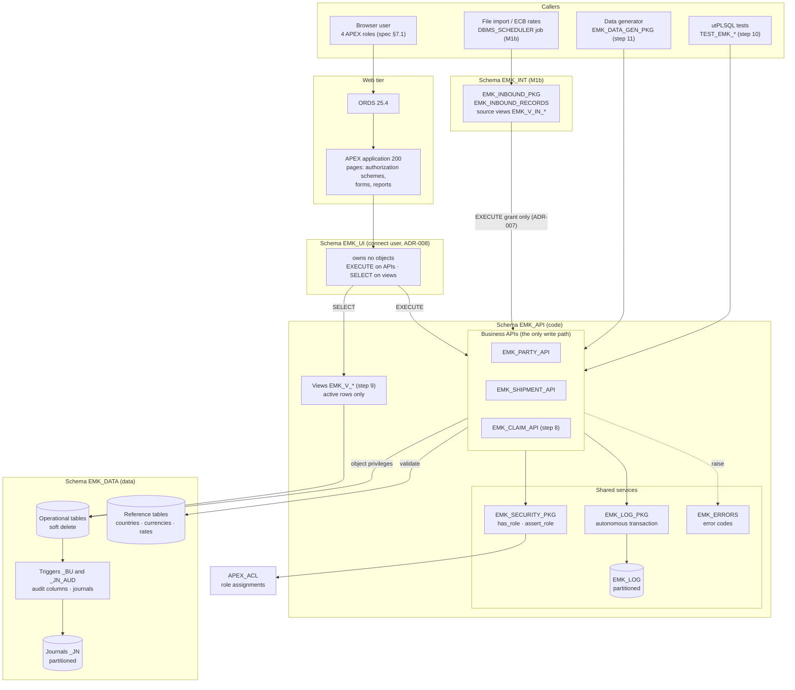
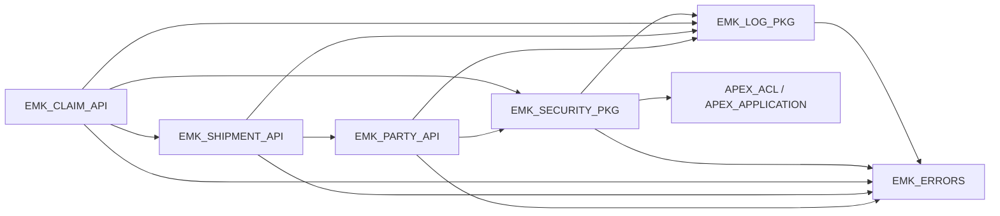
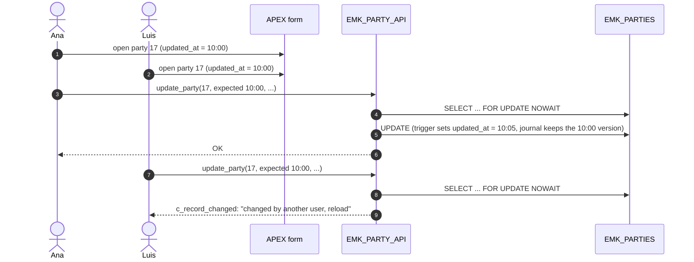
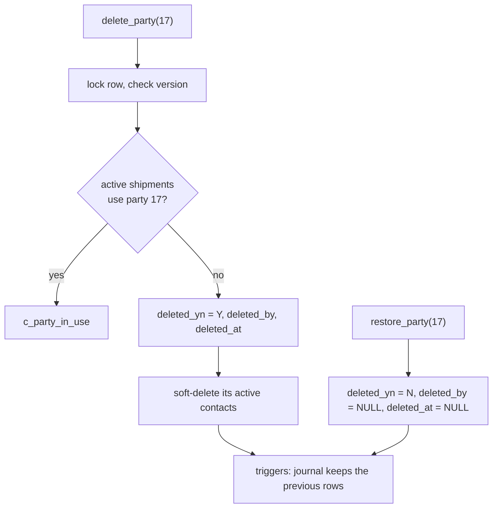

# PL/SQL API Design

| | |
|---|---|
| **Status** | Accepted v1.1 (2026-10-10): schemas `EMK_DATA`, `EMK_API`, `EMK_UI` (ADR-008) |
| **Schema** | `EMK_API` (APIs, services, views, log) · `EMK_DATA` (tables, journals, triggers) · `EMK_UI` (APEX parsing schema, no objects) · `EMK_INT` (integration, M1b) — [ADR-008](../adr/ADR-008-schema-separation.md) |
| **Milestone** | M1a (plan steps 1, 7, 8) |
| **Input** | [spec.md](../spec.md) §1, §2.7, §4, §7.1 · [Data model](README.md) · [ADR-007](../adr/ADR-007-integration-schema-and-account-hardening.md) · [ADR-008](../adr/ADR-008-schema-separation.md) |

How the application code is organised: which packages exist, who calls them, and how a business operation flows from the user to the tables. Business rules live in these packages, never in APEX pages (spec §1.1).

## 1. Architecture



| Layer | Responsibility | Never does |
|-------|----------------|------------|
| APEX pages | Show data (views), collect input, call an API, show errors (APEX error handling function, M1c) | Business rules, direct DML on tables |
| Business APIs | Validate, normalise, apply business rules (BR), lock, write, log refusals | `COMMIT` / `ROLLBACK` (the caller decides) |
| Shared services | Role checks, logging, error codes | Business rules |
| Triggers | Audit columns, journals, immutable document file | Business rules (spec §1.3) |
| Constraints | Rules within one row (formats, BR-03, BR-11, dates) | Rules across tables (those are in the APIs) |

## 2. Package Dependencies



- Dependencies point in one direction only (no cycles): an API may call a lower API (`EMK_SHIPMENT_API` checks party roles through `EMK_PARTY_API`), never the other way.
- `EMK_SECURITY_PKG` is used by `EMK_CLAIM_API` for BR-02. `EMK_PARTY_API` and `EMK_SHIPMENT_API` do not check roles in Release 1 (§5, decision 4).

## 3. `EMK_PARTY_API` and `EMK_SHIPMENT_API` (step 7)

| Package | Subprogram | Rules and errors |
|---------|------------|------------------|
| `EMK_PARTY_API` | `create_party (in_name, in_vat_number, in_country_code, in_street, in_postal_code, in_city, in_language_code, out_party_id)` | VAT normalised (upper case, no spaces); prefix = country's `eu_vat_prefix` (`XI` allowed for `GB`) → `c_vat_country_mismatch`; duplicate VAT → `c_duplicate_vat` (message says "restore" if the party is deleted, D-39) |
| | `update_party (in_party_id, in_expected_updated_at, …same fields…)` | Optimistic locking → `c_record_changed`; same checks as create; no update if nothing changed |
| | `delete_party (in_party_id, in_expected_updated_at)` | Rejected while active shipments use the party → `c_party_in_use`; active contacts are soft-deleted in the same transaction |
| | `restore_party (in_party_id)` | `deleted_yn` Y→N, `deleted_by`/`deleted_at` → NULL (D-39); contacts are restored one by one |
| | `add_role (in_party_id, in_role_code)` / `remove_role (in_party_id, in_role_code)` | BR-16: a role used by any shipment (also soft-deleted) cannot be removed → `c_party_role_in_use` |
| | `has_role (in_party_id, in_role_code) RETURN BOOLEAN` | Active party with the role; used by `EMK_SHIPMENT_API` |
| | `create_contact` / `update_contact` / `delete_contact` | Personal data (spec §3.3); optimistic locking on update and delete |
| `EMK_SHIPMENT_API` | `create_shipment (in_cmr_note_no, in_shipper_id, in_carrier_id, in_consignee_id, in_pickup_place, in_origin_country, in_delivery_place, in_destination_country, in_pickup_date, in_agreed_delivery_date, in_delivery_date, in_goods_description, in_packages, in_gross_weight_kg, in_carriage_charges, in_currency_code, out_shipment_id)` | Note number `UPPER(TRIM())`; dates `TRUNC`; **BR-16** each party active with its role → `c_party_role_missing`; **BR-17** one country is a CMR party on the pickup date → `c_cmr_not_applicable`; currency EUR or with an ECB rate, valid on the pickup date → `c_reference_not_valid`; **BR-03** duplicate → `c_duplicate_cmr_note` |
| | `update_shipment (in_shipment_id, in_expected_updated_at, …)` | Same checks; optimistic locking |
| | `delete_shipment (in_shipment_id, in_expected_updated_at)` / `restore_shipment (in_shipment_id)` | Rejected while active claims exist → `c_shipment_in_use`; restore re-checks BR-16 (a party may have lost its role) |

All parameters use `%TYPE` of their column; callers use named notation. Every public subprogram is documented in its package specification (spec §1.3 *Code documentation*).

## 4. Flows

### 4.1 Create a shipment (APEX page or import)

```mermaid
sequenceDiagram
    autonumber
    actor U as User / import job
    participant P as APEX page or EMK_INBOUND_PKG
    participant S as EMK_SHIPMENT_API
    participant PA as EMK_PARTY_API
    participant R as Reference tables
    participant T as EMK_SHIPMENTS + triggers
    participant L as EMK_LOG_PKG

    U->>P: enter / load a shipment
    P->>S: create_shipment(...)
    S->>S: normalise note number and dates
    S->>PA: has_role(shipper, SHIPPER), has_role(carrier, CARRIER), has_role(consignee, CONSIGNEE)
    alt a party is missing its role (BR-16)
        S->>L: log_warn
        S-->>P: c_party_role_missing
    end
    end
    S->>R: CMR party on pickup date? currency valid?
    alt not a CMR carriage (BR-17)
        S->>L: log_warn
        S-->>P: c_cmr_not_applicable
    end
    end
    S->>T: INSERT (constraints check BR-03, formats, dates)
    alt same note number for this carrier (BR-03)
        S-->>P: c_duplicate_cmr_note
    end
    end
    S-->>P: out_shipment_id
    P->>P: COMMIT (APEX page process) or one COMMIT per batch (import)
```

### 4.2 Update with optimistic locking ("lost update")



The version compared is `NVL(updated_at, created_at)`: the trigger `_BU` changes it on every update, so it works like the *row version column* of APEX lost update detection, without an extra column, and it protects every caller (APEX, import, scripts), not only APEX forms ([APEX: Configuring Lost Update Detection](https://docs.oracle.com/en/database/oracle/apex/24.2/htmdb/configuring-lost-update-detection.html)). `FOR UPDATE NOWAIT` never makes a web session wait: a row locked by another transaction raises `c_record_locked` ("try again").

### 4.3 Soft delete and restore of a party



## 5. Decisions (D-43, 2026-10-09)

| # | Decision | Alternative not taken |
|---|----------|-----------------------|
| 1 | One parameter per field, named notation | A `%ROWTYPE` record: callers would see columns they must not set (id, audit) |
| 2 | Optimistic locking with `in_expected_updated_at`; `FOR UPDATE NOWAIT` | Last writer wins: silent loss of another user's change |
| 3 | No delete of a party with active shipments or of a shipment with active claims; a party's contacts are soft-deleted with it | Deleting anything: visible shipments of hidden parties |
| 4 | `EMK_PARTY_API` and `EMK_SHIPMENT_API` do not check roles in Release 1; protected by APEX authorization, the `EMK_INT` grants (ADR-007) and the connect user `EMK_UI`, which has no privilege on any table (ADR-008); role check in the API for BR-02 only | A role check with an exception for trusted processes: more complex, and the exception becomes the weak point |

## 6. Best-Practice Review

Checked against the SmartDB properties (Oracle: [The SmartDB Manifesto](https://asktom.oracle.com/ords/r/tech/catalog/session-landing-page?p2_oh_id=3422); [Is your application SmartDB?](https://www.salvis.com/blog/2018/07/18/is-your-application-smartdb/)) and the project conventions.

| Practice | Status | Note |
|----------|--------|------|
| Business logic in PL/SQL APIs, one entry point per area | ✅ | All writes go through the APIs |
| SQL written by hand, set-based where possible | ✅ | No ORM; window functions for KPIs (D-21) |
| APIs do not commit; the caller controls the transaction | ✅ | Except the autonomous log and batch jobs |
| Integration calls the APIs only (EXECUTE grants) | ✅ | ADR-007 |
| Rules within a row as constraints, rules across tables in the APIs | ✅ | Constraints without ranges and with explicit `IS NOT NULL` (P-20, P-22) |
| Lost update protection and no waiting on locks | ✅ | §4.2 |
| Errors never swallowed; named exceptions | ✅ | `EMK_ERRORS`; log failures propagate (D-33) |
| **The connect user does not own the objects** | ✅ **Met by ADR-008** | Found in this review (APEX parsed as the owner `EMK_APP`); resolved by the separation into `EMK_DATA`, `EMK_API` and the connect user `EMK_UI`, which owns nothing and has `EXECUTE` on the APIs and `SELECT` on the views only |

## 7. Error Codes Added in Step 7

| Code | Constant | Meaning |
|------|----------|---------|
| -20004 | `c_record_changed` | The row was changed by another user since it was read |
| -20005 | `c_record_locked` | The row is locked by another transaction (`ORA-00054`) |
| -20103 | `c_vat_country_mismatch` | VAT prefix does not match the party's country |
| -20104 | `c_duplicate_vat` | VAT number already used (also by a soft-deleted party) |
| -20105 | `c_party_in_use` | Party has active shipments |
| -20202 | `c_shipment_in_use` | Shipment has active claims |
| -20203 | `c_cmr_not_applicable` | BR-17: no CMR party on the pickup date |
