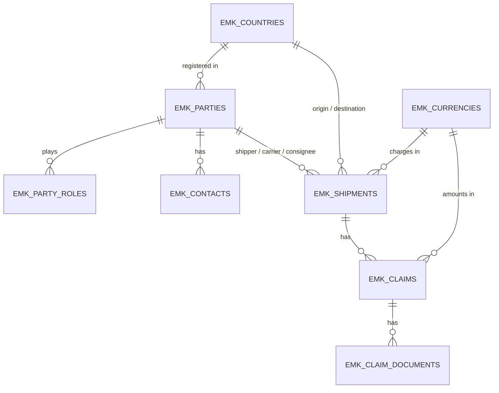

# Data Model — Operational Data

| | |
|---|---|
| **Status** | Accepted v1.5 (2026-10-09): explicit `IS NOT NULL` in `EMK_CLAIMS_APPARENT_CK` and `EMK_SHIPMENTS_CHARGES_CK` (Common Rules). v1.4: claims — BR-11 closed for missing amounts, business dates without time; documents immutable (trigger). v1.3: shipments normalised, BR-17 |
| **Date** | 2026-10-07 |
| **Schema** | `EMK_APP` |
| **Milestone** | M1a (plan steps 3–5, 7–9) |
| **Input** | [spec.md](../spec.md) v1.6 §1.3, §2.1, §2.7, §3, §4, §12.1 · [Standard audit block](README.md#standard-audit-block) · [Reference data](data-model-reference.md) |
| **Scope** | Claims management, not a transport management system: no tariffs (only the carriage charges of each shipment, BR-10), no employee table (users are APEX accounts, spec §7.1; data minimisation), one postal address per party (letters, M4) |

Operational tables hold the business records. Audit block: **created + updated + soft delete**; each has a journal `<TABLE>_JN` (designed in the audit area). All changes go through the business APIs (spec §1.3).

## 1. Overview

| Table | Rows per year (spec §12.1) | Partitioned | Notes |
|-------|----------------------------|-------------|-------|
| `EMK_PARTIES` | ≈ 1,000 new | No | Companies |
| `EMK_PARTY_ROLES` | ≈ 1,500 new | No | One or more roles per company |
| `EMK_CONTACTS` | ≈ 2,000 new | No | **Personal data** isolated here (spec §3.3) |
| `EMK_SHIPMENTS` | 200,000 | No | ≈ 1 M rows in 5 years: indexes suffice (spec §1.3 *Partitioning*) |
| `EMK_CLAIMS` | 10,000 | No | |
| `EMK_CLAIM_DOCUMENTS` | ≈ 30,000 (3 per claim) | No | BLOBs: see §6 on storage |

## 2. `EMK_PARTIES`

| Column | Type | Null | Default | Rule / reason |
|--------|------|------|---------|---------------|
| `party_id` | `NUMBER` | No | identity | **PK.** `GENERATED ALWAYS AS IDENTITY` |
| `name` | `VARCHAR2(200 CHAR)` | No | — | Legal company name |
| `vat_number` | `VARCHAR2(14 CHAR)` | Yes | — | **UK.** EU VAT number in VIES format: 2-letter prefix + 2–12 alphanumeric characters, stored upper case without spaces. `NULL` for parties without an EU VAT number (Oracle allows several `NULL`s in a unique key) |
| `country_code` | `CHAR(2 CHAR)` | No | — | FK `EMK_COUNTRIES`; country of registration |
| `street` | `VARCHAR2(200 CHAR)` | Yes | — | Postal address for letters (M4) |
| `postal_code` | `VARCHAR2(20 CHAR)` | Yes | — | Text: postal codes contain letters and spaces in several countries (e.g., GB, NL) |
| `city` | `VARCHAR2(100 CHAR)` | Yes | — | |
| `language_code` | `CHAR(2 CHAR)` | No | `'en'` | Language for letters to this party (ISO 639; `en` or `de` in Release 1) |
| *audit block* | — | — | — | `created_*`, `updated_*`, `deleted_*` |

| Constraint / index | Definition | Reason |
|--------------------|------------|--------|
| `EMK_PARTIES_PK` | `PRIMARY KEY (party_id)` | |
| `EMK_PARTIES_VAT_UK` | `UNIQUE (vat_number)` | One party per VAT number |
| `EMK_PARTIES_VAT_CK` | `vat_number IS NULL OR REGEXP_LIKE(vat_number, '^[ABCDEFGHIJKLMNOPQRSTUVWXYZ]{2}[0123456789ABCDEFGHIJKLMNOPQRSTUVWXYZ]{2,12}$', 'c')` | VIES: 2-letter prefix + a block of 2–12 digits or letters. Member-state formats differ; special characters in some national formats are not verified — widen the check if a valid number is rejected |
| `EMK_PARTIES_LANG_CK` | `language_code IN ('en','de')` | Languages of Release 1 |
| `EMK_PARTIES_COUNTRIES_FK` + index `EMK_PARTIES_COUNTRY_IX` | FK to `EMK_COUNTRIES` | FK index rule |
| Business rule (API) | The VAT prefix matches the country's `eu_vat_prefix` (`XI` allowed for `GB`) | Cross-table rule: not expressible as a check constraint |

## 2a. `EMK_PARTY_ROLES`

A company can play **several roles** (a forwarder that also carries with its own trucks; a shipper of one shipment that is the consignee of another), so a single "party type" column would be wrong. This is the standard *party–role* pattern: a new role is a new row, not a table change.

| Column | Type | Null | Rule / reason |
|--------|------|------|---------------|
| `party_id` | `NUMBER` | No | **PK (1).** FK `EMK_PARTIES` |
| `role_code` | `VARCHAR2(20 CHAR)` | No | **PK (2).** Role (below) |
| *audit block* | — | — | `created_*` only: a role assignment is inserted or removed, never updated; removals are recorded in the journal |

| Role code | Meaning | CMR | UN/EDIFACT 3035 | Used in Release 1 |
|-----------|---------|-----|-----------------|-------------------|
| `SHIPPER` | Sender / consignor of the goods | Art. 5–7 | `CZ` | Shipments (required) |
| `CONSIGNEE` | Receiver of the goods | Art. 13, 30 | `CN` | Shipments (required) |
| `CARRIER` | Carrier liable for loss, damage, delay | Art. 17 | `CA` | Shipments and claims (required) |
| `FORWARDER` | Freight forwarder that arranges the carriage | — | `FW` | Optional |
| `INSURER` | Insurer of the goods or of the carrier's liability | — | (not verified) | Available, not used yet |
| `SURVEYOR` | Expert who inspects the damage (joint check, Art. 30(2)) | Art. 30 | (not verified) | Available, not used yet |

| Constraint / index | Definition | Reason |
|--------------------|------------|--------|
| `EMK_PARTY_ROLES_PK` | `PRIMARY KEY (party_id, role_code)` | One row per company and role; also indexes the foreign key |
| `EMK_PARTY_ROLES_PARTIES_FK` | FK to `EMK_PARTIES` | |
| `EMK_PARTY_ROLES_ROLE_CK` | `role_code IN ('SHIPPER','CONSIGNEE','CARRIER','FORWARDER','INSURER','SURVEYOR')` | Values are program logic (like statuses); shown through a static APEX list translated by XLIFF |
| `EMK_PARTY_ROLES_ROLE_IX` | `(role_code, party_id)` | APEX lists of values such as "carriers" read by role |
| **BR-16** (API) | The shipper, carrier and consignee of a shipment have the role `SHIPPER`, `CARRIER` and `CONSIGNEE`; a role still used by a shipment cannot be removed | Cross-table rule. A declarative alternative (foreign key on a virtual column) was not verified for this case and is not used |

## 3. `EMK_CONTACTS` (personal data)

| Column | Type | Null | Rule / reason |
|--------|------|------|---------------|
| `contact_id` | `NUMBER` | No | **PK**, identity |
| `party_id` | `NUMBER` | No | FK `EMK_PARTIES` |
| `full_name` | `VARCHAR2(200 CHAR)` | No | Personal data |
| `email` | `VARCHAR2(254 CHAR)` | Yes | Personal data. 254 = practical maximum of an e-mail address (RFC 5321 path limit, RFC 3696 erratum 1690) |
| `phone` | `VARCHAR2(16 CHAR)` | Yes | Personal data. ITU-T E.164: `+` and at most 15 digits, no spaces |
| *audit block* | — | — | `created_*`, `updated_*`, `deleted_*` |

| Constraint / index | Definition |
|--------------------|------------|
| `EMK_CONTACTS_PK` | `PRIMARY KEY (contact_id)` |
| `EMK_CONTACTS_PARTIES_FK` + `EMK_CONTACTS_PARTY_IX` | FK to `EMK_PARTIES` + index |
| `EMK_CONTACTS_EMAIL_CK` | `email IS NULL OR REGEXP_LIKE(email, '^[^@[:space:]]+@[^@[:space:]]+\.[^@[:space:]]+$')` — basic syntax only; full RFC 5322 validation is not practical in a check |
| `EMK_CONTACTS_PHONE_CK` | `phone IS NULL OR REGEXP_LIKE(phone, '^\+[123456789][0123456789]{1,14}$', 'c')` |

**Why isolated:** erasure and pseudonymisation (FR-41, X4) touch one table and its journal only.

## 4. `EMK_SHIPMENTS`

| Column | Type | Null | Rule / reason |
|--------|------|------|---------------|
| `shipment_id` | `NUMBER` | No | **PK**, identity |
| `cmr_note_no` | `VARCHAR2(50 CHAR)` | No | CMR consignment note number; no international format (free text, trimmed, upper case); unique **per carrier** (BR-03, spec v1.5) |
| `shipper_id`, `carrier_id`, `consignee_id` | `NUMBER` | No | FK `EMK_PARTIES`; each party must have the matching role (BR-16) |
| `pickup_place` | `VARCHAR2(100 CHAR)` | No | Place of taking over the goods (postal code and town), a mandatory particular of the consignment note (CMR Art. 6(1)(d)); relevant for jurisdiction (Art. 31) |
| `origin_country` | `CHAR(2 CHAR)` | No | FK `EMK_COUNTRIES`; country of `pickup_place` |
| `delivery_place` | `VARCHAR2(100 CHAR)` | No | Place designated for delivery (Art. 6(1)(d)); its public holidays drive the reservation deadline (spec §5.1) |
| `destination_country` | `CHAR(2 CHAR)` | No | FK `EMK_COUNTRIES`; country of `delivery_place` |
| `pickup_date` | `DATE` | No | Taking over of the goods |
| `agreed_delivery_date` | `DATE` | Yes | Agreed time-limit (delay, total loss; CMR Art. 19, 20) |
| `delivery_date` | `DATE` | Yes | Delivery (starts reservation and limitation periods) |
| `goods_description` | `VARCHAR2(500 CHAR)` | No | |
| `packages` | `NUMBER(7)` | Yes | Number of packages |
| `gross_weight_kg` | `NUMBER(12,3)` | No | kg (SI), gram precision; basis of the liability cap (CMR Art. 23) |
| `carriage_charges` | `NUMBER(14,2)` | Yes | Delay compensation limit (BR-10, Art. 23(5)) |
| `currency_code` | `CHAR(3 CHAR)` | Yes | FK `EMK_CURRENCIES`; currency of `carriage_charges` |
| *audit block* | — | — | `created_*`, `updated_*`, `deleted_*` |

| Constraint / index | Definition | Reason |
|--------------------|------------|--------|
| `EMK_SHIPMENTS_PK` | `PRIMARY KEY (shipment_id)` | |
| `EMK_SHIPMENTS_CMR_NOTE_UK` | `UNIQUE (carrier_id, cmr_note_no)` | BR-03: never reused by the same carrier, including soft-deleted rows (the key ignores `deleted_yn`). Its leading column also indexes the carrier foreign key, so `…_CARRIER_IX` is not needed |
| `EMK_SHIPMENTS_CMR_NOTE_CK` | `cmr_note_no = UPPER(TRIM(cmr_note_no))` | BR-03 relies on one spelling per number (`abc123 ` and `ABC123` would otherwise be two keys); inner spaces and hyphens are kept as printed by the carrier |
| `EMK_SHIPMENTS_COUNTRIES_CK` | `origin_country <> destination_country` | Cross-border carriage only (CMR Art. 1); the second condition of Art. 1 (one country is a CMR party on the pickup date) is **BR-17**, checked in the API because it reads `EMK_COUNTRIES` |
| `EMK_SHIPMENTS_DAY_CK` | `pickup_date = TRUNC(pickup_date) AND (delivery_date IS NULL OR delivery_date = TRUNC(delivery_date)) AND (agreed_delivery_date IS NULL OR agreed_delivery_date = TRUNC(agreed_delivery_date))` | Business dates have no time part (spec §1.3): deadlines are counted in calendar days |
| `EMK_SHIPMENTS_DATES_CK` | `(delivery_date IS NULL OR delivery_date >= pickup_date) AND (agreed_delivery_date IS NULL OR agreed_delivery_date >= pickup_date)` | |
| `EMK_SHIPMENTS_WEIGHT_CK` | `gross_weight_kg > 0` | |
| `EMK_SHIPMENTS_PACKAGES_CK` | `packages IS NULL OR packages > 0` | |
| `EMK_SHIPMENTS_CHARGES_CK` | `(carriage_charges IS NULL AND currency_code IS NULL) OR (carriage_charges IS NOT NULL AND carriage_charges >= 0 AND currency_code IS NOT NULL)` | An amount always has its currency, and a currency only comes with an amount |
| FK + index per foreign key | `…_SHIPPER_IX`, `…_CONSIGNEE_IX`, `…_ORIGIN_IX`, `…_DEST_IX`, `…_CURRENCY_IX` (carrier: covered by `…_CMR_NOTE_UK`) | FK index rule; carrier and countries are also dashboard filters |

## 5. `EMK_CLAIMS`

| Column | Type | Null | Default | Rule / reason |
|--------|------|------|---------|---------------|
| `claim_id` | `NUMBER` | No | identity | **PK** |
| `claim_no` | `VARCHAR2(15 CHAR)` | No | — | **UK.** `CLM-YYYY-NNNNNN` from `EMK_CLAIM_NO_SEQ` (M1 plan open point 2) |
| `shipment_id` | `NUMBER` | No | — | FK `EMK_SHIPMENTS` (BR-04: exactly one shipment) |
| `claim_type` | `VARCHAR2(20 CHAR)` | No | — | `TOTAL_LOSS`, `PARTIAL_LOSS`, `DAMAGE`, `DELAY` (total and partial loss have different limitation rules, spec §5) |
| `damage_apparent_yn` | `CHAR(1 CHAR)` | Yes | — | Apparent or not (CMR Art. 30(1)); only for `PARTIAL_LOSS` and `DAMAGE` |
| `status` | `VARCHAR2(20 CHAR)` | No | `'DRAFT'` | State machine (spec §4); transitions only through `EMK_CLAIM_API` (BR-01) |
| `handler` | `VARCHAR2(255 CHAR)` | Yes | — | APEX user responsible for the claim |
| `registration_date` | `DATE` | No | `TRUNC(SYSDATE)` | Business date of registration; date of the EUR rate (BR-12); differs from `created_at` for imported or late-entered claims |
| `joint_check_date`, `reservation_date`, `written_claim_date`, `carrier_rejection_date` | `DATE` | Yes | — | CMR events (Art. 30, 32; spec §5) |
| `weight_short_kg` | `NUMBER(12,3)` | Yes | — | Weight lost or damaged (liability cap, M4) |
| `claimed_amount`, `settled_amount`, `recovered_amount` | `NUMBER(14,2)` | Yes | — | BR-11; required by the API from `SUBMITTED` on |
| `currency_code` | `CHAR(3 CHAR)` | Yes | — | FK `EMK_CURRENCIES`; EUR or a currency with an ECB rate valid on `registration_date` (API, BR-12) |
| `description` | `VARCHAR2(1000 CHAR)` | Yes | — | Short description. ≤ 1000 characters stays within 4000 bytes in UTF-8 (`MAX_STRING_SIZE = STANDARD`, verified) |
| *audit block* | — | — | — | `created_*`, `updated_*`, `deleted_*` |

| Constraint / index | Definition | Reason |
|--------------------|------------|--------|
| `EMK_CLAIMS_PK`, `EMK_CLAIMS_CLAIM_NO_UK` | PK; `UNIQUE (claim_no)` | |
| `EMK_CLAIMS_CLAIM_NO_CK` | `REGEXP_LIKE(claim_no, '^CLM-[0123456789]{4}-[0123456789]{6}$', 'c')` | |
| `EMK_CLAIMS_TYPE_CK` | `claim_type IN ('TOTAL_LOSS','PARTIAL_LOSS','DAMAGE','DELAY')` | |
| `EMK_CLAIMS_APPARENT_CK` | `(claim_type IN ('PARTIAL_LOSS','DAMAGE') AND damage_apparent_yn IS NOT NULL AND damage_apparent_yn IN ('Y','N')) OR (claim_type IN ('TOTAL_LOSS','DELAY') AND damage_apparent_yn IS NULL)` | The flag exists exactly where the CMR distinguishes it |
| `EMK_CLAIMS_STATUS_CK` | `status IN ('DRAFT','SUBMITTED','UNDER_REVIEW','NEGOTIATION','RESOLVED','REJECTED','ESCALATED')` | Valid values; the transitions are checked by the API |
| `EMK_CLAIMS_AMOUNTS_CK` | `(claimed_amount IS NULL OR claimed_amount >= 0) AND (settled_amount IS NULL OR (claimed_amount IS NOT NULL AND settled_amount BETWEEN 0 AND claimed_amount)) AND (recovered_amount IS NULL OR (settled_amount IS NOT NULL AND recovered_amount BETWEEN 0 AND settled_amount))` | BR-11 in the database. A check is satisfied when its condition is TRUE **or unknown**, and a comparison with `NULL` is unknown: without `IS NOT NULL` a settled amount without a claimed amount would pass (found 2026-10-09). The order is claimed → settled → recovered |
| `EMK_CLAIMS_DAY_CK` | `registration_date`, `joint_check_date`, `reservation_date`, `written_claim_date`, `carrier_rejection_date` each `IS NULL OR col = TRUNC(col)` | Business dates without time (spec §1.3 *Normalised values*) |
| `EMK_CLAIMS_CURRENCY_CK` | `currency_code IS NOT NULL OR (claimed_amount IS NULL AND settled_amount IS NULL AND recovered_amount IS NULL)` | Amounts always have a currency |
| `EMK_CLAIMS_REJECTION_CK` | `carrier_rejection_date IS NULL OR (written_claim_date IS NOT NULL AND carrier_rejection_date >= written_claim_date)` | A rejection answers a written claim (Art. 32(2)) |
| `EMK_CLAIMS_WEIGHT_CK` | `weight_short_kg IS NULL OR weight_short_kg > 0` | Comparison with the shipment weight is a cross-table rule (API) |
| FK indexes | `…_SHIPMENT_IX`, `…_CURRENCY_IX` | FK index rule |
| `EMK_CLAIMS_HANDLER_STATUS_IX` | `(handler, status)` | Home page: open claims of the user (spec §2.6) |

**Status and type as check constraints, not lookup tables:** the values are part of the program logic (state machine, deadline rules), not data a user maintains. The UI shows them through static APEX lists of values, which the APEX translation (XLIFF) translates to German.

## 6. `EMK_CLAIM_DOCUMENTS`

| Column | Type | Null | Rule / reason |
|--------|------|------|---------------|
| `document_id` | `NUMBER` | No | **PK**, identity |
| `claim_id` | `NUMBER` | No | FK `EMK_CLAIMS` |
| `doc_type` | `VARCHAR2(30 CHAR)` | No | `CMR_NOTE`, `DAMAGE_REPORT`, `PHOTO`, `INVOICE`, `CORRESPONDENCE`, `OTHER` |
| `file_name` | `VARCHAR2(255 CHAR)` | No | Original file name |
| `mime_type` | `VARCHAR2(100 CHAR)` | No | `application/pdf`, `image/jpeg`, `image/png` (M1 plan open point 7) |
| `file_size` | `NUMBER(10)` | No | Bytes; 1 to 10,485,760 (10 MB) |
| `content` | `BLOB` | No | The file |
| `extracted_text` | `CLOB` | Yes | Text for search and AI features (M3, X1) |
| *audit block* | — | — | `created_*`, `updated_*`, `deleted_*` |

| Constraint / index | Definition |
|--------------------|------------|
| `EMK_CLAIM_DOCUMENTS_PK`, FK + `…_CLAIM_IX` | PK; FK to `EMK_CLAIMS` + index |
| `…_TYPE_CK`, `…_MIME_CK` | Allowed values above |
| `…_SIZE_CK` | `file_size BETWEEN 1 AND 10485760` (the API also checks `DBMS_LOB.GETLENGTH(content) = file_size`) |
| Trigger `EMK_CLAIM_DOCUMENTS_BU` | Besides the audit columns, rejects any change of `content`, `file_name`, `mime_type` or `file_size` with `EMK_ERRORS.c_document_immutable` (-20303). The journal does not copy the file, so an update would lose the original without any copy; documents are evidence (CMR Art. 30). To replace a file: new document row + soft delete of the old one. `doc_type`, `extracted_text` (M3) and the soft-delete columns may change |

**LOB storage:** SecureFiles (the default since Oracle 12c). Advanced LOB Compression and Deduplication are included in the Free edition, but are **not** used: PDF, JPEG and PNG are already compressed, and duplicate documents are rare. Storage clauses would also be removed by the SQLcl export (`segmentAttributes: false`; verified in the step 5 export: the table has no LOB storage clause).

**Volume vs. the Free edition:** at the design volume (≈ 30,000 documents per year) documents of ~1 MB would need ~30 GB per year, above the 12 GB of user data in the Free edition. Release 1 uses small synthetic documents; production would store documents in object storage (spec §12.2).

## 7. Sequence and Views

| Object | Definition |
|--------|------------|
| `EMK_CLAIM_NO_SEQ` | Global sequence for `claim_no` (default cache; gaps allowed) |
| `EMK_V_PARTIES`, `EMK_V_CONTACTS`, `EMK_V_SHIPMENTS`, `EMK_V_CLAIMS`, `EMK_V_CLAIM_DOCUMENTS` | Active rows only (`deleted_yn = 'N'`); used by APEX and reports (BR-13) |

## 8. Open Points

| # | Point | Options | Decision (2026-10-07) |
|---|-------|---------|----------|
| 1 | **Uniqueness of the CMR note number** (BR-03) | A. Global `UNIQUE (cmr_note_no)`. B. `UNIQUE (carrier_id, cmr_note_no)` | The CMR does not define a numbering scheme (Art. 5–6); notes are numbered by whoever issues them, so two carriers can use the same number. **Decided: B** — avoids rejecting a valid shipment; BR-03 reads "unique per carrier" (spec v1.5) |
| 2 | Party address and letter language | Add `street`, `postal_code`, `city`, `language_code` now, or in M4 | **Decided: now** — letters (M4) need them; adding columns to a filled table later is more work. Company addresses are not personal data |
| 3 | Registration date for BR-12 | Use `created_at`, or a business date `registration_date` | **Decided: `registration_date`** — imported or late-entered claims have a registration date different from the technical insert time |
| 4 | Claim types | Spec §3.1: `LOSS`, `DAMAGE`, `DELAY` | **Decided: `TOTAL_LOSS`, `PARTIAL_LOSS`, `DAMAGE`, `DELAY`** (spec v1.5) — the deadline rules distinguish total and partial loss (`LIM_TOTAL`, `LIM_PARTIAL`, spec §5) |
| 5 | International carriage only | Check `origin_country <> destination_country` | **Decided: yes** — the project covers cross-border CMR claims (Art. 1) |
| 6 | Long texts | `MAX_STRING_SIZE` is `STANDARD` by default (4000 bytes per `VARCHAR2`) | Text columns ≤ 1000 characters (safe in UTF-8); longer texts as `CLOB`. **Decided;** `MAX_STRING_SIZE = STANDARD` verified on 2026-10-07 |
| 7 | LOB options | Compression / deduplication (included in Free) | **Decided: not used** (§6) |
| 8 | Kinds of party | A. No roles. B. One `party_type` per party. C. Role flags. D. Role table | **Decided: D** (§2a) — a party can play several roles; a new role is a row, not a table change. Six roles; BR-16 (spec v1.6) |
| 9 | Places of taking over and delivery | Countries only, or places too | **Decided: `pickup_place`, `delivery_place`** (text) — mandatory particulars of the consignment note (Art. 6(1)(d)); a UN/LOCODE location table is the growth path, too large for the MVP (~100,000 codes) |
| 10 | Tariffs, employees, addresses | Separate tables or not | **Decided: none** — outside the claims scope (intent §5: no TMS); users are APEX accounts; one address per party is enough for letters |

## 9. Revision History

| Version | Date | Change |
|---------|------|--------|
| v0.1 | 2026-10-07 | First draft. |
| v1.0 | 2026-10-07 | Open points 1–7 decided. Accepted by the owner. |
| v1.1 | 2026-10-07 | Party roles (`EMK_PARTY_ROLES`, BR-16); places of taking over and delivery; scope note (no tariffs, employees or address table). Accepted by the owner. |

## 10. Sources

- CMR Convention — [UNECE text](https://unece.org/DAM/trans/conventn/cmr_e.pdf) (Art. 1, 5–6, 19, 20, 23, 30, 32)
- European Commission — [VAT identification numbers](https://taxation-customs.ec.europa.eu/taxation/vat/vat-directive/vat-identification-numbers_en) · [VIES](https://ec.europa.eu/taxation_customs/vies/) · [Use of GB and XI codes](https://taxation-customs.ec.europa.eu/system/files/2020-11/use_of_gb_and_xi_codes_guidance.pdf)
- IETF — [RFC 5321 (SMTP, length limits)](https://datatracker.ietf.org/doc/html/rfc5321) · [RFC 5322](https://www.rfc-editor.org/rfc/rfc5322)
- ITU — [E.164](https://www.itu.int/rec/T-REC-E.164)
- UNECE — [UN/EDIFACT code list 3035 — Party function code qualifier](https://service.unece.org/trade/uncefact/vocabulary/uncl3035/) (`CZ`, `CN`, `CA`, `FW`)
- Oracle — [SecureFiles and Large Objects Developer's Guide 26ai](https://docs.oracle.com/en/database/oracle/oracle-database/26/adlob/securefiles-and-large-objects-developers-guide.pdf) · [Licensing Information 26 (Advanced Compression included in Free)](https://docs.oracle.com/en/database/oracle/oracle-database/26/dblic/Licensing-Information.html)
