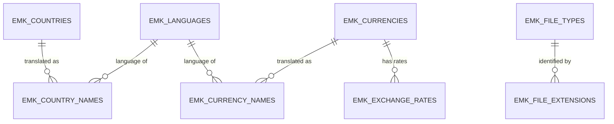

# Data Model — Reference Data

| | |
|---|---|
| **Status** | Accepted v1.6 (2026-10-22): role `SENDER` instead of `SHIPPER` (D-83). v1.5 (2026-10-21): master data maintenance per list (§6: who adds a value, what the administrator may change, never deleted or re-coded, protected codes; D-82). v1.4 (2026-10-21): code lists (§6, D-68) — business value lists as reference tables with validity instead of check constraints; file type allowlist (BR-18). v1.3 (2026-10-13): schema `EMK_DATA` (ADR-008). v1.2 (2026-10-09): `EMK_EXCHANGE_RATES_DAY_CK`. v1.1 (2026-10-08): name sources (EU display name + ISO name), `cmr_party_since` rule, RUB excluded; REGEXP patterns without ranges (P-20) |
| **Date** | 2026-10-07 |
| **Schema** | `EMK_DATA` ([ADR-008](../adr/ADR-008-schema-separation.md)); read by `EMK_API` through `SELECT` grants |
| **Milestone** | M1a (plan steps 2, 6 and 7.6) |
| **Input** | [spec.md](../spec.md) v1.4 §1.3, §3 · [M1 plan](../plans/M1-plan.md) v1.2 open points 4–8 · [Standard audit block](README.md#standard-audit-block) |

Reference tables hold standard code lists (keyed by ISO codes) and the business code lists of the application (§6, keyed by their code). Keys are never updated. **Data scripts never overwrite production data** (D-72): reference data is loaded by insert-only `MERGE` scripts (missing rows only), added to a release once; a change to existing rows is a separate change script, run once, that cites the authorized change request (ITIL change enablement; Liquibase: roll forward, `runOnChange` not for data). Audit block: **created + updated** (no soft delete: a reference row is closed with `valid_to`, never deleted).

## 1. Overview

The other code lists (`EMK_LANGUAGES` for parties, `EMK_PARTY_ROLE_TYPES`, `EMK_CLAIM_STATUSES`, `EMK_CLAIM_TYPES`, `EMK_DOCUMENT_TYPES`, `EMK_FILE_TYPES` for documents) are referenced by operational tables ([data-model-operational.md](data-model-operational.md)).

| Table | Rows (expected) | Growth | Partitioned | Journal |
|-------|-----------------|--------|-------------|---------|
| `EMK_COUNTRIES` | 60 | Static | No | No |
| `EMK_COUNTRY_NAMES` | 60 per extra language | Static | No | No |
| `EMK_CURRENCIES` | ≈ 33 | Static | No | No |
| `EMK_CURRENCY_NAMES` | ≈ 33 per extra language | Static | No | No |
| `EMK_EXCHANGE_RATES` | ≈ 45,000 (from 2020) | ≈ 7,700 per year | No | No |
| Code lists (§6) | 2 to 7 each | Static | No | No |

**Journals:** standard lists (countries, currencies, rates) change only through change scripts, whose history is Git. The code lists the administrator maintains in the application have a journal `<TABLE>_JN` (§6). **Why no partitioning:** small tables, no purge needed.

## 2. `EMK_COUNTRIES`

Countries in scope: the 58 CMR contracting parties plus Iceland and Liechtenstein (EEA, not CMR parties) — 60 rows. Territories to which a party extended the CMR (Gibraltar, Isle of Man) are out of scope.

| Column | Type | Null | Default | Rule / reason |
|--------|------|------|---------|---------------|
| `country_code` | `CHAR(2 CHAR)` | No | — | **PK.** ISO 3166-1 alpha-2 |
| `name` | `VARCHAR2(100 CHAR)` | No | — | **Display name** in English: short name of the EU Publications Office authority table *Countries and territories* (used by the EU Interinstitutional Style Guide), e.g. `United Kingdom`, `Moldova`; other languages in `EMK_COUNTRY_NAMES` from the same table |
| `iso_name` | `VARCHAR2(100 CHAR)` | No | — | English short name of ISO 3166-1, e.g. `United Kingdom of Great Britain and Northern Ireland`; traceability to the standard (longest in scope ≈ 52 characters) |
| `eu_vat_prefix` | `CHAR(2 CHAR)` | Yes | — | EU VAT (VIES) prefix; differs from ISO for Greece (`EL`); `NULL` outside the EU |
| `eu_member_yn` | `CHAR(1 CHAR)` | No | `'N'` | EU member |
| `eea_member_yn` | `CHAR(1 CHAR)` | No | `'N'` | EEA member (EU + IS, LI, NO); explains why IS and LI are in scope; GDPR territory |
| `cmr_party_since` | `DATE` | Yes | — | Date from which the CMR applies to the country; `NULL` = not a party. The CMR applies to a carriage if loading **or** delivery is in a country that is a party on that date (CMR Art. 1). Calculated from the UN Treaty Collection (rule below) |
| `valid_from` | `DATE` | No | `DATE '1900-01-01'` | Validity period (spec §1.3) |
| `valid_to` | `DATE` | Yes | — | `NULL` = still valid |
| *audit block* | — | — | — | `created_*`, `updated_*` |

| Constraint | Definition |
|------------|------------|
| `EMK_COUNTRIES_PK` | `PRIMARY KEY (country_code)` |
| `EMK_COUNTRIES_CODE_CK` | `REGEXP_LIKE(country_code, '^[ABCDEFGHIJKLMNOPQRSTUVWXYZ]{2}$', 'c')` |
| `EMK_COUNTRIES_VAT_CK` | `eu_vat_prefix IS NULL OR REGEXP_LIKE(eu_vat_prefix, '^[ABCDEFGHIJKLMNOPQRSTUVWXYZ]{2}$', 'c')` |
| `EMK_COUNTRIES_EU_VAT_CK` | `(eu_member_yn = 'Y' AND eu_vat_prefix IS NOT NULL) OR (eu_member_yn = 'N' AND eu_vat_prefix IS NULL)` — every EU member has a VAT prefix, nobody else |
| `EMK_COUNTRIES_EEA_CK` | `eu_member_yn = 'N' OR eea_member_yn = 'Y'` — an EU member is always in the EEA |
| `EMK_COUNTRIES_EU_YN_CK`, `EMK_COUNTRIES_EEA_YN_CK` | Each flag `IN ('Y','N')` |
| `EMK_COUNTRIES_VALID_CK` | `valid_to IS NULL OR valid_to >= valid_from` |

**Rule for `cmr_party_since`** (CMR Art. 43, decided 2026-10-08): the UN publishes the date of **deposit** of each instrument, not the date of entry into force.

| Case | Date stored |
|------|-------------|
| Ratification or accession (a) | Deposit + 90 days (Art. 43(2)), e.g. Germany 1961-11-07 → 1962-02-05 |
| The first five instruments (France, the former Yugoslavia, Austria, the Netherlands, Italy) | 1961-07-02, entry into force of the Convention (Art. 43(1)) |
| Succession (d) (successor states of Yugoslavia and Czechoslovakia) | Date of the notification of succession: conservative (it never applies the CMR too early); all are before the data range (2020) |

## 3. `EMK_CURRENCIES`

EUR plus the 29 currencies with an ECB reference rate (table of 2026-10-07), plus historic currencies still referenced (HRK until 2022-12-31, BGN until 2025-12-31) — 32 rows. **RUB is excluded:** the ECB suspended its rate on 2022-03-01, so a RUB amount could not be converted to EUR (BR-12); such amounts are recorded in EUR or USD.

| Column | Type | Null | Default | Rule / reason |
|--------|------|------|---------|---------------|
| `currency_code` | `CHAR(3 CHAR)` | No | — | **PK.** ISO 4217 alphabetic code |
| `name` | `VARCHAR2(100 CHAR)` | No | — | **Display name** in English from the EU authority table *Currencies*, e.g. `Zloty`, `US dollar`; other languages in `EMK_CURRENCY_NAMES` from the same table |
| `iso_name` | `VARCHAR2(100 CHAR)` | No | — | ISO 4217 currency name (SIX lists), e.g. `Zloty`, `Yen`; traceability to the standard |
| `minor_units` | `NUMBER(1)` | No | — | ISO 4217 decimals (EUR 2, JPY 0, max 4); used to round converted amounts |
| `ecb_rate_yn` | `CHAR(1 CHAR)` | No | `'N'` | `Y` = the ECB publishes a reference rate. Amounts may use EUR or a currency with `ecb_rate_yn = 'Y'` that is valid on the business date (BR-12; checked in the APIs, because a date rule cannot be a foreign key) |
| `valid_from` | `DATE` | No | `DATE '1900-01-01'` | Validity period |
| `valid_to` | `DATE` | Yes | — | `NULL` = still valid; HRK `2022-12-31`, BGN `2025-12-31` |
| *audit block* | — | — | — | `created_*`, `updated_*` |

| Constraint | Definition |
|------------|------------|
| `EMK_CURRENCIES_PK` | `PRIMARY KEY (currency_code)` |
| `EMK_CURRENCIES_CODE_CK` | `REGEXP_LIKE(currency_code, '^[ABCDEFGHIJKLMNOPQRSTUVWXYZ]{3}$', 'c')` |
| `EMK_CURRENCIES_MINOR_CK` | `minor_units BETWEEN 0 AND 4` |
| `EMK_CURRENCIES_ECB_EUR_CK` | `currency_code <> 'EUR' OR ecb_rate_yn = 'N'` — EUR is the base, it has no rate |
| `EMK_CURRENCIES_ECB_YN_CK` | `ecb_rate_yn IN ('Y','N')` |
| `EMK_CURRENCIES_VALID_CK` | `valid_to IS NULL OR valid_to >= valid_from` |

## 4. `EMK_COUNTRY_NAMES` and `EMK_CURRENCY_NAMES`

Names in languages other than English, for the German UI (F-15) and German letters (M4). English stays in the base table and is the fallback when a translation is missing.

**Why translation tables** (decided 2026-10-07): country and currency names are data, not application texts, so APEX text translation (XLIFF) does not cover them. APEX Dynamic Translations (`APEX_LANG.LANG`) only work inside an APEX session, and letters are generated in PL/SQL. Columns per language (`name_de`) would need `ALTER TABLE` for each new language. One table per entity keeps the foreign key, which a single generic translation table (`type, code, language, text`) cannot.

| Column | Type | Null | Rule / reason |
|--------|------|------|---------------|
| `country_code` / `currency_code` | `CHAR(2 CHAR)` / `CHAR(3 CHAR)` | No | **PK (1).** FK to the base table |
| `language_code` | `CHAR(2 CHAR)` | No | **PK (2).** ISO 639 alpha-2, lower case; FK `EMK_LANGUAGES` (§6) |
| `name` | `VARCHAR2(100 CHAR)` | No | Translated name |
| *audit block* | — | — | `created_*`, `updated_*` |

| Constraint | Definition |
|------------|------------|
| `EMK_COUNTRY_NAMES_PK` / `EMK_CURRENCY_NAMES_PK` | `PRIMARY KEY (<code>, language_code)` — also serves the foreign key |
| `EMK_COUNTRY_NAMES_COUNTRIES_FK` / `EMK_CURRENCY_NAMES_CURRENCIES_FK` | `FOREIGN KEY (<code>) REFERENCES` the base table |
| `…_LANG_CK` | `REGEXP_LIKE(language_code, '^[abcdefghijklmnopqrstuvwxyz]{2}$', 'c') AND language_code <> 'en'` — English lives in the base table |
| `…_LANGUAGES_FK` | `FOREIGN KEY (language_code) REFERENCES emk_languages` — only languages of the list (D-68); no index (keys of a code list never change, D-72) |

**Lookup:** `COALESCE(translated name for the session language, base name)`. In M1 only `de` rows are loaded.

## 5. `EMK_EXCHANGE_RATES`

Daily ECB reference rates: **units of the currency per 1 EUR**. Loaded in M1b through `EMK_INT`.

| Column | Type | Null | Default | Rule / reason |
|--------|------|------|---------|---------------|
| `currency_code` | `CHAR(3 CHAR)` | No | — | **PK (1).** FK to `EMK_CURRENCIES` |
| `rate_date` | `DATE` | No | — | **PK (2).** Business date of the rate (no time) |
| `units_per_eur` | `NUMBER(18,6)` | No | — | The ECB publishes 4 decimals; 6 decimals also hold the fixed euro conversion rates (1.95583, 7.53450) if ever needed |
| `source` | `VARCHAR2(10 CHAR)` | No | `'ECB'` | Origin of the rate; only `ECB` in Release 1 |
| *audit block* | — | — | — | `created_*`, `updated_*` (the ECB may correct a published rate) |

| Constraint / index | Definition | Reason |
|--------------------|------------|--------|
| `EMK_EXCHANGE_RATES_PK` | `PRIMARY KEY (currency_code, rate_date)` | One rate per currency and day; the index also serves the foreign key (leading column) and the BR-12 lookup |
| `EMK_EXCHANGE_RATES_CURRENCIES_FK` | `FOREIGN KEY (currency_code) REFERENCES emk_currencies` | |
| `EMK_EXCHANGE_RATES_RATE_CK` | `units_per_eur > 0` | |
| `EMK_EXCHANGE_RATES_NOT_EUR_CK` | `currency_code <> 'EUR'` | EUR is the base (rate 1, not stored) |
| `EMK_EXCHANGE_RATES_SOURCE_CK` | `source IN ('ECB')` | |
| `EMK_EXCHANGE_RATES_DAY_CK` | `rate_date = TRUNC(rate_date)` | Business date without time (spec §1.3 *Normalised values*) |

**BR-12 lookup** (function in M1b/M1c): the rate of the latest `rate_date <= business date` for the currency; EUR returns 1. With the primary key, this is an index range scan.

## 6. Code Lists (D-68)

Business value lists of the application. **Rule** (spec §1.3 *Code lists*, decided 2026-10-18): a business value list is a reference table with a validity period, referenced by a foreign key; never a `CHECK (col IN (...))` list. A check constraint can only allow or forbid a value: to retire a value that old rows still use, the check would have to stay (and keep accepting it) or be removed (and reject the old rows). A validity period retires the value for new records while old records keep it. Check constraints remain for technical values that only programs set (`Y`/`N` flags, journal operation `U`/`D`, log level, inbound status).

| Table | Key | Values (Release 1) | Referenced by |
|-------|-----|--------------------|---------------|
| `EMK_LANGUAGES` | `language_code CHAR(2 CHAR)` (ISO 639-1, lower case) | `en`, `de`; no default, a company always chooses one (D-71) | `EMK_PARTIES`, `EMK_COUNTRY_NAMES`, `EMK_CURRENCY_NAMES` |
| `EMK_PARTY_ROLE_TYPES` | `role_code VARCHAR2(20 CHAR)` | `SENDER`, `CONSIGNEE`, `CARRIER`, `FORWARDER`, `INSURER`, `SURVEYOR` | `EMK_PARTY_ROLES` |
| `EMK_CLAIM_STATUSES` | `status_code VARCHAR2(20 CHAR)` | The 7 statuses of spec §4; `final_yn = 'Y'` for `RESOLVED`, `REJECTED`, `ESCALATED` | `EMK_CLAIMS.status`, `EMK_CLAIM_STATUS_HISTORY.from_status`, `.to_status` |
| `EMK_CLAIM_TYPES` | `claim_type VARCHAR2(20 CHAR)` | `TOTAL_LOSS`, `PARTIAL_LOSS`, `DAMAGE`, `DELAY` | `EMK_CLAIMS` |
| `EMK_DOCUMENT_TYPES` | `doc_type VARCHAR2(30 CHAR)` | `CMR_NOTE`, `DAMAGE_REPORT`, `PHOTO`, `INVOICE`, `CORRESPONDENCE`, `OTHER` | `EMK_CLAIM_DOCUMENTS` |
| `EMK_FILE_TYPES` | `mime_type VARCHAR2(100 CHAR)` (IANA media type, lower case) | `application/pdf`, `image/jpeg`, `image/png` | `EMK_CLAIM_DOCUMENTS`, `EMK_FILE_EXTENSIONS` |
| `EMK_FILE_EXTENSIONS` | `file_extension VARCHAR2(10 CHAR)` (lower case, no dot) | `pdf`, `jpg`, `jpeg`, `png`; technical, **no validity** (D-72) | — (read by `EMK_CLAIM_API`, BR-18) |

**Columns.** Every list has its code, `name` (English display name), `valid_from DATE DEFAULT ON NULL DATE '1900-01-01'` (in `EMK_FILE_TYPES` without default and optional: empty = in the catalog, not allowed), `valid_to DATE` (`NULL` = still valid) and the audit block created + updated with its trigger `<TABLE>_BU`; `EMK_FILE_EXTENSIONS` has no validity. Business lists add `description VARCHAR2(400 CHAR)` and `sort_order NUMBER(3)` (position in lists). Extra columns: `EMK_CLAIM_STATUSES.final_yn` (closed claims; open claims are those with `N`), `EMK_FILE_TYPES.signature RAW(16)` (the first bytes of every file of the type), `EMK_FILE_EXTENSIONS.mime_type` (FK).

| Constraint | Definition | Reason |
|------------|------------|--------|
| `<TABLE>_PK` | `PRIMARY KEY (<code>)` | |
| `<TABLE>_CODE_CK` | Codes `REGEXP_LIKE(<code>, '^[ABCDEFGHIJKLMNOPQRSTUVWXYZ_]+$', 'c')`; language `'^[abcdefghijklmnopqrstuvwxyz]{2}$'`; media type `'^[abcdefghijklmnopqrstuvwxyz]+/[abcdefghijklmnopqrstuvwxyz0123456789.+-]+$'`; extension `'^[abcdefghijklmnopqrstuvwxyz0123456789]+$'` (`_MIME_CK`, `_EXT_CK`) | One spelling per code; explicit character lists (P-20) |
| `<TABLE>_VALID_CK` | `valid_to IS NULL OR valid_to >= valid_from` (not on `EMK_FILE_EXTENSIONS`) | |
| `EMK_CLAIM_STATUSES_FINAL_CK` | `final_yn IN ('Y','N')` | |
| `EMK_FILE_EXTENSIONS_FILE_TYPES_FK` | FK to `EMK_FILE_TYPES` | No index: a code list (D-72) |
| `EMK_FILE_TYPES_VALID_CK` | `valid_to IS NULL OR (valid_from IS NOT NULL AND valid_to >= valid_from)` | `valid_from` may be empty: in the catalog, not allowed (D-72) |

**How validity is enforced.** The foreign key guarantees that a value exists; it cannot check a date. The APIs accept a **new** value only if it is valid today and keep a value a record already has (api-design decision 18). The views for the lists of values (`EMK_V_LANGUAGES`, `EMK_V_PARTY_ROLE_TYPES`, `EMK_V_CLAIM_STATUSES`, `EMK_V_CLAIM_TYPES`, `EMK_V_DOCUMENT_TYPES`) show `valid_yn` (valid today); a page offers those values plus the record's current value.

**Codes used by the program.** `SENDER`, `CONSIGNEE`, `CARRIER` (BR-16), every status (state machine, spec §4) and every claim type (deadline rules, spec §5) are named in the code, once, in `EMK_CODES_PKG` (D-69; statuses and types from step 8). The language has no default, so no language is named in the code (D-71). These codes are retired only together with a code change; the master data API refuses to retire them (step 7.7), and a unit test fails if one of them is not valid today (`TEST_EMK_CODES_PKG`, `TEST_EMK_CODE_LISTS`). The transitions between statuses stay in `EMK_CLAIM_API` (BR-01): each transition has its own rules (amounts, reason), so a transition table would not remove code.

**File types (BR-18, D-72).** A **catalog** maintained by developers and an **allowed period** maintained by the administrator. A developer adds a type, its signature and its extensions with documented criteria — the business needs it; its format standard defines a fixed signature; it is passive (no executables, scripts, HTML, SVG, macros); it is not a container (ZIP, Office Open XML) — reviewed in a pull request. The type arrives with `valid_from` empty, so it is **not allowed**; the administrator allows or retires it in the master data pages, which can never change a signature or an extension. Signatures: PDF `25 50 44 46 2D` (`%PDF-`, ISO 32000-2 §7.5.2), JPEG `FF D8 FF` (start-of-image marker `FFD8` and the first byte of the next marker, ITU-T T.81 Annex B), PNG `89 50 4E 47 0D 0A 1A 0A` (PNG Specification §5.2). The checks are designed in [api-design.md §9](api-design.md#9-claim-documents-file-checks-br-18-built-in-step-8).

**Names in other languages.** The code lists have English names. German names come with the translated interface (F-15, M5), in name tables like `EMK_COUNTRY_NAMES` (§4); a list of values read from a table is not translated by the APEX text translation (XLIFF).

**Who maintains what (D-72).** Read-only in the application: languages (a new one needs a translated application), countries, currencies. Maintained by the administrator, with a journal `<TABLE>_JN` (previous row, operation, user, time; not partitioned: a few rows a year): party role types, claim statuses and types (names, descriptions, order; the codes named in `EMK_CODES_PKG` cannot be retired), document types, file types (allowed period). **No foreign key to a code list has an index**: keys are never updated and rows never deleted, so Oracle's locking reason does not apply, and no query needs one (design README).

**Master data maintenance (D-82, step 7.7).** Only the administrator, in the Master Data menu; `EMK_MASTER_DATA_API` checks the role itself ([api-design](api-design.md) decision 22).

| List | Who adds a value | The administrator may change | Never changes |
|------|------------------|------------------------------|---------------|
| Languages, countries, currencies | Developer (data script) | Nothing: read only in the application | — |
| Party role types | Administrator (the first values come with the data script) | Name, description, order, validity | Code; a code named in `EMK_CODES_PKG` is never retired |
| Claim statuses | Developer, together with the state machine (`EMK_CLAIM_API`) | Name, description, order | Code; `final_yn` (part of the state machine); the validity of the codes named in `EMK_CODES_PKG` (all of them, from step 8) |
| Claim types | Developer, together with the deadline rules | Name, description, order | Code; the validity of the codes named in `EMK_CODES_PKG` (all of them, from step 8) |
| Document types | Administrator (the first values come with the data script) | Name, description, order, validity | Code |
| File types | Developer (catalog: type, signature, extensions, with the criteria above) | Allowed period (`valid_from`, `valid_to`) | Type, name, signature, extensions |
| File extensions | Developer | Nothing | — |

- **Never deleted, never re-coded.** A value is retired with `valid_to`: the records that have it keep it, open claims too, and the lists of values no longer offer it. A code is never changed or reused: the primary key keeps a retired code, so it cannot come back with another meaning. This is the practice of the standards the application uses: ISO 3166 does not reassign a deleted country code for at least 50 years, and ISO 4217 keeps withdrawn currency codes as historic codes.
- **Names may change**; the journal keeps the previous name, and pages and reports show the current one.
- **Protected codes:** retiring a code named in `EMK_CODES_PKG` is rejected (`c_code_protected`, -20402, added in step 7.7). A code is protected while the program names it, and only a code change removes it from the package.

**Why one table per list.** A single generic table (`list, code, name`) cannot be the target of a foreign key for one list only, mixes unrelated values and needs the list name in every query (the *One True Lookup Table* antipattern).

## 7. Open Points

| # | Point | Decision |
|---|-------|----------|
| 1 | Translations of names | **Decided:** translation tables per entity (§4) |
| 2 | CMR applicability by date | **Decided:** `cmr_party_since DATE` instead of `cmr_party_yn` (spec v1.4) |
| 3 | Exchange-rate history | **Decided:** from 2020-01-01 (≈ 45,000 rows); adjust to the generator's date range |
| 4 | Numeric ISO 4217 code (e.g., 978) | **Decided:** not stored; no interface in Release 1 needs it |
| 5 | Name sources | **Decided (2026-10-08):** two columns: `name` (EU authority tables, displayed; German translations from the same tables) and `iso_name` (ISO standard, traceability) |
| 6 | `cmr_party_since` | **Decided (2026-10-08):** calculated with CMR Art. 43 (§2) |
| 7 | RUB | **Decided (2026-10-08):** excluded (no ECB rate since 2022-03-01) |
| 8 | REGEXP patterns | **Decided (2026-10-08):** explicit character lists and match parameter `'c'`, never ranges. Found in step 2: with the session sort `GERMAN`, `'^[A-Z]{2}$'` accepted `'xx'` (ranges follow `NLS_SORT`); see [README](README.md#common-rules-spec-13) |
| 10 | Reference data in releases | A. `MERGE` that inserts and updates, `runOnChange`. B. Insert-only `MERGE`; changes to existing rows as separate change scripts with an authorized request | **Decided (2026-10-20, D-72): B** — a release never overwrites production data (owner); Liquibase recommends rolling forward with new changesets and warns against `runOnChange` for data; ITIL: a production change needs an authorized change request. Replaces open point 6 of the M1 plan |
| 9 | Business value lists (languages, roles, statuses, claim and document types, file types) | A. Check constraints `IN (...)`. B. One reference table per list with validity and a foreign key. C. One generic code table | **Decided (2026-10-18, D-68): B** — a value can be retired while old rows keep it; the foreign key keeps integrity; one table per list avoids the generic table antipattern. Replaces the earlier choice of check constraints and static APEX lists (operational v1.0) |

## 8. Sources

- ISO — [ISO 3166 Country Codes](https://www.iso.org/iso-3166-country-codes.html) · [ISO 4217 Currency Codes](https://www.iso.org/iso-4217-currency-codes.html) · [ISO 639](https://www.iso.org/standard/74575.html)
- SIX (ISO 4217 maintenance agency) — [Currency code lists](https://www.six-group.com/en/products-services/financial-information/data-standards.html)
- EU Publications Office — [EU Vocabularies: Countries and territories](https://op.europa.eu/en/web/eu-vocabularies/countries-and-territories) · [Currencies](https://op.europa.eu/en/web/eu-vocabularies/authority-tables) (labels in English and German; read through the SPARQL endpoint `publications.europa.eu/webapi/rdf/sparql`)
- CMR text — [Art. 1, 43 (UNECE)](https://unece.org/fileadmin/DAM/trans/conventn/cmr_e.pdf)
- Code list practice — [ISO 3166: deleted codes not reassigned for at least 50 years (ICANN terminology paper)](https://community.icann.org/download/attachments/150179010/ccPDP4%20-Background%20terminology%20-%20ISO%203166%20Standard%20version%2002.pdf?api=v2) · [ISO 4217 amendment 164: withdrawn codes moved to the historic list (SIX)](https://www.six-group.com/dam/download/financial-information/data-center/iso-currrency/amendments/dl_currency_iso_amendment_164.pdf) (D-82)
- European Union — [Interinstitutional Style Guide, Annex A6](https://style-guide.europa.eu/en/content/-/isg/topic?identifier=annex-a6-country-and-territory-codes) · [VIES](https://ec.europa.eu/taxation_customs/vies/)
- UN Treaty Collection — [CMR Convention, status](https://treaties.un.org/Pages/ViewDetails.aspx?src=TREATY&mtdsg_no=XI-B-11&chapter=11&clang=_en)
- ECB — [Euro foreign exchange reference rates](https://www.ecb.europa.eu/stats/policy_and_exchange_rates/euro_reference_exchange_rates/html/index.en.html) · [Framework for the euro foreign exchange reference rates](https://www.ecb.europa.eu/stats/pdf/exchange/Frameworkfortheeuroforeignexchangereferencerates.en.pdf) · [Bulgaria](https://www.ecb.europa.eu/euro/changeover/bulgaria/html/index.en.html) · [Croatia](https://www.ecb.europa.eu/press/pr/date/2022/html/ecb.pr220712~b97dd38de3.en.html)
- Oracle APEX 24.2 — [Managing Application Globalization](https://docs.oracle.com/en/database/oracle/apex/24.2/htmdb/managing-application-globalization.html) · [APEX_LANG.LANG](https://docs.oracle.com/en/database/oracle/apex/24.2/aeapi/LANG_Function.html)
- Code lists — [ISO 639 Language codes](https://www.iso.org/iso-639-language-code) · [IANA Media Types](https://www.iana.org/assignments/media-types/media-types.xhtml) · [RFC 8118 (application/pdf)](https://www.rfc-editor.org/rfc/rfc8118) · [PNG Specification §5.2](https://www.w3.org/TR/png-3/#5PNG-file-signature) · ITU-T T.81 (JPEG) Annex B · ISO 32000-2 §7.5.2 · [OWASP File Upload Cheat Sheet](https://cheatsheetseries.owasp.org/cheatsheets/File_Upload_Cheat_Sheet.html) · [OWASP ASVS 5.0 V5](https://github.com/OWASP/ASVS/blob/master/5.0/en/0x14-V5-File-Handling.md)
