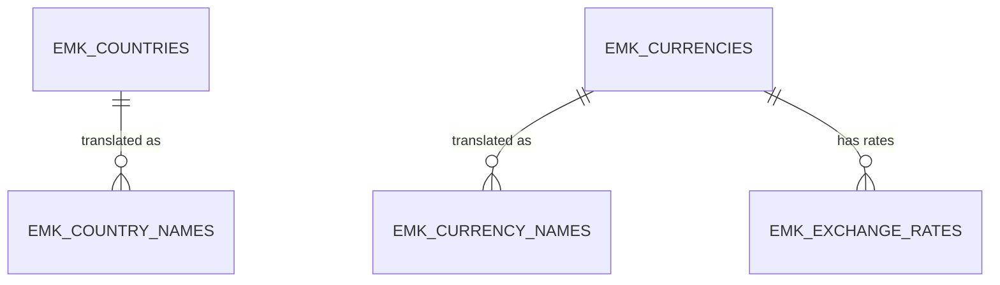

# Data Model — Reference Data

| | |
|---|---|
| **Status** | Accepted v1.0 (2026-10-07) |
| **Date** | 2026-10-07 |
| **Schema** | `EMK_APP` |
| **Milestone** | M1a (plan step 2 and 6) |
| **Input** | [spec.md](../spec.md) v1.4 §1.3, §3 · [M1 plan](../plans/M1-plan.md) v1.2 open points 4–8 · [Standard audit block](README.md#standard-audit-block) |

Reference tables hold standard code lists. They are keyed by ISO codes, never updated in their key, and changed through versioned `MERGE` scripts (`project stage add-custom`, `runOnChange:true`). Audit block: **created + updated** (no soft delete: a reference row is closed with `valid_to`, never deleted).

## 1. Overview

| Table | Rows (expected) | Growth | Partitioned | Journal |
|-------|-----------------|--------|-------------|---------|
| `EMK_COUNTRIES` | 60 | Static | No | No |
| `EMK_COUNTRY_NAMES` | 60 per extra language | Static | No | No |
| `EMK_CURRENCIES` | ≈ 33 | Static | No | No |
| `EMK_CURRENCY_NAMES` | ≈ 33 per extra language | Static | No | No |
| `EMK_EXCHANGE_RATES` | ≈ 45,000 (from 2020) | ≈ 7,700 per year | No | No |

**Why no journals:** reference rows change only through versioned scripts; their history is the Git history of those scripts. **Why no partitioning:** small tables, no purge needed.

## 2. `EMK_COUNTRIES`

Countries in scope: the 58 CMR contracting parties plus Iceland and Liechtenstein (EEA, not CMR parties) — 60 rows.

| Column | Type | Null | Default | Rule / reason |
|--------|------|------|---------|---------------|
| `country_code` | `CHAR(2 CHAR)` | No | — | **PK.** ISO 3166-1 alpha-2 |
| `name` | `VARCHAR2(100 CHAR)` | No | — | English short name (ISO 3166); longest in scope ≈ 52 characters; other languages in `EMK_COUNTRY_NAMES` |
| `eu_vat_prefix` | `CHAR(2 CHAR)` | Yes | — | EU VAT (VIES) prefix; differs from ISO for Greece (`EL`); `NULL` outside the EU |
| `eu_member_yn` | `CHAR(1 CHAR)` | No | `'N'` | EU member |
| `eea_member_yn` | `CHAR(1 CHAR)` | No | `'N'` | EEA member (EU + IS, LI, NO); explains why IS and LI are in scope; GDPR territory |
| `cmr_party_since` | `DATE` | Yes | — | Date from which the CMR applies to the country (entry into force, UN Treaty Collection); `NULL` = not a party. The CMR applies to a carriage if loading **or** delivery is in a country that is a party on that date (CMR Art. 1) |
| `valid_from` | `DATE` | No | `DATE '1900-01-01'` | Validity period (spec §1.3) |
| `valid_to` | `DATE` | Yes | — | `NULL` = still valid |
| *audit block* | — | — | — | `created_*`, `updated_*` |

| Constraint | Definition |
|------------|------------|
| `EMK_COUNTRIES_PK` | `PRIMARY KEY (country_code)` |
| `EMK_COUNTRIES_CODE_CK` | `REGEXP_LIKE(country_code, '^[A-Z]{2}$')` |
| `EMK_COUNTRIES_VAT_CK` | `eu_vat_prefix IS NULL OR REGEXP_LIKE(eu_vat_prefix, '^[A-Z]{2}$')` |
| `EMK_COUNTRIES_EU_VAT_CK` | `(eu_member_yn = 'Y' AND eu_vat_prefix IS NOT NULL) OR (eu_member_yn = 'N' AND eu_vat_prefix IS NULL)` — every EU member has a VAT prefix, nobody else |
| `EMK_COUNTRIES_EEA_CK` | `eu_member_yn = 'N' OR eea_member_yn = 'Y'` — an EU member is always in the EEA |
| `EMK_COUNTRIES_EU_YN_CK`, `EMK_COUNTRIES_EEA_YN_CK` | Each flag `IN ('Y','N')` |
| `EMK_COUNTRIES_VALID_CK` | `valid_to IS NULL OR valid_to >= valid_from` |

## 3. `EMK_CURRENCIES`

EUR plus the currencies with an ECB reference rate, plus historic currencies still referenced (HRK until 2022-12-31, BGN until 2025-12-31).

| Column | Type | Null | Default | Rule / reason |
|--------|------|------|---------|---------------|
| `currency_code` | `CHAR(3 CHAR)` | No | — | **PK.** ISO 4217 alphabetic code |
| `name` | `VARCHAR2(100 CHAR)` | No | — | English ISO 4217 name; other languages in `EMK_CURRENCY_NAMES` |
| `minor_units` | `NUMBER(1)` | No | — | ISO 4217 decimals (EUR 2, JPY 0, max 4); used to round converted amounts |
| `ecb_rate_yn` | `CHAR(1 CHAR)` | No | `'N'` | `Y` = the ECB publishes a reference rate. Amounts may use EUR or a currency with `ecb_rate_yn = 'Y'` that is valid on the business date (BR-12; checked in the APIs, because a date rule cannot be a foreign key) |
| `valid_from` | `DATE` | No | `DATE '1900-01-01'` | Validity period |
| `valid_to` | `DATE` | Yes | — | `NULL` = still valid; HRK `2022-12-31`, BGN `2025-12-31` |
| *audit block* | — | — | — | `created_*`, `updated_*` |

| Constraint | Definition |
|------------|------------|
| `EMK_CURRENCIES_PK` | `PRIMARY KEY (currency_code)` |
| `EMK_CURRENCIES_CODE_CK` | `REGEXP_LIKE(currency_code, '^[A-Z]{3}$')` |
| `EMK_CURRENCIES_MINOR_CK` | `minor_units BETWEEN 0 AND 4` |
| `EMK_CURRENCIES_ECB_EUR_CK` | `currency_code <> 'EUR' OR ecb_rate_yn = 'N'` — EUR is the base, it has no rate |
| `EMK_CURRENCIES_ECB_YN_CK` | `ecb_rate_yn IN ('Y','N')` |
| `EMK_CURRENCIES_VALID_CK` | `valid_to IS NULL OR valid_to >= valid_from` |

## 4. `EMK_COUNTRY_NAMES` and `EMK_CURRENCY_NAMES`

Names in languages other than English, for the German UI (F-15) and German letters (M4). English stays in the base table and is the fallback when a translation is missing.

**Why translation tables** (decided 2026-10-07): country and currency names are data, not application texts, so APEX text translation (XLIFF) does not cover them. APEX Dynamic Translations (`APEX_LANG.LANG`) only work inside an APEX session, and letters are generated in PL/SQL. Columns per language (`name_de`) would need `ALTER TABLE` for each new language. One table per entity keeps the foreign key, which a single generic translation table (`type, code, language, text`) cannot.

| Column | Type | Null | Rule / reason |
|--------|------|------|---------------|
| `country_code` / `currency_code` | `CHAR(2 CHAR)` / `CHAR(3 CHAR)` | No | **PK (1).** FK to the base table |
| `language_code` | `CHAR(2 CHAR)` | No | **PK (2).** ISO 639 alpha-2, lower case |
| `name` | `VARCHAR2(100 CHAR)` | No | Translated name |
| *audit block* | — | — | `created_*`, `updated_*` |

| Constraint | Definition |
|------------|------------|
| `EMK_COUNTRY_NAMES_PK` / `EMK_CURRENCY_NAMES_PK` | `PRIMARY KEY (<code>, language_code)` — also serves the foreign key |
| `EMK_COUNTRY_NAMES_COUNTRIES_FK` / `EMK_CURRENCY_NAMES_CURRENCIES_FK` | `FOREIGN KEY (<code>) REFERENCES` the base table |
| `…_LANG_CK` | `REGEXP_LIKE(language_code, '^[a-z]{2}$') AND language_code <> 'en'` — English lives in the base table |

**Lookup:** `COALESCE(translated name for the session language, base name)`. In M1 only `de` rows are loaded.

## 5. `EMK_EXCHANGE_RATES`

Daily ECB reference rates: **units of the currency per 1 EUR**. Loaded in M1b through `EMK_INT`.

| Column | Type | Null | Default | Rule / reason |
|--------|------|------|---------|---------------|
| `currency_code` | `CHAR(3 CHAR)` | No | — | **PK (1).** FK to `EMK_CURRENCIES` |
| `rate_date` | `DATE` | No | — | **PK (2).** Business date of the rate (no time) |
| `units_per_eur` | `NUMBER(18,6)` | No | — | The ECB publishes 4 decimals; 6 decimals also hold the fixed euro conversion rates (1.95583, 7.53450) if ever needed |
| `source` | `VARCHAR2(10 CHAR)` | No | `'ECB'` | Origin of the rate; only `ECB` in Release 1 |
| *audit block* | — | — | — | `created_*`, `updated_*` (the ECB may correct a published rate) |

| Constraint / index | Definition | Reason |
|--------------------|------------|--------|
| `EMK_EXCHANGE_RATES_PK` | `PRIMARY KEY (currency_code, rate_date)` | One rate per currency and day; the index also serves the foreign key (leading column) and the BR-12 lookup |
| `EMK_EXCHANGE_RATES_CURRENCIES_FK` | `FOREIGN KEY (currency_code) REFERENCES emk_currencies` | |
| `EMK_EXCHANGE_RATES_RATE_CK` | `units_per_eur > 0` | |
| `EMK_EXCHANGE_RATES_NOT_EUR_CK` | `currency_code <> 'EUR'` | EUR is the base (rate 1, not stored) |
| `EMK_EXCHANGE_RATES_SOURCE_CK` | `source IN ('ECB')` | |

**BR-12 lookup** (function in M1b/M1c): the rate of the latest `rate_date <= business date` for the currency; EUR returns 1. With the primary key, this is an index range scan.

## 6. Open Points

| # | Point | Decision |
|---|-------|----------|
| 1 | Translations of names | **Decided:** translation tables per entity (§4) |
| 2 | CMR applicability by date | **Decided:** `cmr_party_since DATE` instead of `cmr_party_yn` (spec v1.4) |
| 3 | Exchange-rate history | **Decided:** from 2020-01-01 (≈ 45,000 rows); adjust to the generator's date range |
| 4 | Numeric ISO 4217 code (e.g., 978) | **Decided:** not stored; no interface in Release 1 needs it |

## 7. Sources

- ISO — [ISO 3166 Country Codes](https://www.iso.org/iso-3166-country-codes.html) · [ISO 4217 Currency Codes](https://www.iso.org/iso-4217-currency-codes.html) · [ISO 639](https://www.iso.org/standard/74575.html)
- SIX (ISO 4217 maintenance agency) — [Currency code lists](https://www.six-group.com/en/products-services/financial-information/data-standards.html)
- European Union — [Interinstitutional Style Guide, Annex A6](https://style-guide.europa.eu/en/content/-/isg/topic?identifier=annex-a6-country-and-territory-codes) · [VIES](https://ec.europa.eu/taxation_customs/vies/)
- UN Treaty Collection — [CMR Convention, status](https://treaties.un.org/Pages/ViewDetails.aspx?src=TREATY&mtdsg_no=XI-B-11&chapter=11&clang=_en)
- ECB — [Euro foreign exchange reference rates](https://www.ecb.europa.eu/stats/policy_and_exchange_rates/euro_reference_exchange_rates/html/index.en.html) · [Framework for the euro foreign exchange reference rates](https://www.ecb.europa.eu/stats/pdf/exchange/Frameworkfortheeuroforeignexchangereferencerates.en.pdf) · [Bulgaria](https://www.ecb.europa.eu/euro/changeover/bulgaria/html/index.en.html) · [Croatia](https://www.ecb.europa.eu/press/pr/date/2022/html/ecb.pr220712~b97dd38de3.en.html)
- Oracle APEX 24.2 — [Managing Application Globalization](https://docs.oracle.com/en/database/oracle/apex/24.2/htmdb/managing-application-globalization.html) · [APEX_LANG.LANG](https://docs.oracle.com/en/database/oracle/apex/24.2/aeapi/LANG_Function.html)
