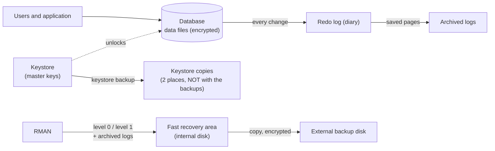

# Backup Runbook

| Field | Value |
|-------|-------|
| **Version** | v1.1 (2026-10-12) |
| **Decisions** | [ADR-010](../adr/ADR-010-operations-and-release-strategy.md) §1 (backup strategy, targets) · [ADR-011](../adr/ADR-011-tablespace-encryption.md) (encryption, keystore, encrypted backups) |
| **Companion** | [Recovery runbook](recovery-runbook.md): what to do when data is lost. This runbook covers the **routine**: what is backed up, when, for how long, where everything is kept and who checks it |
| **Status of commands** | Configuration, keystore and first encrypted level 0 **executed in DEV** (`scripts/operations/`, [drill 2026-10-12](drills/2026-10-12-m1-dev.md)). **Not yet built:** routine level 1, copy to the external disk and scheduling (with the external disk) |

---

## 1. Concepts in Plain Words

For readers who are not database administrators. Terms are also in the [glossary](../glossary.md).

### Where the data lives

| Concept | Plain explanation |
|---------|-------------------|
| **Data file** | A file on disk (`.DBF`) that holds the data. A database has many |
| **Tablespace** | A named group of data files, like a folder: each table is stored in one tablespace (here `EMK_DATA_TS`, `EMK_INT_TS`) |
| **Control file** | The database's "table of contents": which data files exist, where they are, and which backups RMAN made |
| **Redo log** | The database's **diary**: every change is written there first, before it reaches the data files. Online redo logs are reused in a cycle |
| **Archived log** | A **saved page of the diary**: a full redo log copied away before it is reused (only in `ARCHIVELOG` mode). With them, a restored backup can be brought forward to a later minute |

### Encryption

| Concept | Plain explanation |
|---------|-------------------|
| **Encrypted tablespace (TDE)** | A tablespace whose data files are written to disk **in coded form**. The database decodes the data when it reads it, so users and the application see normal data. Someone who copies the files sees only unreadable bytes. Comparison: the data is in a **locked filing cabinet** |
| **Tablespace key** | The key that locks the cabinet of one tablespace; stored in the file header, itself locked by the master key |
| **Master encryption key** | The key that locks all tablespace keys of one PDB. It lives only in the keystore |
| **Keystore (wallet)** | The **safe** that holds the master keys: the file `ewallet.p12`, protected by a password |
| **Keystore password** | The **combination of the safe**. Kept by people (password manager), never in a file of the project |
| **Local auto-login keystore** | A second file, `cwallet.sso`, that opens the safe **automatically** when the database starts — but only on the computer where it was created; copied elsewhere, it does not work |
| **AES-256** | The encryption algorithm (international standard); 256 is the key length in bits. Modern CPUs have built-in instructions for it (AES-NI), so it costs little time |
| **Key rotation** | Replacing the master key with a new one; old keys stay in the keystore so that old backups can still be read |

### Backups

| Concept | Plain explanation |
|---------|-------------------|
| **RMAN** (Recovery Manager) | Oracle's tool that **makes backups and restores them**. It is the archivist of the database: it photographs the data files, keeps the diary pages (archived logs), records every backup in the control file, and on restore knows exactly which pieces are needed and in which order |
| **Full backup (level 0)** | A copy of **all** used blocks of the database: the base |
| **Incremental backup (level 1)** | A copy of **only the blocks changed** since the previous backup: small and fast. *Block change tracking* tells RMAN which blocks changed, so it does not have to read everything |
| **Backup piece** | A file written by RMAN that contains (part of) a backup |
| **Fast recovery area** | A folder managed by Oracle for backups and archived logs, with a size limit; Oracle deletes what is no longer needed when space runs low |
| **Retention policy, recovery window** | How long backups are kept. "Recovery window of 7 days" = it must always be possible to return to **any minute of the last 7 days**; older backups become **obsolete** and are deleted |
| **Validate** | RMAN **reads** a backup and checks it without restoring it: proof that the backup is complete and not damaged |
| **Encrypted backup** | RMAN encrypts the backup pieces with the keystore: a lost backup disk is unreadable |
| **Restore** | Copy the data files **back** from a backup |
| **Recover** | **Apply the diary** (archived logs) to the restored files, to bring them forward to the latest possible moment or to a chosen time |
| **Point-in-time recovery** | Recover only up to a chosen time, e.g. just before a wrong mass update |
| **DBID** | The identity number of the database; needed to find its backups when the control file is lost |
| **Data Pump export** | A **logical** copy: the tables and their rows written to a dump file, readable by any Oracle database. RMAN makes **physical** copies (blocks). Different purposes: RMAN for recovery, Data Pump as an independent second copy and for moving data |
| **Restore drill** | A real restore made on purpose, timed and recorded. **A backup that has never been restored is not a backup** |

### How the pieces fit together



---

## 2. Golden Rules

1. **Keys are never kept with the data.** The keystore and its copies are never on the same disk or medium as the database backups.
2. **No keystore, no data.** Losing the keystore and all its copies loses the encrypted data for good, in every backup.
3. **Back up the keystore every time a key changes** (`WITH BACKUP`), then copy it to its two places.
4. **Passwords are never written into files** — entered at run time, stored in the password manager.
5. **Keystore copies are kept as long as the oldest database backup.**
6. **Every backup is validated and regularly restored** (drill): untested backups do not count.

---

## 3. What Is Backed Up, When and for How Long

Times are outside the support hours (Monday–Friday 08:00–18:00, ADR-010).

| What | When | Kept | Purpose |
|------|------|------|---------|
| Full backup (level 0) of the CDB, encrypted | Sunday 22:00 | Recovery window of 7 days (two level 0 at most) | Base for every restore |
| Incremental backup (level 1), encrypted | Monday–Saturday 22:00 | Recovery window of 7 days | Daily changes |
| Archived logs → fast recovery area | Continuously; a log switch at least every 30 min (`ARCHIVE_LAG_TARGET = 1800`) | Until backed up and outside the window | RPO ≤ 1 h |
| Copy of archived logs and backups → external disk | Every 30 min (archived logs), after each level 0 / level 1 (backups) | Recovery window of 7 days | Copy outside the internal disk |
| Control file and server parameter file | Automatically after each backup (`CONTROLFILE AUTOBACKUP ON`) | With the backups | Restore when the control file is lost |
| Data Pump export of the project schemas, encrypted with its own password | Before each release in ACCEPTANCE and PROD | Two latest | Independent logical copy |
| Keystore backup | After every key operation (`WITH BACKUP`) and checked monthly | As long as the oldest database backup | The keys for every backup |

**DEV machine (laptop):** the machine is not always on at 22:00; the scheduled tasks run as soon as possible after a missed start (Windows Task Scheduler option).

---

## 4. Where Everything Is Kept

| Item | DEV (reference machine) | Company setup |
|------|-------------------------|---------------|
| Data files | `<ORACLE_BASE>\oradata\<DB>` and the project tablespace folder of the admin configuration (internal disk) | Database server, data storage |
| Fast recovery area | `<ORACLE_BASE>\fast_recovery_area` (internal disk; size in [setup.md §1.1](../setup.md)) | Separate storage on the database server |
| Backup copies | External USB disk (≥ 128 GB, recommended 256 GB), folder `emk_backups` | Backup server or appliance + off-site copy |
| Keystore (live) | `WALLET_ROOT` = `<ORACLE_BASE>\admin\<DB>\wallet`, keystore in its subfolder `tde` (outside the data folders; access: Oracle service and administrators only) | Database server, restricted folder, or a key manager (Oracle Key Vault, HSM) |
| Keystore copy 1 | Password manager (KeePassXC): `ewallet.p12` attached to the keystore entry; the `.kdbx` file has its own off-disk copy (cloud) | Key custodian 1, or the key manager |
| Keystore copy 2 | A dedicated USB stick, **not** the backup disk, kept in another place (**pending**) | Key custodian 2 in a safe, other site |
| Keystore password | Password manager (KeePassXC) | Two custodians (four-eyes) |
| DBID, locations, contacts | Record of the database (recovery runbook §3, prerequisite 6), kept outside the server | Operations documentation |

The scripts contain no fixed paths: `scripts/operations/00_config.sql` derives them from the database (`ORACLE_BASE` from `V$DIAG_INFO`, `WALLET_ROOT` and the fast recovery area from `V$PARAMETER`, data folders from `V$DATAFILE`) and prints them at the start of each script. The `WALLET_ROOT` folder must exist before the keystore is created; its permissions on Windows (Oracle service and administrators only) are checked then.

---

## 5. Routine Tasks and Owners

| Frequency | Task | Owner | Check |
|-----------|------|-------|-------|
| Daily | Backups of the night finished (`V$RMAN_BACKUP_JOB_DETAILS`: `COMPLETED`); RPO age < 45 min; keystore `OPEN` | Operations (DBA) | Operations page (ADR-010 §7) from M2 |
| Weekly | `RESTORE DATABASE VALIDATE`; fast recovery area < 80 %; external disk space | DBA | Validation without errors |
| Monthly | Keystore copies in both places present and readable (open a copy on a test location) | Key custodians | Signed checklist |
| Each release (DEV) / quarterly (company) | Restore drill with the **keystore copy** (recovery runbook §8, T-M1-33) | DBA + business owner | Drill protocol in `docs/operations/drills/` |
| Yearly, and when a person with access leaves | Master key rotation `WITH BACKUP`; keystore copied to both places | Key custodians | New key in `V$ENCRYPTION_KEYS` |

---

## 6. RMAN: a Simple Example

Run on the database server as a member of the operating-system DBA group: `rman target /` asks no password.

```
rman target /

-- One-time configuration
CONFIGURE RETENTION POLICY TO RECOVERY WINDOW OF 7 DAYS;   -- keep 7 days
CONFIGURE CONTROLFILE AUTOBACKUP ON;                       -- table of contents saved with each backup
CONFIGURE ENCRYPTION FOR DATABASE ON;                      -- encrypt backups with the keystore

-- Sunday: full backup plus the archived logs
BACKUP INCREMENTAL LEVEL 0 DATABASE PLUS ARCHIVELOG;

-- Monday to Saturday: only the changes
BACKUP INCREMENTAL LEVEL 1 DATABASE PLUS ARCHIVELOG;

-- What backups exist?
LIST BACKUP SUMMARY;

-- Could we restore? (reads, checks, restores nothing)
RESTORE DATABASE VALIDATE;

-- Remove what the 7-day window no longer needs
DELETE NOPROMPT OBSOLETE;
```

Executed version: `scripts/operations/06a_enable_bct.sql` (block change tracking) and `06b_rman_level0.rman` (configuration, encrypted level 0, validation). Level 1, the copy to the external disk and scheduling are added with the external disk.

## 7. Keystore: Who Creates It and How

| Question | Answer |
|----------|--------|
| Who | A person with the key-management privilege `SYSKM` (or `SYSDBA`): in a company the DBA or security officer, with two custodians for the password — not a developer |
| How | With SQL commands (`ADMINISTER KEY MANAGEMENT`), once per CDB, from an admin script that asks the password at run time |
| When | Migration phase 1, in the same restart window as `ARCHIVELOG` (`WALLET_ROOT` and `TABLESPACE_ENCRYPTION` need a restart). Executed: `scripts/operations/05_create_keystore.sql` |
| Verify | **Right after creation, open the keystore file with the password stored in the password manager:** `orapki wallet display -wallet <WALLET_ROOT>\tde`. A keystore whose stored password does not open it cannot be managed (drill 2026-10-12: the stored password did not match; recovered with S7 of the recovery runbook) |
| Password | Letters and digits only; copied from the password manager only when the hidden prompt appears (the clipboard is cleared after 10 s) |
| Files | `ewallet.p12` (keystore, copied to the key copies), `cwallet.sso` (auto-login, stays on the server), `*.lck` (empty lock files, left in place, never copied) |

Reference commands (ADR-011). Before them: the `WALLET_ROOT` folder is created by hand (Oracle creates the `tde` subfolder itself, otherwise `ORA-46693`), and the password is read without echo — `SET VERIFY OFF`, no `SPOOL`, `ACCEPT keystore_pwd CHAR PROMPT 'Keystore password: ' HIDE`, and `UNDEFINE keystore_pwd` at the end — so that it appears in no file and no screen output.


```sql
-- 1. Create the keystore (the safe); the password is typed, never stored
ADMINISTER KEY MANAGEMENT CREATE KEYSTORE IDENTIFIED BY "&keystore_pwd";
-- 2. Open it for the CDB and all PDBs
ADMINISTER KEY MANAGEMENT SET KEYSTORE OPEN IDENTIFIED BY "&keystore_pwd" CONTAINER = ALL;
-- 3. Create the master key and back up the keystore at the same time
ADMINISTER KEY MANAGEMENT SET KEY IDENTIFIED BY "&keystore_pwd" WITH BACKUP CONTAINER = ALL;
-- 4. Automatic opening, valid only on this computer
ADMINISTER KEY MANAGEMENT CREATE LOCAL AUTO_LOGIN KEYSTORE FROM KEYSTORE IDENTIFIED BY "&keystore_pwd";
-- Check
SELECT con_id, status, wallet_type FROM v$encryption_wallet;
```

## Sources

[Backup and Recovery User's Guide 26ai](https://docs.oracle.com/en/database/oracle/oracle-database/26/bradv/oracle-ai-database-backup-and-recovery-users-guide.pdf) · [RMAN Backup Concepts 26ai](https://docs.oracle.com/en/database/oracle/oracle-database/26/bradv/rman-backup-concepts.html) · [TDE Quick-start Guide 26ai](https://docs.oracle.com/en/database/oracle/oracle-database/26/dbtde/get-started.html) · [RMAN 23ai new features](https://blogs.oracle.com/maa/oracle-database-23ai-recovery-manager-rman-new-features-part-2-celebrating-three-decades-of-data-protection-more) · [ARCHIVE_LAG_TARGET](https://docs.oracle.com/en/database/oracle/oracle-database/26/refrn/ARCHIVE_LAG_TARGET.html) · [ORA-46693](https://docs.oracle.com/en/error-help/db/ora-46693/)

## Revision History

| Version | Date | Change |
|---------|------|--------|
| v1.0 | 2026-10-12 | First version with ADR-011: concepts in plain words, golden rules, schedule and retention, locations of backups and keystore, routine tasks, RMAN example, keystore creation. |
| v1.1 | 2026-10-12 | Executed parts marked (drill 2026-10-12); actual key copies; password verification with `orapki`; lock files. |
