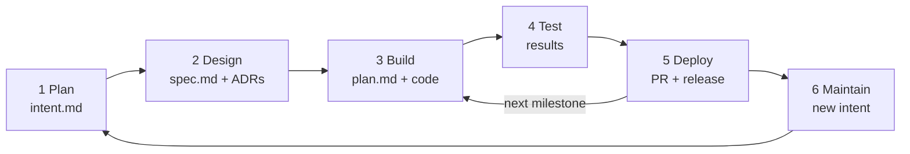

# SDLC — Stages, Artifacts and Versioning

This project follows a **lightweight AI-native SDLC** based on [The AI-native SDLC playbook](https://claude.com/blog/the-ai-native-sdlc-playbook). Each stage produces an artifact that the next stage reads. Terms are defined in the [glossary](glossary.md).

## Current Stage

> **Stage 3 — Build, milestone M1:** M0 is done (PR #6). Increment M1a in progress: data core tables built and tested (steps 0–6); step 7 (vertical slice) in progress: APIs, views, application context test and code lists (7.1–7.6) and the master data API (7.7) done; architecture and operations decided ([ADR-008](adr/ADR-008-schema-separation.md) to [ADR-011](adr/ADR-011-tablespace-encryption.md)); spec v1.24 and [M1 plan](plans/M1-plan.md) v1.20 accepted (2026-10-21); focus on the MVP components of the intent, built in DEV only (deferred items listed as improvements in the M1 plan, §2). Step M, migration to the separated schemas (branch `feature/m1a-schema-separation`): phases M.1 and M.2 done, **phase M.3** (a phase of milestone M1, not milestone M3) done 2026-10-16 (structure moved, 42 utPLSQL tests green), **phase M.4** done 2026-10-16 (APEX application on `EMK_UI`, SQLcl project per schema, `EMK_APP` retired); next steps 7–12 (phase M.5 moved to M5).

## Stages

| # | Stage | Artifact | Location | Exit criterion | Status |
|---|-------|----------|----------|----------------|--------|
| 1 | **Plan** | Intent: problem, outcome, users, constraints, open questions | `docs/intent.md` | Owner accepts the intent | ✅ Done (2026-10-03) |
| 2 | **Design** | Spec: requirements, diagrams, data model, success criteria + ADRs answering the open questions | `docs/spec.md`, `docs/adr/` | Owner accepts the spec (ADR-004 and ADR-005 accepted 2026-10-04) | ✅ Done (2026-10-04) |
| 3 | **Build** | Plan per milestone (files, order, tests) + code | `docs/plans/<milestone>-plan.md`, code | Plan approved; code ready for review | 🟡 In progress (M1; M0 done) |
| 4 | **Test** | Test and evaluation results | `tests/`, run logs | All milestone criteria pass | ⚪ Not started |
| 5 | **Deploy** | Reviewed pull request merged to `main`; GitHub release for M5 | Pull request, release | PR approved and merged | ⚪ Not started |
| 6 | **Maintain** | New intent for each issue or improvement | `docs/intent.md` or a new intent | Accepted intent restarts the loop | ⚪ Lightweight (see below) |

**Stages 1 and 2 run once for Release 1. Stages 3 to 5 repeat for every milestone** (M1–M5, then X1–X4).

## Versioning Rules

| Rule | Detail |
|------|--------|
| **Header** | Every artifact states its stage, status, version, owner and date. |
| **Status** | `Draft` → `Proposed` → `Accepted`. |
| **Version** | `v0.x` while in draft; `v1.0` when accepted; `v1.1`, `v1.2`… for later changes, recorded in the revision history. |
| **Commit cadence** | Drafts stay local. An artifact is committed when it is **accepted** or when a milestone is stable, not on every edit. |
| **Branches** | One branch and one pull request per accepted artifact set or milestone. |
| **Decisions** | Design decisions go to `docs/adr/`. Accepted ADRs are not edited; a new ADR supersedes an old one. |
| **Releases** | The MVP is tagged as a GitHub release at M5. |

## Lightweight Adaptation

- Stage 4 runs tests locally (utPLSQL, evaluation scripts). CI pipelines are a later improvement.
- Stage 5 uses a self-review of each pull request against the success criteria in `spec.md` §8.
- Stage 6 is limited to scheduled checks (e.g., `scripts/admin/check_password_expiry.sql`) and new intents for improvements. Automated monitoring is out of scope for Release 1.
