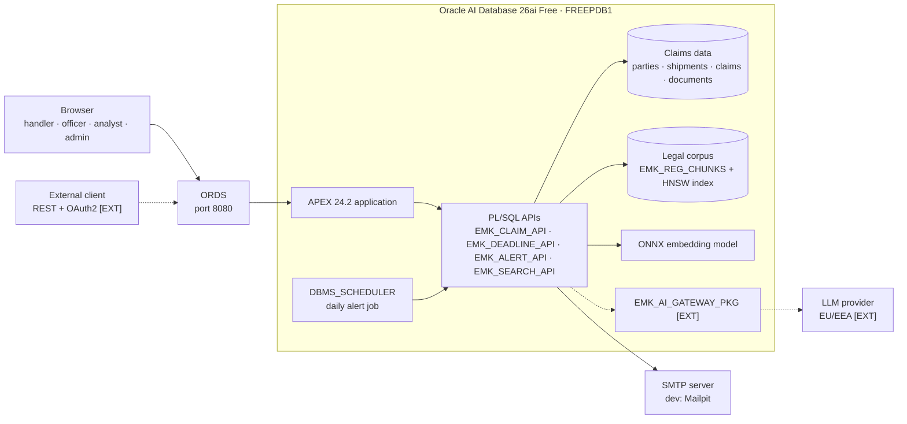
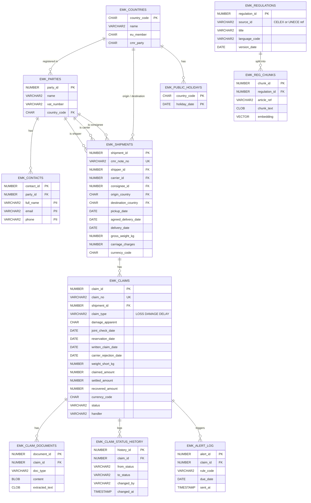
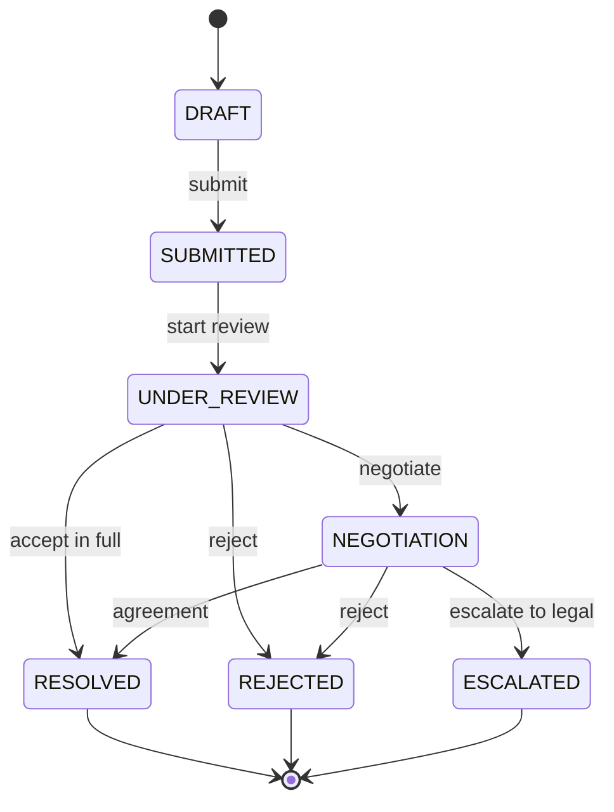
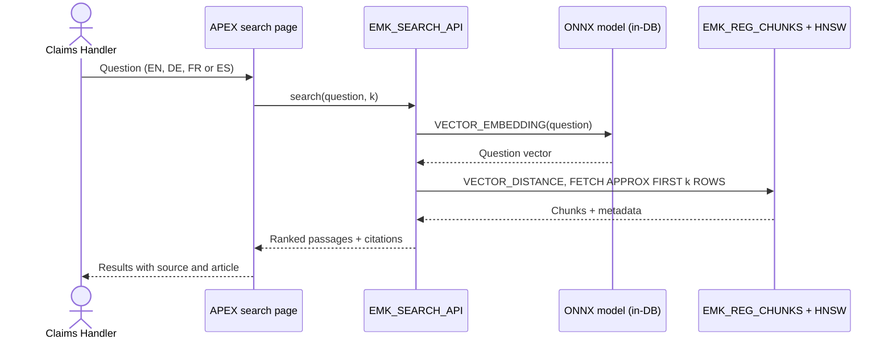
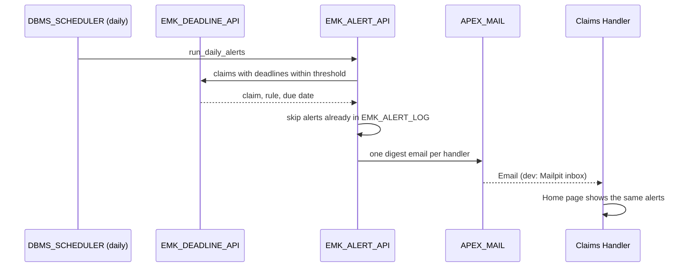
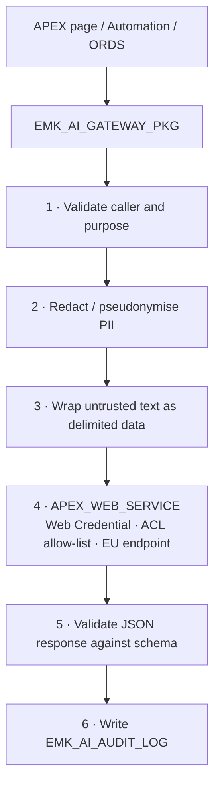

# Spec — EuroMarket AI-Driven Compliance & Claims Manager

| | |
|---|---|
| **SDLC stage** | 2 — Design ([docs/sdlc.md](sdlc.md)) |
| **Status** | Accepted v1.0 (2026-10-04) |
| **Owner** | Natalia Müller ([@nmuller000](https://github.com/nmuller000)) |
| **Date** | 2026-10-03 |
| **Input** | [docs/intent.md](intent.md) v1.0 |

Requirements and design for **Release 1**. Each item is labelled **[MVP]** or **[EXT]** (extension). Terms are defined in the [glossary](glossary.md).

---

## 1. Architecture

### 1.1 Principles

1. **Database as the AI platform.** Data, vector search and AI orchestration live in Oracle AI Database 26ai, governed by PL/SQL.
2. **In-database embeddings.** `DBMS_VECTOR` / `DBMS_VECTOR_CHAIN` are used only with the in-database ONNX model, never with external providers.
3. **Single AI egress.** Every external AI call goes through `EMK_AI_GATEWAY_PKG`. [EXT]
4. **Privacy by design.** PII is minimised, redacted before any external call and retained only as long as needed.
5. **EU data residency.** External AI providers process data in the EU/EEA under a DPA. [EXT]
6. **Everything as code.** Idempotent SQLcl scripts in Git; no secrets in files.
7. **Business rules in PL/SQL**, not in APEX page logic.

### 1.2 Component Diagram



Solid lines = MVP. Dashed lines = extensions.

### 1.3 Cross-Cutting Conventions

| Topic | Convention |
|-------|------------|
| **Business dates** | `DATE` without time (pickup, delivery, reservation, written claim). Deadlines are calendar dates. |
| **Technical timestamps** | `TIMESTAMP WITH TIME ZONE`, stored in UTC (audit, logs, alerts). |
| **Time zone for deadlines** | Calendar days in the country of delivery; public holidays from `EMK_PUBLIC_HOLIDAYS` of that country (Q4 decision, §5). |
| **Currencies** | Amounts stored in their original currency (ISO 4217 code). KPIs are converted to **EUR** with daily rates in `EMK_EXCHANGE_RATES` (source: ECB reference rates, loaded as reference data). |
| **Error handling** | Business errors raised with codes `-20001` to `-20999`, defined as constants in `EMK_ERRORS`. An APEX error-handling function shows clear messages to users. |
| **Logging** | `EMK_LOG_PKG` writes to `EMK_LOG` in an autonomous transaction (level, module, message, context, timestamp). |
| **Naming** | Prefix `EMK_`; tables plural; APIs `EMK_<AREA>_API`; views `EMK_V_<NAME>`; staging tables `EMK_<ENTITY>_STG`. |
| **Soft delete** | Operational tables (parties, contacts, shipments, claims, documents) are never physically deleted: `delete_yn CHAR(1) DEFAULT 'N' NOT NULL` (`Y`/`N`), plus `deleted_at` and `deleted_by`. Views and APEX pages show only `delete_yn = 'N'`. Logs and history tables are never deleted. Soft delete is not GDPR erasure (FR-41). |
| **External data (ELT)** | All inbound data (file imports, reference data, REST [EXT]) follows: load into a staging table → validate and apply business rules in PL/SQL (`EMK_IMPORT_API`) → `MERGE` into operational tables → mark each row `LOADED` or `REJECTED` with a reason. |
| **Audit columns** | Operational tables carry `created_at`, `created_by`, `updated_at`, `updated_by`. |
| **Secrets** | No file in the repository contains secrets or personal data; passwords and API keys are entered at run time or stored in Web Credentials / the ORDS wallet. |
| **UI language** | English by default; German as a translated application; users switch with a language selector (F-15). |

---

## 2. Functional Requirements

### Feature Catalogue

What each feature solves and how. Detailed requirements follow in §2.1–2.6; business rules in §2.7.

| # | Feature | Value (problem solved) | How | Scope | Milestone |
|---|---------|------------------------|-----|-------|-----------|
| F-01 | Claims management | One structured place instead of emails and spreadsheets (P3) | APEX forms and grids over `EMK_CLAIM_API`; state machine (§4) | MVP | M1 |
| F-02 | Recovery tracking | Shows the financial result of each claim and the **recovery rate** per carrier (P3) | Settled and recovered amounts per claim; EUR conversion (§1.3); dashboard KPI | MVP | M1 |
| F-03 | Shipment import (CSV/Excel) | Reuses data companies already have; no retyping (P3) | APEX Data Load into a staging table, validation, error report, then `EMK_SHIPMENT_API` | MVP | M1 |
| F-04 | Dashboards | Claim indicators by carrier, route, country, type, status and ageing (P3) | APEX charts on aggregated views | MVP | M1 |
| F-05 | CMR deadline tracking | Prevents lost claims through missed deadlines (P2) | `EMK_DEADLINE_API` with rules from §5 and public holidays | MVP | M2 |
| F-06 | Deadline alerts (app + email) | Users learn about risks **without logging in** (P2) | Daily `DBMS_SCHEDULER` job; alert region on the home page; daily email digest with `APEX_MAIL` | MVP | M2 |
| F-07 | Multilingual legal search | Finds the applicable article in any of EN/DE/FR/ES (P1, P2) | ONNX model `multilingual-e5-small` (ADR-004), HNSW index, `EMK_SEARCH_API` (§6.1) | MVP | M3 |
| F-08 | Claim letters (EN/DE) | Formal reservation and claim letters in minutes, consistent wording (P1, P2) | Templates with placeholders in `EMK_LETTER_TEMPLATES`; printable page → PDF from the browser | MVP | M4 |
| F-09 | Liability cap (CMR Art. 23) | Shows the maximum recoverable amount before negotiating (P2) | Gross weight short × 8.33 SDR × SDR rate (`EMK_SDR_RATES`, maintained manually); delay capped at carriage charges (BR-10) | MVP | M4 |
| F-15 | Multilingual UI (EN/DE) | German-speaking users work in their language (P1) | APEX Globalization: primary language English, German translated application (seed → XLIFF → translate → publish), language selector in the navigation bar | MVP | M5 |
| F-10 | AI summaries and translations | Understands foreign-language documents quickly (P1) | AI gateway (§6.3) | EXT | X1 |
| F-11 | AI answers with citations | Direct answers grounded in the corpus (P2) | Retrieved passages + LLM via gateway | EXT | X1 |
| F-12 | Natural-language analytics | New questions without IT or Excel work (P3) | NL-to-SQL via gateway (ADR-002) | EXT | X2 |
| F-13 | REST API | Integration with TMS/ERP systems (P3) | ORDS REST + OAuth2 client credentials | EXT | X3 |
| F-14 | GDPR compliance pack | Retention, erasure and compliance records (P2) | Scheduler purge job, erasure procedure, `docs/compliance/` | EXT | X4 |

### 2.1 Claims Management

| ID | Requirement | Scope |
|----|-------------|-------|
| FR-01 | Manage parties (companies) and their contact persons. | MVP |
| FR-02 | Register shipments: CMR note number, shipper, carrier, consignee, origin/destination country, pickup/delivery dates, goods, packages, gross weight. | MVP |
| FR-03 | Import shipments from CSV or Excel through the ELT pattern (§1.3): staging table, validation, error report per row, `MERGE` without duplicates. | MVP |
| FR-04 | Register claims linked to a shipment: type (loss, damage, delay), apparent/non-apparent damage, joint check date, reservation date, written claim date, carrier rejection date, claimed / settled / recovered amounts, currency, documents. | MVP |
| FR-05 | Enforce the claim state machine (§4) in PL/SQL. | MVP |
| FR-06 | Calculate CMR deadlines (§5) per claim, including suspension of the limitation period. | MVP |
| FR-07 | Alert handlers about claims close to a deadline: home-page region, plus one daily email digest per handler. Thresholds are reference data (e.g., 2 days for reservations, 30 days for limitation). | MVP |
| FR-08 | Dashboards: claims by carrier, route, country, type, status and ageing; amounts and recovery rate in EUR. | MVP |
| FR-09 | Audit trail of status changes and key field changes. | MVP |
| FR-10 | Generate reservation and claim letters in English or German from templates, filled with claim data; printable as PDF from the browser. | MVP |
| FR-11 | Calculate the indicative liability cap (CMR Art. 23(3)) from gross weight short and the SDR rate. | MVP |
| FR-12 | REST API for claim intake and status, protected by OAuth2 client credentials. | EXT |

### 2.2 Regulatory Semantic Search

| ID | Requirement | Scope |
|----|-------------|-------|
| FR-13 | Ingest the corpus below, chunked by article, with metadata (source ID, article, language, version date). | MVP |
| FR-14 | Search in EN, DE, FR or ES and return ranked passages with citations (source + article). | MVP |
| FR-15 | Open the search from a claim, pre-filled with the claim type. | MVP |
| FR-16 | Generate an answer grounded in the retrieved passages, with mandatory citations. | EXT |

**Corpus**

| Instrument | Source | Why |
|------------|--------|-----|
| CMR Convention (1956) | [UNECE](https://unece.org/DAM/trans/conventn/cmr_e.pdf) (EN and FR texts are authentic) | Liability, reservations, deadlines, jurisdiction |
| CMR Protocol (1978) | UNECE | SDR as unit of account for the liability limit |
| GDPR (EU) 2016/679 | EUR-Lex | Personal data in claims |
| Rome I (EC) 593/2008 | EUR-Lex | Law applicable to carriage contracts (Art. 5) |
| Brussels I bis (EU) 1215/2012 | EUR-Lex | Jurisdiction |
| eFTI (EU) 2020/1056 | EUR-Lex | Electronic freight information |
| EU AI Act (EU) 2024/1689 | EUR-Lex | Transparency of AI features |

### 2.3 AI Gateway [EXT]

| ID | Requirement |
|----|-------------|
| FR-20 | Summarise damage reports and correspondence; translate claim documents; classify claim type; extract key data. |
| FR-21 | Redact or pseudonymise PII before each call; re-identify only inside the database. |
| FR-22 | Treat document text as delimited data (prompt-injection defence); validate output against a JSON schema. |
| FR-23 | Log every call (redacted payload, purpose, latency, tokens, status) in `EMK_AI_AUDIT_LOG`. |

### 2.4 NL-to-SQL Analytics [EXT]

| ID | Requirement |
|----|-------------|
| FR-30 | Answer analyst questions with SQL generated by the LLM over allow-listed, read-only views only (ADR-002). |
| FR-31 | Show, run or explain the generated SQL; validate it (single `SELECT`, allow-listed views, row limit) before execution. |

### 2.5 Retention & Erasure [EXT]

| ID | Requirement |
|----|-------------|
| FR-40 | Purge AI log payloads after 180 days; pseudonymise personal data of closed claims after 24 months (illustrative defaults, stored as reference data). |
| FR-41 | Process erasure requests: pseudonymise a person's data in all tables and logs, and record the request. |

### 2.6 User Interface

- **Languages:** English is the primary language; German is a translated application (F-15, M5). A language selector switches the session language. Texts live in APEX text messages so that translation stays complete. Letters are available in English and German.
- The home page shows the user's alerts and open claims.
- Every AI-assisted result shows its sources and a "not legal advice" notice.

### 2.7 Business Rules

Single catalogue of business rules. Each rule is enforced in the database (not only in the UI) and has at least one test (§8.4).

| ID | Rule | Source | Enforced in | Test |
|----|------|--------|-------------|------|
| BR-01 | A claim changes status only through the transitions of §4. | Design | `EMK_CLAIM_API` | SC-QA-03 |
| BR-02 | Only the `CLAIMS_HANDLER` role changes a claim's status. | Design (§7.1) | APEX authorization + `EMK_CLAIM_API` | Unit |
| BR-03 | The CMR note number is unique, including soft-deleted shipments; it is never reused. | Business | Unique constraint | Unit |
| BR-04 | A claim belongs to exactly one shipment. Damage, partial loss and delay claims require the delivery date; total loss requires the agreed delivery date or the pickup date. | CMR Art. 30, 32 | `EMK_CLAIM_API` | Unit |
| BR-05 | Reservation deadlines follow §5 (`RES_*` rules). | CMR Art. 30 | `EMK_DEADLINE_API` | SC-QA-04 |
| BR-06 | Limitation deadlines follow §5 (`LIM_*` rules); a written claim suspends the period until the carrier's written rejection. | CMR Art. 32 | `EMK_DEADLINE_API` | SC-QA-04 |
| BR-07 | The start day of a period is not counted. | CMR Art. 30(4), 32(1) | `EMK_DEADLINE_API` | SC-QA-04 |
| BR-08 | Public holidays are those of the country of delivery; alerts use the earlier *act-by* date (§5, Q4 decision). | Q4 decision | `EMK_DEADLINE_API` | SC-QA-04 |
| BR-09 | Each handler receives at most one alert email per day; an alert for the same claim, rule and due date is sent once. | Design | `EMK_ALERT_API` + `EMK_ALERT_LOG` | SC-QA-05 |
| BR-10 | Liability cap: loss or damage ≤ 8.33 SDR per kg of gross weight short (affected part); delay ≤ carriage charges. Shown as indicative. | CMR Art. 23(3) as amended by the 1978 Protocol, Art. 23(5), Art. 25 | `EMK_CLAIM_API` | Unit |
| BR-11 | Settled amount ≤ claimed amount; recovered amount ≤ settled amount; amounts ≥ 0. | Business | Check constraints + API | Unit |
| BR-12 | KPIs are converted to EUR at the ECB rate of the claim's registration date. | Design (§1.3) | Views | Unit |
| BR-13 | Operational records are soft-deleted only; deleted records are hidden but kept. | Design (§1.3) | APIs + views | Unit |
| BR-14 | Imported rows that fail validation are rejected with a reason; valid rows are loaded; the import never creates duplicates. | Design (§1.3) | `EMK_IMPORT_API` | SC-QA-06 |
| BR-15 | Erasure of personal data is done by pseudonymisation, never by soft delete. [EXT] | GDPR Art. 17 | Erasure procedure (FR-41) | SC-SEC-07 |

---

## 3. Data Model

### 3.1 Entity-Relationship Diagram [MVP]



### 3.2 Reference and Technical Tables

| Table | Content | Scope |
|-------|---------|-------|
| `EMK_DEADLINE_RULES` | CMR deadline rules (§5) and alert thresholds | MVP |
| `EMK_EXCHANGE_RATES` | Daily EUR rates per currency (ECB reference rates) | MVP |
| `EMK_SDR_RATES` | EUR value of one SDR per date (maintained manually) | MVP |
| `EMK_LETTER_TEMPLATES` | Letter templates per type and language, with placeholders | MVP |
| `EMK_<ENTITY>_STG` | Staging tables for inbound data (e.g., `EMK_SHIPMENTS_STG`, `EMK_EXCHANGE_RATES_STG`): all columns as text, batch ID, row status, rejection reason | MVP |
| `EMK_IMPORT_BATCHES` | One row per import: source, file name, user, counts loaded / rejected, timestamps | MVP |
| `EMK_LOG` | Application log (§1.3) | MVP |
| `EMK_AI_AUDIT_LOG`, `EMK_RETENTION_POLICY`, `EMK_ERASURE_REQUESTS` | Extension tables | EXT |

### 3.3 Design Notes

- **Personal data is isolated** in `EMK_CONTACTS`, which simplifies redaction and erasure.
- **Deadlines are calculated, not stored.** `EMK_DEADLINE_API` derives them and exposes them through the view `EMK_V_CLAIM_DEADLINES`.
- **`EMK_ALERT_LOG`** prevents the same alert from being emailed twice.
- **Successive carriers** (CMR Art. 34) are out of the MVP: one carrier per shipment.
- **Not shown in the diagram, for readability:** soft-delete columns (`delete_yn`, `deleted_at`, `deleted_by`) on operational tables and audit columns (`created_*`, `updated_*`) on all tables (§1.3).
- **`carriage_charges`** on shipments is needed for the delay compensation limit (BR-10, CMR Art. 23(5)).

---

## 4. Claim State Machine [MVP]



- Only the transitions shown are allowed. `EMK_CLAIM_API` rejects any other transition, regardless of the UI.
- `RESOLVED`, `REJECTED` and `ESCALATED` are final. Escalation hands the claim to legal handling (out of scope).
- Every transition writes a row to `EMK_CLAIM_STATUS_HISTORY`.

---

## 5. CMR Deadline Rules [MVP]

Verified against the [official CMR text](https://unece.org/DAM/trans/conventn/cmr_e.pdf) (UNECE) on 2026-10-03.

| Rule | Applies to | Start event | Period | CMR |
|------|-----------|-------------|--------|-----|
| `RES_APPARENT` | Apparent loss or damage | Delivery | Not later than the time of delivery | Art. 30(1) |
| `RES_NON_APPARENT` | Non-apparent loss or damage | Delivery | 7 days, Sundays and public holidays excepted; in writing | Art. 30(1) |
| `RES_AFTER_CHECK` | Non-apparent loss or damage after a joint check | Date of the joint check | 7 days, Sundays and public holidays excepted; in writing | Art. 30(2) |
| `RES_DELAY` | Delay | Goods placed at the consignee's disposal | 21 days; in writing | Art. 30(3) |
| `LIM_PARTIAL` | Partial loss, damage, delay | Delivery | 1 year (3 years for wilful misconduct) | Art. 32(1)(a) |
| `LIM_TOTAL` | Total loss | 30th day after the agreed time-limit, or 60th day after the carrier took over the goods | 1 year (3 years for wilful misconduct) | Art. 32(1)(b) |
| `LIM_OTHER` | Other cases | 3 months after the contract of carriage | 1 year (3 years for wilful misconduct) | Art. 32(1)(c) |

**Calculation rules**

- The start day is **not included** in any period (Art. 30(4), Art. 32(1)).
- A **written claim suspends** the limitation period until the carrier rejects it in writing and returns the documents (Art. 32(2)). The suspended days are added to the limitation deadline.
- Total loss: goods not delivered within 30 days after the agreed time-limit (or 60 days after taking over) are conclusive evidence of loss (Art. 20(1)).

### 5.1 Q4 Decision: Public Holidays of the Country of Delivery

The CMR text says "Sundays and public holidays excepted" (Art. 30(1), 30(2)) but not **which country's** holidays apply. Decision: **the country of delivery.**

| Reason | Explanation |
|--------|-------------|
| **Where the act happens** | The reservation is an act of the consignee at the place of delivery; the period starts with delivery there. The holidays that affect the consignee's ability to check the goods and send a written reservation are those of that place. |
| **Always known** | The place of delivery is a mandatory particular of the consignment note (Art. 6(1)(d)), so the rule is always applicable. |
| **Safe under any interpretation** | Public holidays can only **extend** a period. The application therefore shows two dates: the **legal deadline** (delivery-country holidays) and an **act-by date** that excludes Sundays only — the earliest deadline under any reading. Alerts use the act-by date, so a handler who acts in time is in time whatever calendar a court applies. |
| **Adjustable** | Holidays are reference data (`EMK_PUBLIC_HOLIDAYS`) at national level; regional holidays (e.g., German federal states) are not modelled, and the act-by date covers that gap. |

The deadlines are informational, not legal advice (intent §5).

**Worked example:** delivery on Friday 2 October 2026, non-apparent damage, 7 days:

| Delivery country | Legal deadline | Act-by date |
|------------------|----------------|-------------|
| Germany (3 October is a public holiday) | Monday 12 October | Saturday 10 October |
| Spain (no public holiday in the period) | Saturday 10 October | Saturday 10 October |

### 5.2 Liability Limit (verified)

The 1956 text sets 25 gold francs per kilogram (Art. 23(3)). The **1978 Protocol** (Art. 2) replaces it with **8.33 units of account per kilogram of gross weight short** and defines the unit of account as the **SDR** of the International Monetary Fund. The amount is converted into national currency at the date of the judgment or a date agreed by the parties. The application therefore shows the cap as **indicative**, using the SDR rate of the calculation date (BR-10). Verified against the official Protocol text (UNECE, ECE/TRANS/34) on 2026-10-04.

---

## 6. Key Flows

### 6.1 Semantic Search [MVP]



### 6.2 Deadline Alerts [MVP]



### 6.3 AI Gateway Egress [EXT]



### 6.4 NL-to-SQL [EXT]

See [ADR-002](adr/ADR-002-nl-to-sql-via-ai-gateway.md): question + allow-listed view metadata → LLM → SQL validator → execution as a read-only schema → results + generated SQL + audit log.

---

## 7. Security Design

### 7.1 Roles and Permissions

| Capability | CLAIMS_HANDLER | COMPLIANCE_OFFICER | ANALYST | ADMINISTRATOR |
|------------|:-:|:-:|:-:|:-:|
| Parties, shipments, claims (create/edit) | ✔ | read | – | read |
| Shipment import (CSV/Excel) | ✔ | – | – | ✔ |
| Claim status transitions | ✔ | – | – | – |
| Claim letters | ✔ | – | – | – |
| Alerts (home page and email) | own claims | – | – | – |
| Regulatory search | ✔ | ✔ | ✔ | ✔ |
| Dashboards | ✔ | ✔ | ✔ | ✔ |
| Reference data (countries, holidays, rules, rates, templates) | read | read | – | ✔ |
| Corpus ingestion | – | – | – | ✔ |
| AI audit log [EXT] | – | ✔ | – | ✔ |
| Erasure requests [EXT] | – | ✔ | – | – |
| NL-to-SQL [EXT] | – | – | ✔ | – |

### 7.2 Accounts and Secrets

- Password expiry stays enabled. Proxy-only accounts are schema-only; unused admin accounts are locked; the ORDS account is rotated with `scripts/admin/rotate_ords_password.sql`.
- Passwords are entered at run time (`ACCEPT ... HIDE`) or stored in the ORDS wallet; API keys and SMTP credentials in APEX settings or Web Credentials, never in files.
- **Email:** development uses a local mail catcher (Mailpit) with no credentials and no real delivery. A real SMTP server with TLS is optional and configured outside the repository.
- **REST [EXT]:** ORDS privileges + OAuth2 client credentials.

### 7.3 APEX Security Checklist

Applied before each release (M5, then each extension):

- Authorization scheme on every page and on sensitive components (§7.1).
- Session state protection enabled; items checksummed where they carry keys.
- Output escaping kept on by default; no raw HTML from user data.
- The parsing schema holds no privileges beyond what the application needs.
- **APEX Advisor** run with no open security findings.

### 7.4 AI Controls [EXT]

Single gateway, network ACL allow-list, EU/EEA provider with DPA (ADR-003), PII redaction, prompt-injection defence, audit log.

### 7.5 Database Setup (ADR-005)

| Object | Name | Rule |
|--------|------|------|
| Tablespace | `EMK_DATA` | `C:\db_files\ia_apex_project\`, max 2 GB |
| Application schema | `EMK_APP` | Schema-only; reached through proxy from developer accounts |
| Roles | `EMK_OWNER_ROLE`, `EMK_DEVELOPER_ROLE`, `EMK_READONLY_ROLE` | No `CONNECT`, `RESOURCE` or `DBA`; privileges used inside PL/SQL and quotas are granted directly |
| Developer account | `EMK_DEV` | `DB_DEVELOPER_ROLE` + `EMK_DEVELOPER_ROLE`; deploys to `EMK_APP` through proxy. `DEV_USER` is not used by this project |
| APEX workspace / application | `EMK_CLAIMS` / ID 200, alias `EMK_CLAIMS` | Primary schema `EMK_APP` |

- **Admin layer:** `scripts/install_admin.sql` runs idempotent SQLcl scripts as `SYS` in `FREEPDB1`.
- **Application layer:** SQLcl `project` (Liquibase); `project deploy` applies each change once.

---

## 8. Success Criteria

### 8.1 MVP

| ID | Criterion | Evidence |
|----|-----------|----------|
| SC-DEP-01 | 100% of database objects and instance configuration created by version-controlled SQLcl scripts. | Schema diff fresh install vs. reference is empty |
| SC-DEP-02 | Clean environment built with one documented command (ADR-005), following `docs/setup.md`. | README + run log |
| SC-DEP-03 | Deployment scripts are idempotent. | Re-run log |
| SC-DEP-04 | APEX application 200 exported through the SQLcl project and committed. | `src/` (SQLcl project) |
| SC-SEC-01 | No external AI calls outside the gateway; no `DBMS_VECTOR*` call to external providers. | Code scan + APEX export search |
| SC-SEC-02 | No secrets in the repository. | Secret scan of full Git history |
| SC-SEC-11 | APEX security checklist (§7.3) passed; APEX Advisor shows no security findings. | Advisor report |
| SC-QA-01 | ≥ 80% PL/SQL coverage; 100% state-machine transition coverage. | utPLSQL report |
| SC-QA-02 | All tests run from SQLcl with one command. | Test log |
| SC-QA-03 | Invalid status transitions rejected by the database. | Negative tests |
| SC-QA-04 | CMR deadline calculations (§5, including suspension and excluded start day) pass reference cases. | utPLSQL report |
| SC-QA-05 | A claim inside an alert threshold produces one home-page alert and exactly one email (Mailpit), not repeated the next day. | Test log + screenshot |
| SC-QA-06 | Import rejects invalid rows with a clear error per row and loads valid rows only. | Test log |
| SC-AI-01 | Recall@5 ≥ 0.80 on ≥ 30 CMR/EU-law questions. | Evaluation results |
| SC-AI-03 | Recall@5 ≥ 0.70 in each of EN, DE, FR, ES. | Per-language results |
| SC-AI-05 | Search p95 latency < 500 ms on the reference environment. | Timing log |
| SC-DOC-01 | README (EN + DE), architecture and data model diagrams. | Repository |
| SC-DOC-02 | ADR-001, 002, 004, 005 accepted. | `docs/adr/` |
| SC-DOC-03 | Demo script and screenshots / video of the MVP. | `docs/demo/` |
| SC-QA-07 | Every page works in English and German; the language selector switches the session language; no untranslated texts. | Test checklist + screenshots |
| SC-QA-08 | Every business rule of §2.7 has at least one passing test. | Traceability table (§8.4) |
| SC-SEC-12 | Outbound network access is granted by script (`08_network_acl.sql`) only to the configured SMTP host and port. | ACL script + `DBA_HOST_ACES` query |

### 8.2 Extensions

| ID | Criterion | Evidence |
|----|-----------|----------|
| SC-SEC-03 | Outbound network restricted by ACL allow-list. | ACL script + blocked-call test |
| SC-SEC-04 | Zero unredacted PII in outbound payloads. | Test report |
| SC-SEC-05 | NL-to-SQL limited to read-only views; other statements rejected and fail on privileges. | Negative tests |
| SC-SEC-06 | GDPR Record of Processing and EU AI Act transparency note. | `docs/compliance/` |
| SC-SEC-07 | Retention purge and erasure leave no personal data of the subject. | Test report |
| SC-SEC-08 | REST modules return 401 without OAuth2 token. | API tests |
| SC-SEC-09 | AI providers process data in EU/EEA under a DPA. | ADR-003 |
| SC-SEC-10 | Injected instructions in documents do not change gateway behaviour. | Test report |
| SC-AI-02 | 100% of generated answers cite a valid source and article. | Citation check |
| SC-AI-04 | NL-to-SQL ≥ 85% correct on 30 benchmark questions. | Benchmark |
| SC-AI-06 | Claims and search keep working when the LLM is unavailable. | Failure test |

### 8.3 Definition of Done

| Level | Done when |
|-------|-----------|
| **Feature** (F-xx) | All tests of its business rules and success criteria pass (§8.4), the code is reviewed in a pull request and merged to `main`, and the documentation is updated. A feature with any failing test is not done. |
| **Milestone** (Mx / Xx) | All its features are done and the milestone's success criteria (§9) pass. |
| **MVP** | All §8.1 criteria pass, the MVP is a GitHub release, and no Critical/High defect is open. |
| **Release 1** | §8.2 criteria also pass. |

### 8.4 Test Strategy

| Level | What is tested | Tool | Written in | Run in |
|-------|----------------|------|------------|--------|
| **Unit** | Each business rule (§2.7) and each public PL/SQL API procedure, including negative cases | utPLSQL | Stage 3 — Build, together with the code | Stage 4 — Test, and on every change |
| **Integration** | End-to-end flows: import (STG → `MERGE`), daily alert job and email, legal search | SQLcl scripts + utPLSQL | Stage 3 | Stage 4 |
| **Acceptance** | The success criteria of §8 for the milestone | Checklist with evidence (logs, screenshots, reports) | Milestone plan (`docs/plans/`) | Stage 4, before the pull request |
| **AI evaluation** | Recall@5 per language on the golden set | Evaluation script | M3 | Stage 4 (M3) and after any model or chunking change |

**Rules**
- Tests are written **with** the code, not after; a defect fix starts with a failing test.
- Every business rule and success criterion maps to at least one test in a **traceability table** kept in each milestone plan.
- Test data is synthetic and created by scripts, so tests are repeatable in a clean environment (SC-QA-02).
- A feature reaches *Done* (§8.3) only when **all** of its tests pass.

---

## 9. Delivery Plan

Milestones are ordered by business value. Each one is releasable.

| Milestone | Content | Features | Criteria |
|-----------|---------|----------|----------|
| **M0 — Foundations** | Intent, spec, glossary, setup guide, ADR-001/002/004/005, admin scripts, utPLSQL, synthetic data generator | — | SC-DOC-02 |
| **M1 — Claims core** | Schema (soft delete, audit columns), `EMK_CLAIM_API`, `EMK_IMPORT_API` (ELT), APEX app, roles, recovery tracking, CSV/Excel import, dashboards | F-01 to F-04 | SC-DEP-*, SC-QA-01 to 03, 06 |
| **M2 — Deadlines & alerts** | `EMK_DEADLINE_API`, holidays, alert job, home-page alerts, email digest (Mailpit), network ACL for SMTP, ADR-006 | F-05, F-06 | SC-QA-04, 05, SC-SEC-12 |
| **M3 — Legal search** | ONNX model, corpus ingestion, HNSW index, search page, golden set | F-07 | SC-AI-01, 03, 05, SC-SEC-01 |
| **M4 — Letters & liability cap** | Letter templates EN/DE, SDR rates, liability cap | F-08, F-09 | SC-QA-01 (coverage) |
| **M5 — MVP release** | German translation + language selector, security checklist, volume test, README EN/DE, diagrams, demo, GitHub release | F-15 | SC-SEC-02, 11, SC-QA-07, 08, SC-DOC-01, 03 |
| X1 — AI gateway | Gateway, grounded answers, summaries/translation | F-10, F-11 | SC-SEC-03, 04, 09, 10, SC-AI-02, 06 |
| X2 — NL-to-SQL | Views, validator, analytics page | F-12 | SC-AI-04, SC-SEC-05 |
| X3 — REST API | ORDS + OAuth2 | F-13 | SC-SEC-08 |
| X4 — Compliance pack | Retention, erasure, compliance docs | F-14 | SC-SEC-06, 07 |

Stages 3–5 (Build, Test, Deploy) repeat for each milestone, with a `docs/plans/<milestone>-plan.md` per milestone ([docs/sdlc.md](sdlc.md)).

---

## 10. Repository Structure

```text
ia_apex_project/
├── CLAUDE.md               # Working conventions for Claude Code
├── README.md               # Entry point, EN + DE (M5)
├── package.json · eslint.config.js
├── .dbtools/ · src/ · dist/  # SQLcl project: application objects, APEX app 200, releases (ADR-005; replaces db/ and apex/)
├── data/sources/           # Third-party source documents (CMR text…), not committed
├── docs/
│   ├── sdlc.md · intent.md · spec.md · glossary.md · setup.md
│   ├── adr/ · plans/ · compliance/ · demo/
├── scripts/
│   ├── install_admin.sql   # Orchestrator (SYS, FREEPDB1): calls admin/* only
│   ├── uninstall_admin.sql # Cleanup; requires typing YES
│   └── admin/              # 00_config, tablespace, roles, schema, workspace, utilities
├── static/                 # APEX static files (css, img, js)
├── tests/                  # utPLSQL suites
└── logs/                   # Local logs, not committed
```

---

## 11. Risks

| ID | Risk | Mitigation |
|----|------|------------|
| R-01 | ONNX model + vector pool + APEX exceed 2 GB RAM. | Small model (ADR-004), measure after load, IVF fallback. |
| R-02 | LLM cost or quotas block extensions. | Budget per extension, caching, rate limits. |
| R-03 | Model variability makes evaluations unstable. | Fixed, recorded parameters. |
| R-04 | Generated SQL is wrong or unsafe. | Defence in depth (ADR-002). |
| R-05 | Prompt injection through documents. | FR-22, SC-SEC-10. |
| R-06 | Source formats change. | Stored snapshots; re-runnable ingestion. |
| R-07 | Embedding model licence unsuitable. | Verify in ADR-004. |
| R-08 | Service passwords expire. | `check_password_expiry.sql`, `rotate_ords_password.sql`. |
| R-09 | No suitable EU LLM provider. | Compare providers in ADR-003; MVP does not depend on it. |
| R-10 | CMR rules misinterpreted. | Rules verified against the official text (§5); SC-QA-04; disclaimer. |
| R-11 | Not enough time for all extensions. | MVP first; every milestone releasable. |
| R-12 | Email delivery fails or is misconfigured. | Mailpit in development; alerts also shown in the app; `APEX_MAIL` queue monitored. |

---

## 12. Scalability & Performance

Release 1 runs on the Free edition (2 CPU, 2 GB RAM, 12 GB data). The design does not remove these limits; it makes sure the application **can grow without redesign** when it moves to a larger edition.

### 12.1 Design Volume

These are assumptions for a mid-sized freight forwarder. They are used to generate synthetic data and to test performance.

| Dimension | Target |
|-----------|--------|
| Shipments | 200,000 per year |
| Claims | 10,000 per year |
| Concurrent users | 50 |
| Legal corpus | up to 20,000 chunks |

### 12.2 How Each Layer Scales

| Layer | Approach |
|-------|----------|
| **Web (ORDS)** | ORDS holds no application state (APEX session state is stored in the database), so several ORDS instances can run behind a load balancer. The connection pool size is tuned in the ORDS configuration. |
| **Database** | Indexes on foreign keys and on frequent filters (status, carrier, dates). Dashboards read aggregated views. Closed claims are archived and personal data is purged by the retention policy, which limits growth. Date-based partitioning is an option in larger editions. |
| **Documents** | BLOBs are the main storage driver. In the Free edition the sample documents are kept small; in production, documents are stored with compression or deduplication, or moved to object storage. |
| **Vector search** | HNSW memory grows with the corpus (ADR-001). The vector pool is resized when usage exceeds about 70%; IVF is the fallback for very large corpora. |
| **Background work** | Corpus ingestion, deadline alerts and AI calls run as `DBMS_SCHEDULER` jobs, never blocking users. |
| **External AI [EXT]** | The gateway enforces rate limits, caches repeated requests and logs token usage to control cost. |

### 12.3 Growth Path

| Stage | Platform | What changes |
|-------|----------|--------------|
| Release 1 | Oracle AI Database 26ai Free (local) | Nothing; reference environment |
| Production pilot | Enterprise Edition or Autonomous Database | More CPU and memory; larger vector pool; scripts unchanged |
| Larger scale | Autonomous Database with auto-scaling, several ORDS nodes | Partitioning, object storage for documents |

### 12.4 Verification

- Search latency: SC-AI-05 (p95 < 500 ms).
- Before the MVP release (M5), the synthetic data set is loaded at the design volume, and the main pages (claims list, claim detail, dashboards) are timed. Results are recorded in `docs/demo/`.

---

## 13. Decisions

| ADR | Decision | Status | Needed by |
|-----|----------|--------|-----------|
| [ADR-001](adr/ADR-001-hnsw-vector-index.md) | HNSW vector index, 128 MB vector pool | Accepted | M0 |
| [ADR-002](adr/ADR-002-nl-to-sql-via-ai-gateway.md) | NL-to-SQL through the AI gateway | Accepted | X2 |
| ADR-003 | EU LLM provider (Q3) | Open | X1 |
| ADR-006 | Email delivery: real SMTP with TLS vs. local Mailpit only | Open | M2 |
| [ADR-004](adr/ADR-004-embedding-model.md) | Embedding model: multilingual-e5-small, Oracle pre-built ONNX (Q2) | Accepted | M3 |
| [ADR-005](adr/ADR-005-deployment-and-database-setup.md) | Hybrid deployment (admin scripts + SQLcl project) and `EMK_` database setup (Q1, Q5) | Accepted | M1 |

## 14. Revision History

| Version | Date | Change |
|---------|------|--------|
| v0.1 | 2026-10-03 | First draft from intent v1.0. |
| v0.2 | 2026-10-03 | Feature catalogue (F-01–F-14) with recovery tracking, import, alerts (app + email), letters and liability cap in the MVP; CMR rules verified against the official text; cross-cutting conventions; APEX security checklist; milestones M0–M5. |
| v0.3 | 2026-10-04 | Database setup (§7.5) and repository structure aligned with ADR-005: `EMK_` tablespace, schema, roles and workspace; hybrid deployment; application ID 200. Embedding model `multilingual-e5-small` (ADR-004). |
| v0.4 | 2026-10-04 | Business rules catalogue (§2.7); test strategy and feature-level Definition of Done (§8.3, §8.4); soft delete, ELT, audit, secrets and UI language conventions (§1.3); German UI with language selector (F-15); Q4 closed and liability limit verified against the 1978 Protocol (§5); `carriage_charges`; developer account `EMK_DEV`; ADR-006 planned. |
| v1.0 | 2026-10-04 | Accepted by the owner (Stage 2 closed). |
